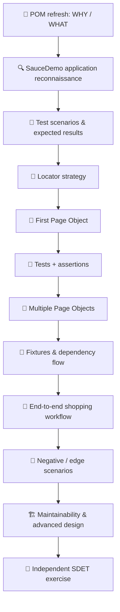
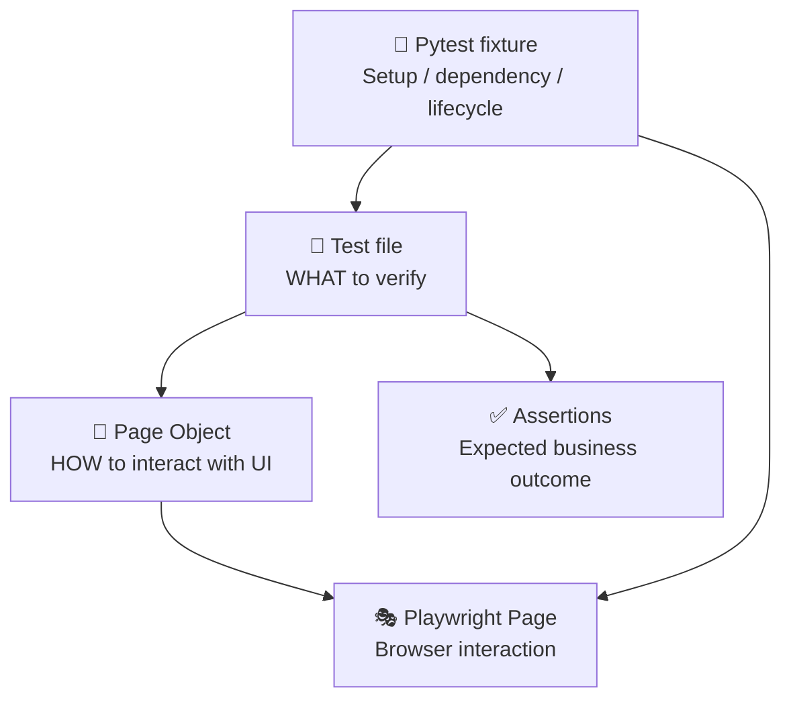
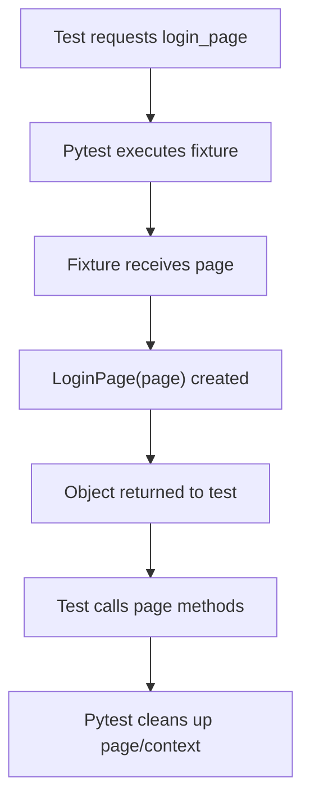

# 🧪 Page Object Model (POM) with Playwright Python

## A practical SDET field guide using SauceDemo --- Beginner to Advanced


> **Mission:** POM ko sirf definition ke roop mein revise nahi karna. Ek
> SDET ki tarah application samajhna, test scenarios identify karna,
> locators design karna, page classes banana, tests likhna, failures
> debug karna aur architecture ko maintainable rakhna seekhna hai.

**Application:** [SauceDemo](https://www.saucedemo.com/)

**Learning approach:** WHY → WHAT → HOW → code chunks → line-by-line →
SDET workplace thinking → common mistakes → interview answers →
exercise.

------------------------------------------------------------------------

# 🧭 0. One-month gap ke baad kaise use karna hai?

Ek month gap ke baad sab kuch bhool jaana unusual nahi hai. Isliye guide
ko revision + relearning dono tarah design kiya gaya hai.

### Study rules

1.  Ek section padho, phir code ko khud type/run karo.
2.  Code chunk samajhne se pehle poora framework copy-paste mat karna.
3.  Har class/method ke liye poochho: **ye kis responsibility ka owner
    hai?**
4.  Browser par actual behavior observe karo.
5.  Exercise mein pehle khud attempt; solution pehle mat dekho.
6.  Jo doubt aaye uska section number note karo.

### Learning route



------------------------------------------------------------------------

# 1. WHY --- POM ki zaroorat kyun hoti hai?

Imagine karo tum SDET ho aur tumhe SauceDemo automate karna hai.

Aaj login page ka username field change ho gaya. Tumhare 15 tests mein
username selector likha hai. Ab 15 files update karni padengi?

Ye maintainability problem hai.

## Without POM

``` python
def test_login(page):
    page.goto("https://www.saucedemo.com/")
    page.locator("#user-name").fill("standard_user")
    page.locator("#password").fill("secret_sauce")
    page.locator("#login-button").click()

    assert page.locator(".inventory_list").is_visible()


def test_locked_user(page):
    page.goto("https://www.saucedemo.com/")
    page.locator("#user-name").fill("locked_out_user")
    page.locator("#password").fill("secret_sauce")
    page.locator("#login-button").click()

    assert page.locator("[data-test='error']").is_visible()
```

**Problems:** - Same selectors repeat. - Same login steps repeat. - UI
change means multiple test files need changes. - Test intent UI
implementation ke beech hide ho jata hai.

## With POM

``` python
def test_standard_user_can_login(login_page, inventory_page):
    login_page.open()
    login_page.login("standard_user", "secret_sauce")

    inventory_page.expect_loaded()
```

Ab test padhkar business intent clear hai.

> **POM = UI interaction ko page-specific classes mein organize karne ka
> design pattern.**
>
> POM ka purpose code ko chhota karna alone nahi; purpose hai UI
> implementation aur test scenario ke beech clear boundary banana.

------------------------------------------------------------------------

# 2. WHAT --- SDET ke kaam mein POM kahan fit hota hai?

SDET ka kaam sirf button click karna nahi hota. Typical
responsibilities:

1.  Application explore karna aur workflows samajhna.
2.  Requirements se test scenarios derive karna.
3.  Positive, negative, boundary aur regression cases choose karna.
4.  Reliable locators identify karna.
5.  Test automation architecture design karna.
6.  Assertions aur test data define karna.
7.  Failures investigate karna.
8.  Bugs ko clear reproduction steps/evidence ke saath report karna.
9.  Suite ko maintain aur CI mein reliable banana.

## Responsibility map



  ---------------------------------------------------------------------------
  Layer                   Responsibility              Example
  ----------------------- --------------------------- -----------------------
  Test                    Scenario + business         Customer can log in
                          assertion                   

  Page Object             Page locators + UI actions  Fill username, click
                                                      login

  Fixture                 Setup/dependency/teardown   Provide `Page` or page
                                                      object

  Playwright              Browser automation          Click, fill, navigate

  Test data               Inputs for scenarios        Username/password

  Config                  Environment values          Base URL
  ---------------------------------------------------------------------------

**Golden rule:** Test = WHAT, POM = HOW (UI), Fixture = setup/lifecycle.

------------------------------------------------------------------------

# 3. SauceDemo --- Application reconnaissance

Open: <https://www.saucedemo.com/>

Before writing automation, an SDET explores the application.

## 3.1 Login page


Explore: - Username field - Password field - Login button - Error
message area

The public demo commonly provides these sample users: -
`standard_user` - `locked_out_user` - `problem_user` -
`performance_glitch_user` - `error_user` - `visual_user`

Common demo password: `secret_sauce`.

> Demo credentials and application behavior can change. Confirm the
> current login page and its own instructions before relying on them.
> These are public demo credentials, not real secrets.

## 3.2 Inventory page

After successful login, inspect: - Page heading - Product cards -
Product name and price - Add to cart buttons - Cart badge - Sort
dropdown - Menu

## 3.3 Cart and checkout

Explore: - Cart items - Remove button - Continue shopping - Checkout -
Customer information form - Overview - Finish order - Confirmation
screen

## 3.4 Reconnaissance checklist

-   [ ] Login with valid credentials.
-   [ ] Login with invalid credentials.
-   [ ] Try locked-out user.
-   [ ] Open inventory page.
-   [ ] Sort products.
-   [ ] Add one product to cart.
-   [ ] Add multiple products.
-   [ ] Remove a product.
-   [ ] Open cart.
-   [ ] Complete checkout.
-   [ ] Observe confirmation.
-   [ ] Logout.

**SDET mindset:** Observe behavior first. Don't assume every button
works or every role has identical behavior. A demo app is also useful
for exploring edge cases and unusual user experiences.

------------------------------------------------------------------------

# 4. Test design before code

Automation starts with a test objective, not with a selector.

  -----------------------------------------------------------------------
  ID                Scenario          Type              Expected result
  ----------------- ----------------- ----------------- -----------------
  AUTH-01           Valid user login  Positive          Inventory page
                                                        opens

  AUTH-02           Invalid password  Negative          Error message
                                                        appears

  AUTH-03           Locked user login Negative          Locked-out
                                                        message appears

  INV-01            Inventory         Functional        Product cards
                    displays products                   visible

  INV-02            Sort price low to Functional        Prices ascending
                    high                                

  CART-01           Add product to    Functional        Cart badge/item
                    cart                                updates

  CART-02           Remove product    Functional        Item removed

  CHECK-01          Complete checkout E2E               Order
                                                        confirmation
                                                        appears

  NAV-01            Logout            Functional        Login page
                                                        appears
  -----------------------------------------------------------------------

## Test case example

**AUTH-01 --- Valid login**

-   Preconditions: application is reachable.
-   Test data: valid demo user.
-   Steps:
    1.  Open login page.
    2.  Enter username.
    3.  Enter password.
    4.  Click Login.
-   Expected result: inventory page is displayed.

A good test has a clear expected result. "Click login and see what
happens" is not a test objective.

------------------------------------------------------------------------

# 5. Locator strategy --- stable automation ki foundation

POM weak selectors ko magically strong nahi banata. Locator quality ab
bhi important hai.

Preferred locator order (context ke hisaab se): 1. `get_by_role()` with
accessible name. 2. `get_by_label()`. 3. `get_by_placeholder()`. 4.
`get_by_text()` for user-visible text. 5. `get_by_test_id()` when app
provides stable test IDs. 6. CSS selector when semantic locators are
unavailable. 7. XPath only when justified; avoid brittle DOM traversal.

SauceDemo commonly exposes `data-test` attributes, so `get_by_test_id()`
can be useful. Confirm the actual attribute in the current app.

``` python
# Semantic locator
page.get_by_role("button", name="Login")

# Label locator
page.get_by_label("Username")

# Test ID locator
page.get_by_test_id("username")

# CSS locator
page.locator("#user-name")
```

### Why semantic locators?

They represent how a user perceives/uses the interface and are often
more resilient to cosmetic DOM changes.

### Locator scoping

Bad --- ambiguous if many matching buttons exist:

``` python
page.get_by_role("button", name="Remove").click()
```

Better --- scope to a specific product card:

``` python
product_card = page.locator(".inventory_item").filter(
    has_text="Sauce Labs Backpack"
)

product_card.get_by_role("button", name="Remove").click()
```

Use actual current DOM structure; don't assume class names without
inspection.

### Avoid blind `nth()`

``` python
# Risky if product order changes
page.get_by_role("button", name="Add to cart").nth(2).click()
```

Prefer product identity and locator chaining.

------------------------------------------------------------------------

# 6. First POM --- LoginPage

## Step 1: Create project structure

``` text
saucedemo-pom/
├── pages/
│   ├── __init__.py
│   └── login_page.py
├── tests/
│   └── test_login.py
├── conftest.py
├── pytest.ini
└── requirements.txt
```

Create and activate a virtual environment, then install:

``` bash
python -m venv .venv

# Windows PowerShell
.venv\Scripts\Activate.ps1

pip install pytest pytest-playwright
playwright install
```

`requirements.txt` should list the project's direct dependencies with
versions chosen and tested by your project. Avoid copying arbitrary
version pins without validating compatibility.

## Step 2: Understand the class skeleton

``` python
class LoginPage:
    def __init__(self, page):
        self.page = page
```

-   `class LoginPage`: blueprint for login page behavior.
-   `__init__`: constructor called when object is created.
-   `page`: Playwright Page object passed from outside.
-   `self.page`: store that page reference on this object.

**Important:** `LoginPage` does not launch a browser. It receives an
existing `Page`.

## Step 3: Add locators

``` python
from playwright.sync_api import Page


class LoginPage:
    def __init__(self, page: Page):
        self.page = page

        self.username_input = page.get_by_label("Username")
        self.password_input = page.get_by_label("Password")
        self.login_button = page.get_by_role(
            "button", name="Login"
        )
        self.error_message = page.get_by_test_id("error")
```

Line-by-line: - `Page` type hint improves readability and editor
support. - Locators are defined once and reused by page methods. -
Locator creation is lazy; it generally doesn't query the DOM
immediately. - `get_by_test_id("error")` assumes the app exposes that
test ID. Verify it in the current DOM.

## Step 4: Add page actions

``` python
    def open(self):
        self.page.goto("https://www.saucedemo.com/")

    def login(self, username: str, password: str):
        self.username_input.fill(username)
        self.password_input.fill(password)
        self.login_button.click()
```

Why methods? - `open()` owns navigation to this page. - `login()` owns
the UI interaction sequence for this page. - Test doesn't need to know
the selectors.

**Method naming:** use action-oriented names: `open`, `login`,
`add_product_to_cart`, `remove_product`, `proceed_to_checkout`.

## Step 5: Add page-specific expectation

``` python
from playwright.sync_api import expect

    def expect_error(self, message: str):
        expect(self.error_message).to_contain_text(message)
```

This is a reusable page-specific expectation. Business assertions may
remain in the test; a focused page expectation is also reasonable. Be
consistent.

### Complete `login_page.py`

``` python
from playwright.sync_api import Page, expect


class LoginPage:
    def __init__(self, page: Page):
        self.page = page

        self.username_input = page.get_by_label("Username")
        self.password_input = page.get_by_label("Password")
        self.login_button = page.get_by_role(
            "button", name="Login"
        )
        self.error_message = page.get_by_test_id("error")

    def open(self):
        self.page.goto("https://www.saucedemo.com/")

    def login(self, username: str, password: str):
        self.username_input.fill(username)
        self.password_input.fill(password)
        self.login_button.click()

    def expect_error(self, message: str):
        expect(self.error_message).to_contain_text(message)
```

------------------------------------------------------------------------

# 7. First test --- POM ko test mein use karna

## `tests/test_login.py`

``` python
from playwright.sync_api import expect
from pages.login_page import LoginPage


def test_standard_user_can_login(page):
    login_page = LoginPage(page)

    login_page.open()
    login_page.login("standard_user", "secret_sauce")

    expect(page).to_have_url(
        "https://www.saucedemo.com/inventory.html"
    )
```

### Understand each chunk

**1. Import**

``` python
from pages.login_page import LoginPage
```

Test ko page class available karata hai.

**2. Object creation**

``` python
login_page = LoginPage(page)
```

Pytest se mila `page` object LoginPage ko pass hua.

**3. Actions**

``` python
login_page.open()
login_page.login(...)
```

Test business flow coordinate kar raha hai; selector details POM ke
andar hain.

**4. Assertion**

``` python
expect(page).to_have_url(...)
```

Test expected business outcome verify kar raha hai.

### Run

``` bash
pytest -v
```

Agar test collect nahi hota: - file name `test_*.py` ya `*_test.py`
pattern follow kare; - test function `test_` se start ho; - correct
virtual environment active ho; - correct folder se pytest run ho.

------------------------------------------------------------------------

# 8. Fixtures --- object creation ko centralize karna

POM use karne ke liye har test mein object manually banana valid hai.
Lekin multiple tests mein same object setup repeat ho to fixture useful
hota hai.

## `conftest.py`

``` python
import pytest
from pages.login_page import LoginPage


@pytest.fixture
def login_page(page):
    return LoginPage(page)
```

Test:

``` python
def test_standard_user_can_login(login_page, page):
    login_page.open()
    login_page.login("standard_user", "secret_sauce")

    expect(page).to_have_url(
        "https://www.saucedemo.com/inventory.html"
    )
```

### Fixture flow



-   `page` fixture pytest-playwright plugin provide karta hai.
-   `login_page` custom fixture POM object provide karta hai.
-   Browser/page lifecycle plugin handle karta hai.
-   POM browser lifecycle ka owner nahi.

**Common mistake:** fixture ko POM class ka replacement samajhna.
Fixture object provide karta hai; POM UI behavior organize karta hai.

------------------------------------------------------------------------

# 9. InventoryPage --- second Page Object

Login ke baad inventory page aata hai. Ab ek separate page class
banayenge.

## `pages/inventory_page.py`

``` python
from playwright.sync_api import Page, expect


class InventoryPage:
    def __init__(self, page: Page):
        self.page = page

        self.page_title = page.get_by_text("Products")
        self.inventory_items = page.locator(".inventory_item")
        self.cart_link = page.get_by_role("link", name="Shopping Cart")

    def expect_loaded(self):
        expect(self.page_title).to_be_visible()

    def product_card(self, product_name: str):
        return self.inventory_items.filter(
            has_text=product_name
        )

    def add_product_to_cart(self, product_name: str):
        card = self.product_card(product_name)
        card.get_by_role(
            "button", name="Add to cart"
        ).click()

    def open_cart(self):
        self.cart_link.click()
```

### Chunk-wise explanation

**Constructor** - Store current page. - Define page-level locators.

**`expect_loaded()`** - Verify inventory page's identifying heading is
visible.

**`product_card()`** - Find a card by product identity. - Return a
Locator, not a new browser page.

**`add_product_to_cart()`** - Scope the button to the matching card. -
Avoid clicking an arbitrary Add to cart button.

**`open_cart()`** - Navigate via the cart link.

### Why return a Locator?

A Locator is a reusable query for an element. It supports chaining and
auto-waiting when actions/assertions run. Returning a locator is useful
when the caller needs to scope further.

------------------------------------------------------------------------

# 10. CartPage --- third Page Object

## `pages/cart_page.py`

``` python
from playwright.sync_api import Page, expect


class CartPage:
    def __init__(self, page: Page):
        self.page = page
        self.cart_items = page.locator(".cart_item")
        self.checkout_button = page.get_by_role(
            "button", name="Checkout"
        )

    def expect_product_present(self, product_name: str):
        product = self.cart_items.filter(
            has_text=product_name
        )
        expect(product).to_be_visible()

    def checkout(self):
        self.checkout_button.click()
```

Note: `expect_product_present` encapsulates a page-specific assertion.
If your team prefers all assertions in tests, expose a locator/query
method instead and assert in the test. Avoid mixing styles randomly.

------------------------------------------------------------------------

# 11. Complete UI flow --- Login → Add product → Cart

``` python
from playwright.sync_api import expect


def test_customer_can_add_product_to_cart(
    login_page, inventory_page, cart_page
):
    login_page.open()
    login_page.login("standard_user", "secret_sauce")

    inventory_page.expect_loaded()
    inventory_page.add_product_to_cart("Sauce Labs Backpack")
    inventory_page.open_cart()

    cart_page.expect_product_present("Sauce Labs Backpack")
```

### Read this like a business story

1.  Customer opens login page.
2.  Customer signs in.
3.  Inventory is visible.
4.  Customer adds a named product.
5.  Customer opens cart.
6.  Cart contains that product.

Test mein selectors nahi hain. Ye POM ka practical benefit hai.

### Add fixtures for these page objects

``` python
@pytest.fixture
def inventory_page(page):
    return InventoryPage(page)


@pytest.fixture
def cart_page(page):
    return CartPage(page)
```

Same `page` fixture passed to all three page objects means they
represent different page views over the **same browser tab**. They are
not three separate tabs or contexts.

------------------------------------------------------------------------

# 12. Checkout flow --- advanced multi-page workflow

SauceDemo checkout typically has: 1. Cart 2. Checkout: Your Information
3. Checkout: Overview 4. Checkout: Complete

Create page objects: - `CheckoutInfoPage` - `CheckoutOverviewPage` -
`CheckoutCompletePage`

Example for information page:

``` python
class CheckoutInfoPage:
    def __init__(self, page: Page):
        self.page = page
        self.first_name = page.get_by_label("First Name")
        self.last_name = page.get_by_label("Last Name")
        self.postal_code = page.get_by_label("Zip/Postal Code")
        self.continue_button = page.get_by_role(
            "button", name="Continue"
        )

    def fill_information(
        self, first_name: str, last_name: str, postal_code: str
    ):
        self.first_name.fill(first_name)
        self.last_name.fill(last_name)
        self.postal_code.fill(postal_code)

    def continue_to_overview(self):
        self.continue_button.click()
```

Test orchestration:

``` python
def test_customer_can_complete_checkout(
    login_page,
    inventory_page,
    cart_page,
    checkout_info_page,
    checkout_overview_page,
    checkout_complete_page,
):
    login_page.open()
    login_page.login("standard_user", "secret_sauce")

    inventory_page.expect_loaded()
    inventory_page.add_product_to_cart("Sauce Labs Backpack")
    inventory_page.open_cart()

    cart_page.checkout()

    checkout_info_page.fill_information(
        "Raj", "Tester", "201301"
    )
    checkout_info_page.continue_to_overview()

    checkout_overview_page.expect_order_summary()
    checkout_overview_page.finish_order()

    checkout_complete_page.expect_confirmation()
```

This is an illustrative flow: method implementations and actual locators
for the remaining checkout pages must be built and validated against the
live demo before running.

**SDET caution:** E2E tests are valuable but should not replace focused
tests. A failure in a long checkout flow can have multiple possible
causes. Keep smaller tests for critical components and a smaller number
of full end-to-end tests.

------------------------------------------------------------------------

# 13. Advanced POM design decisions

## 13.1 Should every page have one class?

Usually a good starting point, but not an absolute law.

-   Separate page class when page has meaningful behavior and its own
    responsibilities.
-   Component class when a UI component is reused or complex enough.
-   Avoid classes for every tiny visual element.

## 13.2 Should BasePage exist?

A small BasePage can hold genuinely common behavior, but don't create it
just because tutorials do.

Potentially useful shared behavior: - common navigation helper (if
consistent); - shared header component composition; - common application
shell behavior.

Avoid: - every locator and every page action in BasePage; - giant
inheritance trees; - overriding methods without clear need.

Prefer composition when a page contains a shared component.

## 13.3 Should POM contain assertions?

There are two reasonable styles:

**Style A --- Assertions in tests**

``` python
expect(inventory_page.page_title).to_be_visible()
```

**Style B --- Page-specific expectation methods**

``` python
inventory_page.expect_loaded()
```

Choose based on readability and consistency. Business outcome assertions
should remain visible in the test or in clearly named domain-level
assertion helpers. Don't hide important verification inside a generic
`click_and_verify()` method.

## 13.4 Should POM return Page or Locator?

-   Return `Locator` when caller needs to scope or assert an element.
-   Return a Page Object when navigation leads to a new page and you
    intentionally model that transition.
-   Avoid returning raw internal objects without a clear reason.

Example of page transition:

``` python
def open_cart(self):
    self.cart_link.click()
    return CartPage(self.page)
```

This fluent style can be convenient, but it couples page classes. An
alternative is to keep `open_cart()` as an action and let the test use
the `cart_page` fixture. Choose one consistent design.

## 13.5 Should login happen in every test?

Depends on objective: - Login tests must exercise login UI. - Other
tests can use an authenticated fixture or saved storage state where
appropriate. - If authentication is part of the user journey under test,
don't bypass it. - Validate role/permissions separately for each user
type.

## 13.6 Avoid over-engineering

Do not add: - generic BasePage with dozens of methods; - one class for
every single element; - a custom wait wrapper around every Playwright
action; - a helper for a one-off line; - multiple layers that merely
forward the same call.

A good framework is the simplest architecture that keeps
responsibilities clear as it grows.

------------------------------------------------------------------------

# 14. Common POM mistakes --- strict review

  -----------------------------------------------------------------------
  Mistake                 Why it is a problem     Better approach
  ----------------------- ----------------------- -----------------------
  Locators in every test  Duplication             Page Object

  API calls inside POM    Mixed responsibilities  API Client

  Browser launch inside   Lifecycle confusion     Fixture/plugin
  POM                                             

  Giant BasePage          Tight coupling          Focused
                                                  classes/composition

  `nth()` for product     Fragile ordering        Filter by product name
  identity                                        

  `time.sleep()`          Flaky and slow          Auto-wait + web-first
                                                  expect

  `force=True` by default Hides real UI issues    Understand
                                                  actionability issue

  Hidden business         Test intent unclear     Explicit assertions
  assertions                                      

  Hardcoded secrets       Security risk           Environment/secret
                                                  store

  One shared state across Order dependency        Isolated context/data
  tests                                           

  Catching every          Hides defects           Handle expected errors
  exception                                       only

  Page object does        God object              Split by responsibility
  everything                                      
  -----------------------------------------------------------------------

------------------------------------------------------------------------

# 15. Debugging like an SDET

When a test fails, don't immediately increase timeout.

### Investigation order

1.  Read exact assertion/exception.
2.  Identify failing test step.
3.  Check URL and current page state.
4.  Check whether locator matches expected element.
5.  Inspect screenshot/trace.
6.  Check console/network errors if relevant.
7.  Determine app bug vs test bug vs environment issue.
8.  Fix root cause and rerun relevant test.

Useful commands:

``` bash
pytest -v
pytest -v -s
pytest tests/test_login.py -q
pytest --headed
```

The exact headed option depends on the installed pytest-playwright
plugin configuration; verify plugin help/version if it differs.

A useful Playwright debugging pattern:

``` python
print("Current URL:", page.url)
print("Page title:", page.title())
```

For deeper debugging, use Playwright Inspector, Trace Viewer and
screenshots. Never print passwords, tokens or session cookies.

------------------------------------------------------------------------

# 16. Interview answers

## Q1. What is Page Object Model?

**Simple English:**

Page Object Model is a design pattern in which we create separate
classes for application pages. These classes contain page locators and
methods for user interactions. It improves maintainability and reduces
duplicate UI code.

**Strong answer:**

Page Object Model is a design pattern used in UI automation to separate
test scenarios from page-specific implementation. Each Page Object
represents a page or meaningful UI component and encapsulates its
locators and interactions. Tests use these methods to express business
workflows without directly depending on DOM selectors. When the UI
changes, updates can often be localized to the relevant Page Object. POM
improves readability and maintainability, but it must be designed
carefully to avoid giant page classes or hiding important business
assertions.

**Keywords:** design pattern, encapsulation, separation of concerns,
maintainability, reusable UI behavior.

## Q2. POM vs Page Factory?

POM is a design pattern. Page Factory is a mechanism/pattern offered by
some automation ecosystems to initialize page elements. In Playwright
Python, you normally use Playwright Locator objects directly; you do not
need Selenium-style PageFactory.

## Q3. POM vs fixtures?

POM encapsulates UI behavior. Fixtures manage test dependencies, setup
and teardown. A fixture can instantiate and provide a Page Object to a
test.

## Q4. Can one test use multiple Page Objects?

Yes. A workflow can interact with login, inventory, cart and checkout
pages. The test coordinates the business flow while each object owns its
page-specific UI behavior.

## Q5. What are the limitations of POM?

POM does not automatically guarantee stable tests or good architecture.
Poor locator choices, giant page objects, excessive abstraction and
hidden assertions can still make a framework difficult to maintain.

------------------------------------------------------------------------

# 17. 🏋️ Practice ladder --- do not skip the attempt

## Level 1 --- Refresh (Easy)

1.  Create `LoginPage`.
2.  Define username, password and login button locators.
3.  Add `open()` and `login()` methods.
4.  Write valid login test.
5.  Write invalid login test.

**Done when:** tests pass and no raw selectors are repeated in test
files.

## Level 2 --- Page interaction (Medium)

1.  Create `InventoryPage`.
2.  Add `product_card(product_name)`.
3.  Add product to cart by product name.
4.  Verify cart badge count.
5.  Remove a selected product.
6.  Create `CartPage` and verify item identity.

**Done when:** test never selects a product by arbitrary index.

## Level 3 --- Checkout workflow (Medium/Hard)

1.  Create checkout page objects.
2.  Fill customer information.
3.  Verify overview.
4.  Finish checkout.
5.  Verify confirmation.
6.  Add a negative validation test for missing information.

**Done when:** page responsibilities remain clear and assertions verify
meaningful outcomes.

## Level 4 --- Architecture challenge (Hard)

1.  Move repeated object creation into fixtures.
2.  Centralize `BASE_URL`.
3.  Separate test data.
4.  Add markers for smoke/regression.
5.  Add screenshot/trace evidence for failures.
6.  Run tests independently and as a suite.
7.  Explain how the design would support parallel execution.

**Done when:** a new teammate can understand how a test obtains its page
objects and where UI actions live.

------------------------------------------------------------------------

# 18. 🎯 Final SDET assignment --- design before coding

**Business requirement:** As a customer, I want to log in, find a
product, add it to cart, complete checkout and see an order
confirmation.

Submit these deliverables:

### A. Architecture

-   Folder structure.
-   Page Object classes.
-   Fixture names and responsibilities.
-   Test data location.

### B. Test design

At least these scenarios: - valid login; - invalid login; - locked-out
user; - add product; - remove product; - checkout success; - checkout
required-field validation.

### C. Code

-   `LoginPage`
-   `InventoryPage`
-   `CartPage`
-   one checkout page class
-   `conftest.py`
-   at least 3 tests

### D. Explanation

Explain: 1. Why is `login()` inside `LoginPage`? 2. Why is `LoginPage`
created by a fixture or test rather than launching its own browser? 3.
Why do we identify a product by name instead of `nth(2)`? 4. Which
assertions belong in the test? 5. What changes if the login page's
selector changes? 6. How will you keep tests independent?

## Review rubric --- 100 points

  Area                                Points
  --------------------------------- --------
  POM responsibilities                    20
  Locator stability                       15
  Test readability/assertions             15
  Fixture/lifecycle understanding         15
  Multi-page workflow                     15
  Negative/edge coverage                  10
  Maintainability/debugging               10

**Review labels:** GOOD / WRONG / RISK / IMPROVEMENT / PRODUCTION
VERSION.

------------------------------------------------------------------------

# 🏁 Your revision target

POM ko yaad karna target nahi hai.

Target ye hai ki tum kisi application ko dekhkar: 1. page boundaries
identify kar sako; 2. stable locators choose kar sako; 3. page/component
responsibilities decide kar sako; 4. fixtures ke through dependencies
provide kar sako; 5. test ko business-readable rakh sako; 6. failures ko
evidence ke saath debug kar sako.

**Mentor rule:** Pehle Level 1 khud attempt karna. Main tumhare code ko
strict SDET standards se review karunga. Full solution tumhare attempt
se pehle nahi dunga.

> 🥷 **Build it like a teammate will maintain it six months from now.**
