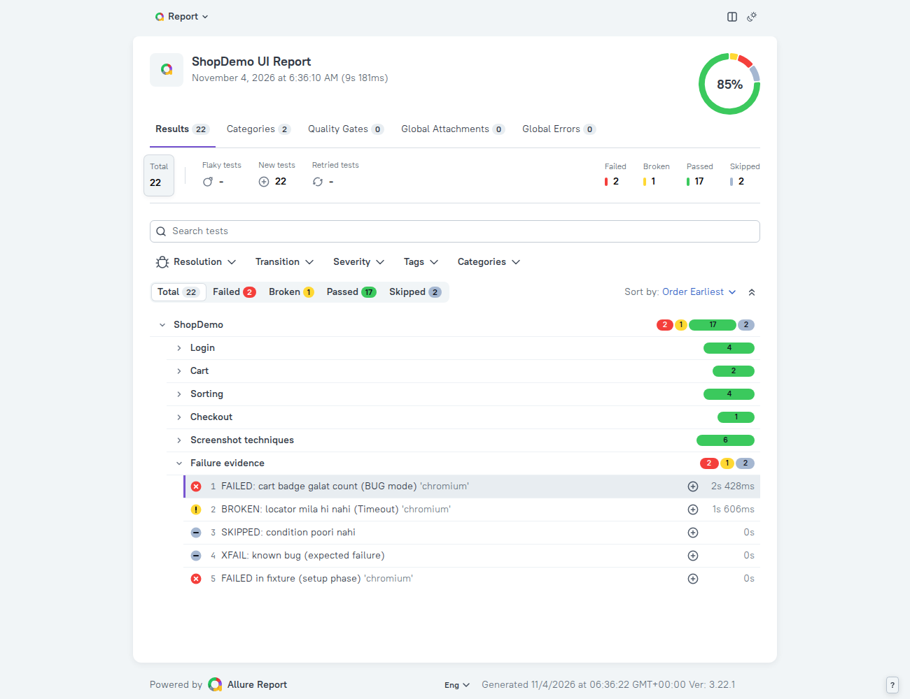
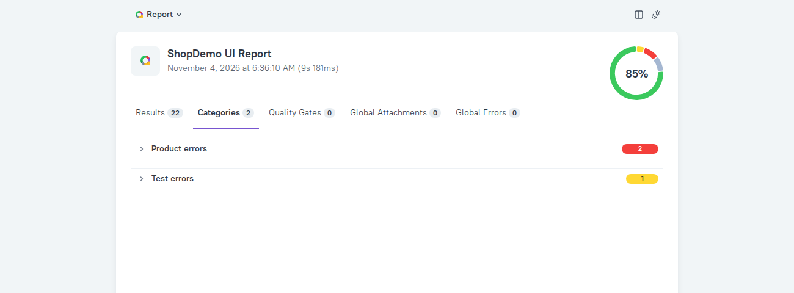
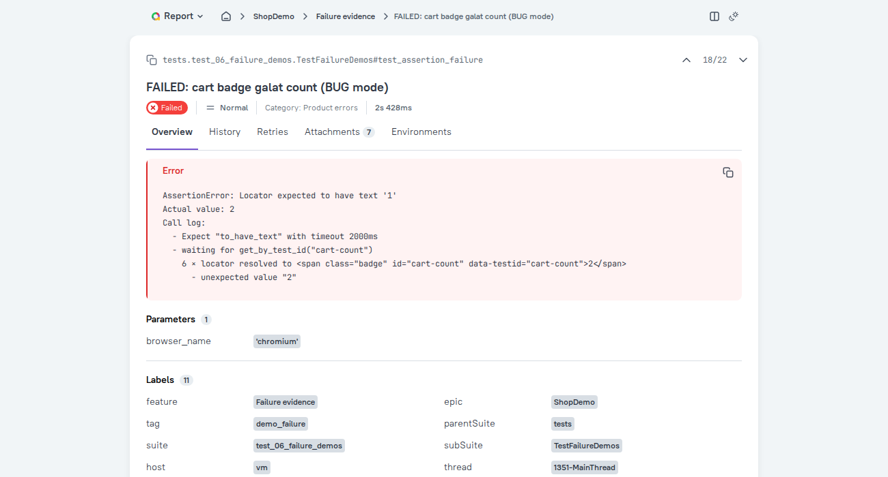
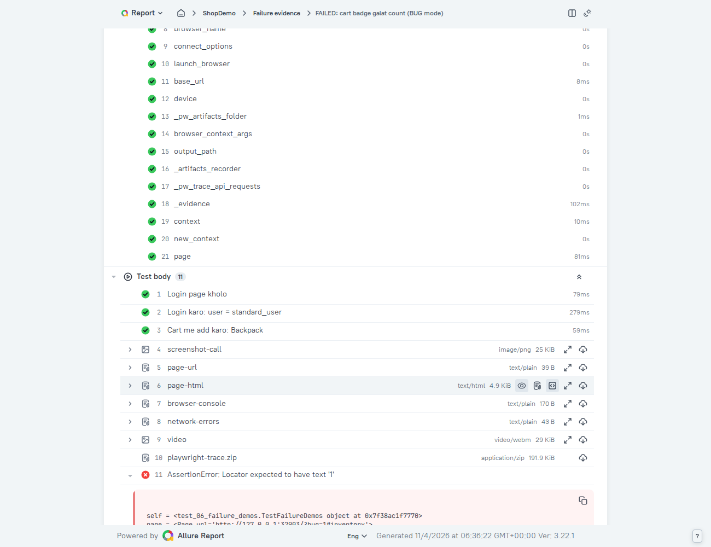
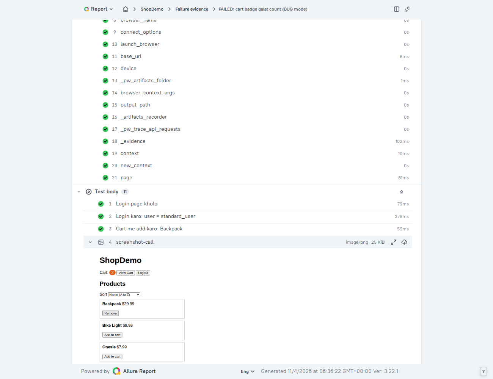
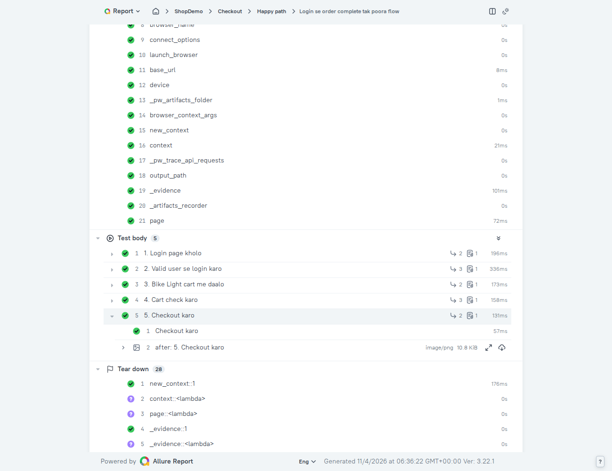

# Allure + pytest + Playwright (Python): Zero se Advanced

**Hinglish mentor guide | Sirf teen cheezein: Allure, pytest, Playwright | Step by step, har cheez explain**

Is guide me tum seekhoge: Allure report kya hai, kaise banti hai, screenshot/video/trace kaise **save** hote hain aur report me **kaise dikhte** hain, steps/labels/parametrize/retries/history, aur advanced cheezein (config, grouping, parallel, quality gate).

> **Images:** report ke screenshots `images/` folder me hain (zip me saath aaye hain). Agar sirf `.md` file khol rahe ho to images nahi dikhengi, par har image ke neeche likha hai ki usme kya hai.

---

# Part 0: Pehle ye padho

## 0.1 Levels (kahan se kahan tak)

| Level | Parts | Tum kya kar sakoge |
|---|---|---|
| **Level 1: Basic** | 1, 2, 3 | Setup, pehli report, report padhna, labels |
| **Level 2: Intermediate** | 4, 5, 6, 7 | Steps, **screenshots**, parametrize, failures aur retries |
| **Level 3: Advanced** | 8, 9, 10 | Config, history, grouping, parallel, CLI, quality gate |

## 0.2 Har chunk ka format

`WHY` (kyun) → `WHAT` (kya hai) → `HOW` (kaise) → `CODE` → `LINE-BY-LINE` → `KYUN YE CHOICE?` → `COMMON MISTAKES` → `PRACTICE`

- **KYUN YE CHOICE?** = jahan kai tareeke the, wahan humne ye wala kyun chuna.
- Jahan zaroori hai wahan **"Student ki tarah"** (seekhte waqt kaise sochna) aur **"SDET ki tarah"** (job me kaise dekhna) likha hai.

## 0.3 Kya maine real me chalaya (honest table)

| Cheez | Status |
|---|---|
| Is guide ka saara code (demo app, 7 test files, conftest, pages, helpers) | **Real Chromium browser me chalaya** (Playwright Python 1.56.0, pytest-playwright 0.10.0, pytest 9.2.0) |
| Allure report generate/open/history/groupBy/quality-gate/csv/log | **Real Allure CLI 3.22.1** se chalaya, aur report ko browser me khol ke UI dekha |
| `allure-pytest` 2.16.2 ke labels, steps, links, filters, dynamic API | **Chalaya** |
| Parallel run (`-n 2`), retries (`--reruns`) | **Chalaya** (real browsers ke saath) |
| Video ka playback, Allure ke purane/naye versions ka alag UI | **Nahi dekha**. UI versions ke saath thoda badal sakta hai |
| `allure run`, `allure serve`, `allure history` command | `--help` padha, **end-to-end nahi chalaya** (jahan likha hai wahan mention hai) |
| Windows/Mac ki machine | **Nahi**. Maine Linux par chalaya. Commands me jahan fark hai wahan likha hai |
| Custom categories, environments, known-issues | **Nahi chalaya** (Part 8 me sirf pointer) |

Is guide ke test run ke saath report ke saare screenshots wahi hain jo maine real run se liye.

---

# Part 1: Big picture aur Setup (Level 1)

## 1.1 Teen tool, teen kaam

```text
pytest          ─▶ tests ko dhundhta aur chalata hai
Playwright      ─▶ browser ko control karta hai (click, fill, screenshot)
allure-pytest   ─▶ pytest ke andar plugin: har test ka result JSON me likhta hai
Allure CLI      ─▶ alag tool: un JSON files se HTML report banata hai
```

Pura flow:

```text
tests chalte hain ──▶ allure-results/ (kaccha JSON + screenshots) ──▶ allure generate ──▶ allure-report/ (HTML) ──▶ allure open ──▶ browser
```

### Pehle terms (har term define)

| Term | Matlab |
|---|---|
| **Test result** | Ek test ka nateeja: status, time, steps, attachments |
| **Attachment** | Report me jodi gayi file (screenshot, video, log, JSON) |
| **Step** | Test ke andar ka ek naam wala hissa ("Login karo") |
| **Label** | Test par laga tag/group jaise epic, feature, severity |
| **Fixture** | pytest ka reusable setup/teardown (browser, page, data) |
| **Hook** | pytest ke andar ek jagah jahan hum apna code jod sakte hain |
| **Artifact** | Run ke baad bachi hui files (report, screenshot, trace) |
| **Playwright `page`** | Browser ka ek tab, jise tumhara test control karta hai |
| **Locator** | Page par element dhundhne ka tareeka |

## 1.2 Lab project: ShopDemo

Is guide ke saare examples ek chhote **demo shopping app** par chalte hain jo is project ke andar hi hai (Appendix A). Faida: internet ya kisi website par depend nahi, aur main ne sab real me chalaya hai. Baad me Part 10 me bataya hai ki isi sab ko tumhari SauceDemo repo par kaise lagana hai.

**Demo app kya karta hai:** login (valid / locked / wrong), products list (Backpack, Bike Light, Onesie), add/remove to cart, cart badge count, sort dropdown, cart view, checkout. Aur ek **BUG mode** (`/?bug=1`): cart badge galat count dikhata hai. Ye hume jaan-boojh ke failing test deta hai, taaki failure evidence seekh sako.

**Final folder structure:**

```text
allure_playwright_lab/
├── demo_app/index.html          # Appendix A
├── pages/                       # Page Objects (Part 4)
│   ├── __init__.py
│   ├── login_page.py
│   ├── inventory_page.py
│   └── cart_page.py
├── utils/
│   ├── __init__.py
│   └── allure_helpers.py        # Part 5
├── tests/
│   ├── test_01_first_report.py
│   ├── test_02_login_data_driven.py
│   ├── test_03_cart_and_sort.py
│   ├── test_04_checkout_flow.py
│   ├── test_05_screenshot_techniques.py
│   ├── test_06_failure_demos.py
│   └── test_07_flaky_retry_demo.py
├── conftest.py                  # Part 5
├── pytest.ini                   # Part 5
├── allurerc.json                # Part 8
└── requirements.txt
```

## 1.3 Setup: step by step

**Step 1: Project folder aur virtual environment**

```bash
mkdir allure_playwright_lab
cd allure_playwright_lab
python -m venv .venv
```

Activate karo:
- Linux/Mac: `source .venv/bin/activate`
- Windows (PowerShell): `.venv\Scripts\Activate.ps1`

**Virtual environment kyun?** Har project ke packages alag rahein. Warna ek project ka version doosre ko tod sakta hai.

**Step 2: `requirements.txt`**

**File: `requirements.txt`**
```text
pytest==9.2.0
pytest-playwright==0.10.0
allure-pytest==2.16.2
pytest-xdist==3.8.0
pytest-rerunfailures==16.7
```

**LINE-BY-LINE:**
- `pytest-playwright`: Playwright ko pytest se jodta hai. `page`, `browser`, `context` fixtures aur `--headed`, `--tracing`, `--screenshot`, `--video` jaise options deta hai. `playwright` package ye khud install kar leta hai.
- `allure-pytest`: pytest ke andar Allure plugin (`--alluredir` aur `allure.*` functions).
- `pytest-xdist`: parallel run (`-n`), Part 8.
- `pytest-rerunfailures`: `--reruns N`, Part 7.
- Versions `==` se pin ki hain (maine yahi set chalaya). Tum apne machine ke versions `pip freeze` se dekh ke pin kar sakte ho.

**Step 3: Packages aur browser install**

```bash
pip install -r requirements.txt
playwright install chromium
```

`pip install` Python packages laata hai. `playwright install chromium` **browser** download karta hai (alag cheez!). Dono zaroori hain. Dusra bhoolna sabse common galti hai ("Executable doesn't exist" error).

**Step 4: Allure CLI (report banane wala tool)**

Allure 3 **Node.js** par chalta hai.

```bash
node -v                    # version dikhna chahiye; nahi to Node.js LTS install karo
npm install -g allure
allure --version           # maine 3.22.1 dekha
```

Permission error aaye to install ke bina `npx allure ...` bhi chal jata hai (maine ye tareeka bhi chalaya).

### KYUN YE CHOICE? (Allure 3 vs Allure 2)

| | Allure 3 (humne chuna) | Allure 2 (purana) |
|---|---|---|
| Kis par chalta | Node.js (`npm install -g allure`) | Java + `allure-commandline` |
| Config | `allurerc.json/.mjs` | Alag purana format |
| Internet tutorials | Kam | Bahut zyada |

Internet ke bahut tutorials Allure 2 ke hain. Koi command copy karne se pehle dekho ki wo Allure 3 ka hai ya 2 ka. Is guide ke saare commands Allure 3 par chalaye hue hain.

**Step 5: Check karo ki sab sahi hai**

```bash
python --version
pytest --version
playwright --version
allure --version
```
Chaaron version dikhne chahiye.

## 1.4 Demo app ko serve karna (conftest ka pehla hissa)

Test ko demo app ka URL chahiye. Hum pytest ke andar hi ek chhota local server chalate hain, taaki alag terminal na kholna pade. Ye `conftest.py` ka pehla hissa hai (poori file Part 5 me hai):

```python
import functools
import threading
from http.server import SimpleHTTPRequestHandler, ThreadingHTTPServer
from pathlib import Path

import pytest

APP_DIR = Path(__file__).parent / "demo_app"


class _QuietHandler(SimpleHTTPRequestHandler):
    def log_message(self, *args):
        pass  # console me server logs nahi chahiye


@pytest.fixture(scope="session")
def base_url():
    handler = functools.partial(_QuietHandler, directory=str(APP_DIR))
    server = ThreadingHTTPServer(("127.0.0.1", 0), handler)  # port 0 = koi bhi free port
    threading.Thread(target=server.serve_forever, daemon=True).start()
    yield f"http://127.0.0.1:{server.server_port}"
    server.shutdown()
```

**LINE-BY-LINE:**
- `APP_DIR`: demo app ka folder (conftest ke saath wala `demo_app/`).
- `SimpleHTTPRequestHandler`: Python ka built-in file server. `_QuietHandler` uska log chup karta hai.
- `@pytest.fixture(scope="session")`: poore test run me **ek hi baar** server chale.
- `("127.0.0.1", 0)`: sirf apni machine, **port 0** = OS koi free port de de (conflict nahi).
- `daemon=True` thread: pytest khatam ho to thread apne aap band.
- `yield`: yield tak = setup, uske baad = teardown (`server.shutdown()`).
- Fixture ka naam `base_url`: **pytest-playwright ka apna `base_url` fixture override** hota hai. Hum URL khud de rahe hain.

**KYUN YE CHOICE?** Alternatives: (1) alag terminal me `python -m http.server`: yaad rakhna padta hai. (2) `file://` URL: kuch browser features file URL par kaam nahi karte. (3) Fixture me thread: ek command (`pytest`) me sab. Isliye (3).

## 1.5 Pehla test (bina Allure ke)

`tests/test_01_first_report.py` abhi **simple** rakho (Allure labels Part 3 me jodenge):

```python
from playwright.sync_api import Page, expect


def test_valid_login(page: Page, base_url):
    page.goto(base_url)
    page.get_by_placeholder("Username").fill("standard_user")
    page.get_by_placeholder("Password").fill("secret_sauce")
    page.get_by_role("button", name="Login").click()
    expect(page.get_by_role("heading", name="Products")).to_be_visible()
```

**LINE-BY-LINE:**
- `page: Page`: pytest-playwright ka fixture. Har test ko **naya, saaf tab** milta hai.
- `base_url`: hamara fixture (Part 1.4).
- `page.goto(base_url)`: site kholo. **Ye bhoolne par page khali (`about:blank`) rehta hai.**
- `get_by_placeholder("Username")`: input jiska placeholder text "Username" hai.
- `.fill(...)`: text daalo. `.click()`: click karo. Dono pehle **auto-wait** karte hain (element ready hone tak).
- `expect(...).to_be_visible()`: web-first assertion. Condition hone tak retry karta hai (default ~5 sec).

**Chalao:**
```bash
pytest -v
```
Output me `1 passed` aana chahiye. Browser ko dekhna ho to `pytest --headed`.

## 1.6 Pehli Allure report (7 step)

**Step 1:** Results banao
```bash
pytest --alluredir=allure-results --clean-alluredir
```
**Step 2:** Report banao
```bash
allure generate allure-results --clean
```
**Step 3:** Report kholo
```bash
allure open allure-report
```
Terminal me `Allure is running on http://localhost:<port>` aayega. Wo link browser me kholo.

### LINE-BY-LINE
- `--alluredir=allure-results`: plugin ko batata hai raw results kahan likhne hain.
- `--clean-alluredir`: pehle us folder ko saaf karo. **Nahi lagaya to purane runs ke results naye ke saath mix** hote hain.
- `allure generate <results> --clean`: results se HTML report banao (`allure-report/` folder), purani report hata ke.
- `allure open <report>`: report ko local server par serve karta hai aur link deta hai.

### Do folders ka fark (bahut zaroori)

| Folder | Kya hai | Kisne banaya |
|---|---|---|
| `allure-results/` | Har test ka raw **JSON** + attachments ki files | `allure-pytest` plugin (pytest ke saath) |
| `allure-report/` | Dekhne layak **HTML** report | `allure` CLI (alag command) |

Analogy: `allure-results` = kaccha saaman, `allure-report` = bana hua khaana. **Kaccha saaman bachaa ke rakho**, usse kabhi bhi report dobara ban sakti hai.

### `index.html` ko double-click mat karo
Report apna data alag JSON files se load karti hai. Browsers `file://` se aisa load block kar sakte hain. Isliye `allure open` (ek chhota server) use karo.

### COMMON MISTAKES
- Sirf `pip install allure-pytest` kiya, Allure **CLI** install nahi kiya (ya ulta).
- `allure generate` galat folder me chalaya, to report khali.
- `--clean-alluredir` bhool gaye, purane results mix.
- `playwright install` bhoolna.

### PRACTICE 1
1. Pehla test chalao, report kholo. Total kitne tests dikhe?
2. `--clean-alluredir` hata ke test do baar chalao, phir report banao. Kya fark aaya?
3. `allure-results/` folder kholo. Kaunsi files hain? Ek `*-result.json` kholo aur `status` dhundho.

**Answer key:** (1) 1 test (passed). (2) Test 2 baar dikhta hai, kyunki dono runs ke results ek folder me hain. (3) `*-result.json` (har test ka), `*-container.json` (fixtures), aur attachments ki files.

---

# Part 2: Report ko padhna: UI tour (Level 1)

## 2.1 Overview page

Pehle ek **poora suite** chalate hain, taaki report me har status dikhe. Lab ke saare tests (Part 3 se 7 me bante hain) bante ke baad ye command:

```bash
pytest -n 2 -m "not demo_flaky" --alluredir=allure-results --clean-alluredir
allure generate allure-results --clean
allure open allure-report
```


*Image 1: Overview. Upar report ka naam aur time, daayen taraf success-rate ka donut (85%). Neeche tabs: Results, Categories, Quality Gates, Global Attachments, Global Errors. Phir Total/Flaky/New/Retried ki ginti aur Failed/Broken/Passed/Skipped ka count. Phir search box, filters (Resolution, Transition, Severity, Tags, Categories) aur tests ka tree. Tree yahan epic > feature se group hai (ShopDemo > Login, Cart, Sorting, Checkout, Screenshot techniques, Failure evidence), jo Part 8 ke `groupBy` config se banta hai.*

**Overview ke hisse:**

| Hissa | Matlab |
|---|---|
| Donut (85%) | **Success rate** = passed / (passed + failed + broken). **Skipped aur unknown shamil nahi** (report khud ye neeche likhti hai) |
| Total / Flaky / New / Retried | Kitne test, kitne flaky, kitne pehli baar dikhe (history ke bina sab "New"), kitne retry hue |
| Failed / Broken / Passed / Skipped | Status ke hisaab se ginti. In par click karke filter lagta hai |
| Search + filters | Naam search, severity, tags, categories se chhantna |
| Tree | Tests ka group. Grouping Part 3 me seekhenge |
| **Categories tab** | Failures ka auto-classification |

## 2.2 Statuses (kaun kya hota hai)

Maine har status ke liye real test chalaya (Part 7):

| Status | Kab banta hai | Lab ka example |
|---|---|---|
| **Passed** | Test bina error ke khatam | login test |
| **Failed** | `AssertionError` (assert fail, `expect(...)` fail) | cart badge galat count |
| **Broken** | Koi **aur** exception: jaise Playwright ka `TimeoutError` (locator mila hi nahi) | `click` ek aise button par jo hai hi nahi |
| **Skipped** | `@pytest.mark.skip` ya `skipif` | feature ready nahi |
| **Skipped** (xfail) | `@pytest.mark.xfail` jab expected fail hua | known bug |

**Failed vs Broken ka fark kyun important:**
- **Failed** = "product ne galat behave kiya" (test ne jo expect kiya wo nahi mila).
- **Broken** = "test khud toota" (locator, timeout, code ki galti).

Report ke **Categories tab** me ye default classification dikhti hai: failed tests **"Product errors"** me, broken tests **"Test errors"** me.


*Image 2: Categories tab. "Product errors" (failed tests) aur "Test errors" (broken) ki ginti.*

## 2.3 Test detail page

Kisi test par click karo. Wo test ka detail page kholta hai.


*Image 3: Failed test ka detail. Upar breadcrumb (ShopDemo > Failure evidence > test), title, status (Failed), severity (Normal), category (Product errors), duration. Phir tabs: Overview, History, Retries, Attachments, Environments. Neeche lal "Error" box: expected '1' tha, actual value 2 mila, call log ke saath. Neeche Parameters aur Labels.*

**Page ke sections:**

| Section | Kya |
|---|---|
| Breadcrumb + title | Test kahan (epic > feature) aur naam |
| Status, severity, category, time | Ek nazar me summary |
| **Tabs** | Overview, **History** (pichhle runs), **Retries**, **Attachments** (saari files ki list), Environments |
| **Error** | Fail ka message. Playwright ka `expect` message call log bhi deta hai (kaunsa locator, kya mila) |
| **Parameters** | parametrize ki values (aur `browser_name` jo pytest-playwright ki wajah se aata hai) |
| **Labels** | epic, feature, tags, suite, host, thread... |
| **Set up** | Test se pehle chale **pytest fixtures** (browser, context, page...). Allure inhe step ki tarah dikhata hai |
| **Test body** | Test ke **steps** aur **attachments** (screenshot, logs...) aur phir failure ka traceback |
| **Tear down** | Test ke baad ke fixtures ka cleanup |

> Ye "Set up / Test body / Tear down" ka structure pytest ke fixture model se aata hai. Isi wajah se report me dikhta hai ki fixture `page` banne me kitna time laga ya kaunsa fixture fail hua.

**Is page ka sabse zaroori sawaal:** "Test kyun fail hua?" Iska jawab dene ke liye 5 cheezein dekho:
1. **Error** box (kya expect kiya, kya mila).
2. **Test body** me **kaunsa step** toota.
3. **Screenshot** (us waqt page kaisa tha). Ye Part 5 me banayenge.
4. **Console / network logs**.
5. **History/Retries** (pehle bhi toota tha?).

**Student ki tarah:** ek failed test khol ke har section ko khud dekho aur naam do. Jab har section ka kaam samajh aa jaye, tab report banana seekho.
**SDET ki tarah:** developer tumhare report ko 30 second me padhna chahta hai. Error + screenshot + step pehli screen par dikhna chahiye.

### PRACTICE 2
1. Failed aur Broken me fark apne words me likho.
2. Success rate me Skipped ginti me kyun nahi? (Report ke neeche likha dekho.)
3. Ek test detail page par "Set up" me kaunse fixtures dikhte hain? `page` aur `browser` dhundho.

**Answer key:** (1) Failed = assertion fail (product ne galat kiya). Broken = koi aur exception (test ya setup ka masla). (2) Skipped test chala hi nahi, to usse pass/fail rate me shamil karna galat hota. (3) pytest-playwright ke fixtures: `playwright`, `browser`, `context`, `page`, aur hamara `_evidence` (Part 5).


---

# Part 3: Labels aur Metadata: report ko "padhne layak" banana (Level 1)

## 3.1 WHY
`test_valid_login[chromium]` se manager ko kuch nahi pata chalta. "Valid user login karke products page dekh sakta hai" aur "Login > Valid login" ka group pata chalta hai. Labels report ko **filter, group aur samjhne layak** banate hain.

## 3.2 WHAT: Allure ke decorators

| Decorator | Kaam | Example |
|---|---|---|
| `@allure.title("...")` | Padhne layak test ka naam | `"Valid user login kar sakta hai"` |
| `@allure.epic("...")` | Sabse bada group (product/module) | `"ShopDemo"` |
| `@allure.feature("...")` | Epic ke andar feature | `"Login"` |
| `@allure.story("...")` | Feature ke andar user story | `"Valid login"` |
| `@allure.severity(...)` | Test kitna critical | `BLOCKER, CRITICAL, NORMAL, MINOR, TRIVIAL` |
| `@allure.tag("a", "b")` | Free tags | `"smoke"` |
| `@allure.label("owner", "RK")` | Koi bhi custom label | owner |
| `@allure.description("...")` | Test ka description | text |
| `@allure.link(url, name=)` | Koi link | spec |
| `@allure.issue("BUG-1", "naam")` | Bug tracker link | |
| `@allure.testcase("TC-5", "naam")` | Test case management link | |
| `@allure.parent_suite / suite / sub_suite` | Suite hierarchy ko manually set karna | |

Epic > Feature > Story ek hierarchy hai: **bada se chhota**. Socho: epic = "Shopping app", feature = "Cart", story = "Add to cart".

## 3.3 CODE: `test_01_first_report.py` ka final version

Pehle wala simple test replace karo:

**File: `tests/test_01_first_report.py`**
```python
import allure
import pytest
from playwright.sync_api import Page, expect

from pages.inventory_page import InventoryPage
from pages.login_page import LoginPage


@allure.epic("ShopDemo")
@allure.feature("Login")
@allure.story("Valid login")
@allure.title("Valid user login karke products page dekh sakta hai")
@allure.severity(allure.severity_level.BLOCKER)
@pytest.mark.smoke
def test_valid_login(page: Page, base_url):
    login = LoginPage(page, base_url)
    login.open()
    login.login("standard_user", "secret_sauce")
    InventoryPage(page).expect_loaded()
```

**LINE-BY-LINE:**
- Decorators test function ke upar. Order se fark nahi padta.
- `@allure.severity(allure.severity_level.BLOCKER)`: agar ye test toote to release rukna chahiye.
- `@pytest.mark.smoke`: pytest ka marker. **Allure ise automatically "tag" bana deta hai** (maine verify kiya: report me tag `smoke` aata hai). Isse `pytest -m smoke` bhi chalta hai aur report me filter bhi.
- Ye test `pages.*` ke Page Objects use karta hai, jo Part 4 me bante hain. Isliye ye file Part 4 ke baad chalegi.
- Test ka naam report me **title** se aata hai, function ke naam se nahi.

## 3.4 Maine real me kya dekha (label demo)

Ek test par saare labels laga ke chalaya aur result JSON dekha:

```python
@allure.epic("E")
@allure.feature("F")
@allure.story("S")
@allure.title("Full labels demo")
@allure.description("Plain text description jo report me dikhega")
@allure.severity(allure.severity_level.BLOCKER)
@allure.tag("smoke", "login")
@allure.label("owner", "RK")
@allure.link("https://example.com/spec", name="Requirement spec")
@allure.issue("BUG-101", "Login bug")
@allure.testcase("TC-55", "Manual test case TC-55")
@allure.parent_suite("Web")
@allure.suite("Authentication")
@allure.sub_suite("Login page")
def test_labels():
    ...
```

Result me aaya: `epic=E, feature=F, story=S, severity=blocker, tag=[smoke, login], owner=RK, parentSuite=Web, suite=Authentication, subSuite=Login page`, aur 3 links (issue, tms/testcase, link).

### Links ko clickable banana (`--allure-link-pattern`)
`@allure.issue("BUG-101")` sirf ID deta hai. Pura URL banane ke liye pattern do:

```bash
pytest --allure-link-pattern=issue:https://jira.example.com/browse/{}
```

Maine ye chalaya: `BUG-101` ban gaya `https://jira.example.com/browse/BUG-101`. `testcase` ke liye alag `tms:` pattern allure-pytest ke docs me hai. Maine sirf `issue` wala chalaya. Pattern ke bina `@allure.testcase("TC-55")` ka link sirf ID (`TC-55`) rehta hai, maine yahi dekha.

## 3.5 Dynamic API: test chalte waqt labels badalna

Jab title/severity/feature **runtime** par pata chale (parametrize, data se):

```python
def test_dynamic():
    allure.dynamic.title("Dynamic title")
    allure.dynamic.description("Dynamic description")
    allure.dynamic.severity(allure.severity_level.CRITICAL)
    allure.dynamic.tag("runtime-tag")
    allure.dynamic.label("owner", "QA-team")
    allure.dynamic.feature("Dynamic feature")
    allure.dynamic.link("https://example.com/x", name="runtime link")
    allure.dynamic.issue("BUG-202")
```

Ye saare maine chalake dekhe, sab result me aaye. `allure.dynamic.*` me ye bhi hain: `epic, story, parent_suite, suite, sub_suite, testcase, description_html, parameter, id, manual`.

**KYUN YE CHOICE? (decorator vs dynamic):** decorator ek nazar me padhne me aasan (static info). `dynamic` tab jab value test ke andar se aati hai (jaise parametrize ke scenario naam se title). Beginner ke liye pehle decorator, jab zaroorat pade tab dynamic.

## 3.6 Report me grouping: default aur epic/feature/story

**Default:** Allure 3 tests ko **suite hierarchy** (folder > file > class) se group karta hai. Epic/feature/story **filters** me aur labels me dikhte hain, par tree **file ke naam** se bana hota hai.

**Epic/feature/story se tree banane ke liye** config chahiye (`allurerc.json`):

```json
{
  "plugins": {
    "awesome": {
      "options": {
        "groupBy": ["epic", "feature", "story"]
      }
    }
  }
}
```

Maine ye real me chalaya: tree ban gaya `ShopDemo > Login / Cart / Sorting / Checkout / ...`. Poori config Part 8 me hai.

## 3.7 Terminal se filter (report banane se pehle)

`allure-pytest` ke options se sirf kuch tests chala sakte ho:

```bash
pytest --allure-severities=blocker,critical
pytest --allure-epics=ShopDemo
pytest --allure-features=Login
pytest --allure-stories="Valid login"
```

Maine `--allure-severities` chalaya: sirf wahi tests chale (baaki deselect hue).

## 3.8 Common mistakes
- Har test par 10 decorators. Report heavy, maintainance mushkil. **Sirf utne jitne kaam ke hon.**
- Epic/feature/story ko random naam dena. Ek project me **ek naming convention** rakho.
- `description` me secrets ya internal URLs.
- `title` me `{param}` likhna par parametrize ka naam alag (Part 6).

## PRACTICE 3
1. Apne ek test par epic, feature, story, severity, tag, owner lagao. Report me detail page par Labels section dekho.
2. `pytest --allure-severities=blocker` chalao. Kitne tests chale?
3. Ek test me `allure.dynamic.title(f"...{scenario}")` use karo (Part 6 ke baad).

**Answer key:** (2) Sirf wahi jin par `BLOCKER` laga hai, baaki deselected.

---

# Part 4: Steps aur Page Object Model (Level 2)

## 4.1 WHY
Test fail hone par sabse pehla sawaal: "**kaunsa step** toota?" Steps ke bina report me sirf ek lamba traceback milta hai. Steps se report me ek **readable kahani** banti hai:

```text
✓ Login page kholo
✓ Login karo: user = standard_user
✓ Cart me add karo: Backpack
✗ Cart badge ka count 1 hona chahiye   ← yahan toota
```

## 4.2 WHAT: step banane ke 2 tareeke

**Tareeka 1: `with allure.step(...)` (context manager)**

```python
import allure

def test_labels():
    with allure.step("Outer step"):
        with allure.step("Inner step 1"):
            pass
        with allure.step("Inner step 2"):
            allure.attach("data", name="note",
                          attachment_type=allure.attachment_type.TEXT)
```
Steps **nest** ho sakte hain (andar step). Maine check kiya: report me `Outer step` ke andar do inner steps aur ek attachment aaya.

**Tareeka 2: `@allure.step(...)` (decorator)**

```python
@allure.step("Add numbers {a} and {b}")
def add(a, b):
    return a + b
```
`{a}` aur `{b}` function ke arguments se bharte hain: step ka naam bana **"Add numbers 2 and 3"** (maine chalaya).

## 4.3 Step fail ho to?
```python
def test_failing_step():
    with allure.step("Ye step fail hoga"):
        assert False, "step ke andar fail"
```
Maine check kiya: step ka status **failed** hota hai, aur test bhi failed. Report me wahi step lal dikhta hai.

## 4.4 SECURITY: decorator function ke saare arguments report me daal deta hai (maine verify kiya)

```python
@allure.step("Login as {username}")
def login(username, password):      # <- password bhi report me chala jaata hai
    ...
```
Maine chalake dekha: Allure step ke **parameters me `password='secret_sauce'` bhi likh deta hai.** Argument ka naam `_password` karne se bhi nahi rukta.

| Tareeka | Password report me? |
|---|---|
| `@allure.step("Login as {username}")` decorator, function me `password` argument | **Haan, leak** |
| `with allure.step(f"Login as {username}")` block | **Nahi** |

**Rule:** jis function me password/token/API key ho, wahan **decorator mat lagao**. Context manager use karo aur sirf safe cheez (username) naam me daalo.

## 4.5 Page Object Model (POM) + steps

**POM kya hai:** har page ke **locators aur actions** ek class me. Test me sirf "kya karna aur kya verify karna" likhte hain. Steps ko bhi yahin rakhte hain, taaki har test me wahi step milein.

**File: `pages/__init__.py`**
```python
# khali file (is folder ko package banata hai)
```

**File: `utils/__init__.py`**
```python
# khali file
```

**File: `pages/login_page.py`**
```python
import allure
from playwright.sync_api import Page, expect


class LoginPage:
    def __init__(self, page: Page, base_url: str):
        self.page = page
        self.base_url = base_url
        self.username = page.get_by_placeholder("Username")
        self.password = page.get_by_placeholder("Password")
        self.login_button = page.get_by_role("button", name="Login")
        self.error = page.get_by_role("alert")

    def open(self, query: str = ""):
        with allure.step("Login page kholo"):
            self.page.goto(self.base_url + query)

    def login(self, username: str, password: str):
        # NOTE: context manager use kiya, decorator nahi: password step ke parameters me nahi jaata
        with allure.step(f"Login karo: user = {username}"):
            self.username.fill(username)
            self.password.fill(password)
            self.login_button.click()

    def expect_error(self, message: str):
        with allure.step(f"Error message dikhna chahiye: {message}"):
            expect(self.error).to_have_text(message)
```

**LINE-BY-LINE:**
- `__init__` me locators bante hain. Playwright locator **lazy** hota hai: element tab dhundha jaata hai jab action hota hai, isliye yahan banana safe hai.
- `open(query="")`: `query` se `"/?bug=1"` jaisa URL de sakte ho (BUG mode ke liye).
- `login`: step ka naam sirf `username` se, **password nahi**.
- `expect_error`: `get_by_role("alert")` wo element jo `role="alert"` rakhta hai (demo app ka error div).

**File: `pages/inventory_page.py`**
```python
import allure
from playwright.sync_api import Page, expect


class InventoryPage:
    def __init__(self, page: Page):
        self.page = page
        self.heading = page.get_by_role("heading", name="Products")
        self.cart_count = page.get_by_test_id("cart-count")
        self.sort = page.get_by_test_id("sort")
        self.names = page.locator("[data-testid=product] .name")
        self.prices = page.locator("[data-testid=product] .price")

    def expect_loaded(self):
        with allure.step("Inventory page load honi chahiye"):
            expect(self.heading).to_be_visible()

    def add_to_cart(self, product_name: str):
        with allure.step(f"Cart me add karo: {product_name}"):
            card = self.page.locator("[data-testid=product]").filter(has_text=product_name)
            card.get_by_role("button", name="Add to cart").click()

    def sort_by(self, label: str):
        with allure.step(f"Sort karo: {label}"):
            self.sort.select_option(label=label)

    def open_cart(self):
        with allure.step("Cart kholo"):
            self.page.get_by_role("button", name="View Cart").click()
```

**LINE-BY-LINE:**
- `get_by_test_id("cart-count")`: element jiska `data-testid="cart-count"` hai. **Playwright ka default attribute `data-testid` hai** (SauceDemo jaise sites `data-test` use karte hain, Part 10).
- `.filter(has_text=product_name)`: saare product cards me se wo card jisme ye naam ho. Phir **us card ke andar** ka button. Isse "sahe product ka sahi button" milta hai.
- `select_option(label=...)`: dropdown me option ko uske **dikhne wale text** se chuno.

**File: `pages/cart_page.py`**
```python
import allure
from playwright.sync_api import Page, expect


class CartPage:
    def __init__(self, page: Page):
        self.page = page
        self.items = page.locator("#cart-items li")
        self.checkout_button = page.get_by_role("button", name="Checkout")

    def expect_items(self, names: list[str]):
        with allure.step(f"Cart me ye items hone chahiye: {names}"):
            expect(self.items).to_have_text(names)

    def checkout(self):
        with allure.step("Checkout karo"):
            self.checkout_button.click()
            expect(self.page.get_by_role("heading", name="Thank you for your order!")).to_be_visible()
```

**LINE-BY-LINE:**
- `expect(self.items).to_have_text(names)`: **names ek list hai.** Playwright **list assertion** karta hai: locator ke saare elements ka text list se match hona chahiye (ginti aur order dono). Ye retry bhi karta hai. Maine ise real browser me chalaya.
- `checkout()`: click karo, phir confirm karo ki "Thank you" heading aayi.

## 4.6 Tests jo POM use karte hain (`test_03`)

Is test me screenshot helper use hota hai. Abhi ek chhoti sahi file bana lo (Part 5 me isme aur kuch jodenge):

```python
# utils/allure_helpers.py (abhi ka chhota version)
import allure
from playwright.sync_api import Page


def attach_screenshot(page: Page, name: str, full_page: bool = False) -> None:
    allure.attach(
        page.screenshot(full_page=full_page),
        name=name,
        attachment_type=allure.attachment_type.PNG,
    )
```

**File: `tests/test_03_cart_and_sort.py`**
```python
import allure
import pytest
from playwright.sync_api import Page, expect

from pages.cart_page import CartPage
from pages.inventory_page import InventoryPage
from pages.login_page import LoginPage
from utils.allure_helpers import attach_screenshot


@pytest.fixture
def inventory(page: Page, base_url) -> InventoryPage:
    login = LoginPage(page, base_url)
    login.open()
    login.login("standard_user", "secret_sauce")
    inv = InventoryPage(page)
    inv.expect_loaded()
    return inv


@allure.epic("ShopDemo")
@allure.feature("Cart")
class TestCart:

    @allure.story("Add to cart")
    @allure.title("Ek product add karne par cart count 1 hota hai")
    @allure.severity(allure.severity_level.CRITICAL)
    @pytest.mark.smoke
    def test_add_one_item(self, page: Page, inventory: InventoryPage):
        inventory.add_to_cart("Backpack")
        expect(inventory.cart_count).to_have_text("1")
        attach_screenshot(page, "cart-after-add")

    @allure.story("Cart contents")
    @allure.title("Cart me wahi items dikhte hain jo add kiye")
    @pytest.mark.regression
    def test_cart_contents(self, page: Page, inventory: InventoryPage):
        inventory.add_to_cart("Backpack")
        inventory.add_to_cart("Onesie")
        inventory.open_cart()
        CartPage(page).expect_items(["Backpack", "Onesie"])


@allure.epic("ShopDemo")
@allure.feature("Sorting")
@pytest.mark.regression
@pytest.mark.parametrize(
    "label, expected_names",
    [
        ("Name (A to Z)", ["Backpack", "Bike Light", "Onesie"]),
        ("Name (Z to A)", ["Onesie", "Bike Light", "Backpack"]),
        ("Price (low to high)", ["Onesie", "Bike Light", "Backpack"]),
        ("Price (high to low)", ["Backpack", "Bike Light", "Onesie"]),
    ],
)
def test_sorting(inventory: InventoryPage, label, expected_names):
    allure.dynamic.title(f"Sorting: {label}")
    inventory.sort_by(label)
    expect(inventory.names).to_have_text(expected_names)
```

**LINE-BY-LINE:**
- `inventory` fixture: login karke inventory page tak le jaata hai. **Setup yahan, test me sirf asli kaam.** Ye login kai tests me repeat nahi hota.
- Class `TestCart`: ek hi class me do tests; epic/feature class par lagaya, story har test par.
- `test_sorting`: ek test **4 data sets** par chalta hai (parametrize, Part 6). `allure.dynamic.title(...)` se har run ka title alag.

**Is run ke baad report me:** Test body me steps ("Cart me add karo: Backpack" etc.) dikhte hain, aur `attach_screenshot` ka screenshot attachment ke roop me. Screenshot ka poora khel Part 5 me.

## 4.7 KYUN YE CHOICE?

| Sawaal | Choice | Kyun |
|---|---|---|
| Step kahan rakhein | **Page Object ke methods me** | Har test me wahi step milta hai, repeat nahi |
| Decorator ya context manager | **Context manager** | Arguments report me nahi jaate (password safe) |
| Step ka naam | **Business language** ("Cart me add karo: Backpack") | Manager aur developer dono samajh sakein |
| Assertion kahan | **Test me ya `expect_*` helper me** | POM ka rule: "kya verify" test batata hai. Chhote `expect_*` helpers step ke saath report me achhe dikhte hain |

## 4.8 Student ki tarah / SDET ki tarah
- **Student:** pehle ek test me haath se `with allure.step(...)` lagao, report me dekho. Phir POM me le jao.
- **SDET:** har choti line step mat banao (report lambi, info kam). Step wahan jahan "ek business action" ho.

## 4.9 Common mistakes
- Decorator ke saath password argument.
- Step ke naam me implementation ("click #btn-3") likhna.
- Har `click` ko step banana.
- POM me `import allure` bhoolna.
- Do alag steps me same naam, report confusing.

## PRACTICE 4
1. `LoginPage.login` ko decorator se likho, password ke saath. Report kholo, leak khud dekho. Phir context manager se fix karo.
2. `CartPage.expect_items(["Backpack", "Onesie"])` ki jagah galat list do. Error me kya dikhta hai?
3. Ek naya Page Object method `remove_from_cart(name)` banao (button text "Remove"). Usme step lagao.

**Answer key:** (2) `expect` ka error message batata hai ki expected list aur actual list me kya fark hai. (3) `card.get_by_role("button", name="Remove").click()` (card pehle jaise `filter(has_text=...)` se).


---

# Part 5: Screenshots: lena, save karna aur Allure report me dikhana (Level 2)

Ye is guide ka sabse important part hai. Isme tum seekhoge:
1. Playwright me screenshot kaise lete hain (har option)
2. Allure me attach kaise karte hain (2 tareeke)
3. Files **kahan save** hoti hain
4. Report me **kaise dikhti** hain (aur kahan dikhengi, ye bahut zaroori)
5. Test **fail hone par apne aap** screenshot + video + trace + logs kaise attach ho
6. Privacy aur size ka dhyan

## 5.1 Bada picture: screenshot ki 3 stages

```text
1. LENA (Playwright)        2. ATTACH (Allure)                    3. DIKHANA (Report)
page.screenshot()    ──▶   allure.attach(...)  ──▶  allure-results/<id>-attachment.png  ──▶ allure generate ──▶ report me image
(bytes ya file)            allure.attach.file(...)   (aur result JSON me entry)
```

Agar koi stage chhoot jaye to screenshot report me nahi dikhta. Isliye 3 stages alag-alag samjho.

## 5.2 Stage 1: Playwright me screenshot lena

### Pehle terms
- **Screenshot (bytes):** image ka raw data memory me (Python `bytes`). Disk par file nahi banti.
- **Viewport:** browser window ka dikhne wala hissa. Default `page.screenshot()` sirf viewport ka leta hai.
- **Full page:** scroll karke poora page.

### Options (maine real browser me chalaye)

| Kya chahiye | Code | Note |
|---|---|---|
| Viewport ka screenshot (bytes) | `page.screenshot()` | Bytes lautata hai |
| File me save | `page.screenshot(path="a.png")` | Disk par file bhi bante hai |
| Poora page | `page.screenshot(full_page=True)` | Lamba page bhi |
| Sirf ek element | `page.locator("...").screenshot()` | Chhota, focused image |
| Kuch hissa chhupana | `page.screenshot(mask=[locator])` | **Default magenta box** se dhak jaata hai (maine pixels count karke dekha). Rang badalne ko `mask_color="#000000"` |
| JPEG, chhota size | `page.screenshot(type="jpeg", quality=60)` | `quality` sirf JPEG ke liye |

Playwright ke aur bhi options hain (`clip`, `animations`, `omit_background`...). Maine unhe nahi chalaya, to unka claim yahan nahi kar raha. Official Playwright docs me dekh sakte ho.

## 5.3 Stage 2: Allure me attach karna (2 tareeke)

### Tareeka A: bytes se seedha (`allure.attach`)

```python
import allure

allure.attach(
    page.screenshot(),                         # bytes
    name="inventory-page",                     # report me dikhne wala naam
    attachment_type=allure.attachment_type.PNG # file ka type
)
```

### Tareeka B: pehle file me save, phir `attach.file`

```python
page.screenshot(path=str(path))
allure.attach.file(str(path), name="inventory-from-file",
                   attachment_type=allure.attachment_type.PNG)
```

### Kab kaun sa (KYUN YE CHOICE?)

| | A: bytes (`attach`) | B: file (`attach.file`) |
|---|---|---|
| Disk par extra file | Nahi | Haan (tumhari bani file alag rehti hai) |
| Code | Chhota | Do steps |
| Kab | **Default choice**. Screenshot sirf report ke liye | Jab file **waise bhi disk par chahiye** (video, trace, bade/pehle se bane files) |

Hum screenshots ke liye **A** use karenge. Video aur trace ke liye **B** (kyunki wo pehle se disk par bani files hain).

### `attachment_type` ki list (is version me)

`TEXT, CSV, TSV, URI_LIST, HTML, XML, JSON, YAML, PCAP, ZIP, PNG, JPG, SVG, GIF, BMP, TIFF, MP4, OGG, WEBM, PDF`

**Type sahi do.** Isse report decide karti hai ki file ko image ki tarah dikhana hai, video ki tarah, ya text ki tarah.

## 5.4 Files kahan save hoti hain (real run ka tree)

Ek failing test ke baad:

```text
allure_playwright_lab/
├── allure-results/                          ← allure-pytest ne likha (kaccha data)
│   ├── <uuid>-result.json                   ← test ka result (status, steps, attachments ki list)
│   ├── <uuid>-container.json                ← fixtures ka data
│   ├── <uuid>-attachment.png                ← screenshot
│   ├── <uuid>-attachment.txt                ← page-url, console, network logs
│   ├── <uuid>-attachment.html               ← page ka HTML
│   ├── <uuid>-attachment.webm               ← video
│   └── <uuid>-attachment.zip                ← playwright trace
├── test-results/                            ← Playwright ke APNE files (pytest-playwright)
│   └── <test-ka-naam>-chromium/
│       ├── test-failed-1.png                ← failure par Playwright ka screenshot
│       ├── video.webm
│       └── trace.zip
└── allure-report/                           ← allure generate ke baad
    └── data/attachments/<hash>.png ...      ← attachments report ke andar copy
```

**Result JSON me attachment ki entry ka format** (real file se):

```json
"attachments": [
  { "name": "screenshot-call", "source": "<uuid>-attachment.png", "type": "image/png" }
]
```

- `name` = report me jo naam dikhega.
- `source` = `allure-results` me us file ka naam.
- `type` = jo `attachment_type` tumne diya.

**Do alag screenshot-system hain, ye confuse mat karna:**

| | Playwright ka | Allure ka |
|---|---|---|
| Kaun banata | `pytest-playwright` (`--screenshot` option) | Tumhara code (`allure.attach`) |
| Kahan | `test-results/.../test-failed-1.png` | `allure-results/<uuid>-attachment.png` |
| Report me dikhta? | **Nahi** (jab tak attach na karo) | **Haan** |
| Kab | `--screenshot only-on-failure` / `on` / `off` | Jab tum attach karo |

`--screenshot on` ka naam maine real run se dekha: pass hone par bhi `test-finished-1.png` banti hai.

## 5.5 Stage 3: Report me kaise dikhta hai

### Attachments ki list (har test par)
Test detail page par **Attachments tab** (ya "Test body" section) me har attachment ki ek row: naam, type, size, aur icons:


*Image 4: Test body. Upar steps (hare tick), phir attachments ki rows: screenshot-call (image/png, 25 KiB), page-url, page-html, browser-console, network-errors, video (video/webm), playwright-trace.zip (application/zip). Har row par expand aur download icon. Last me red failure ka traceback.*

- Row ke **chevron (>) par click** = attachment wahin khul jaata hai.
- **Expand icon** = bada/fullscreen view.
- **Download icon** = file download.
- **HTML attachment** me preview aur code view ke extra icons aate hain.
- **Zip** (trace) sirf download hota hai, report me khulta nahi.


*Image 5: screenshot-call expand hone par. Page ka wahi frame dikhta hai jab test fail hua: cart badge "2" (bug). Yahi wo cheez hai jo developer ko sabse pehle dekhni hoti hai.*

### Bahut important: attachment kahan lagaya, wahin dikhta hai

Maine real me dekha ki Allure 3 me **"Test body" me pehle saare steps dikhte hain, phir test-level attachments** (chronological mix nahi hota). Matlab:

| Tumne kahan attach kiya | Report me kahan dikhega |
|---|---|
| Test function me seedha (`allure.attach(...)`, step ke bahar) | Steps ke **baad**, test-level list me |
| `with allure.step(...)` ke **andar** | **Us step ke neeche** (step expand karo to dikhega) |

Isliye "har step ka screenshot us step ke saath" chahiye to attach **step ke andar** karna padta hai. Neeche 5.6 me helper hai.

## 5.6 Per-step screenshot: `step_shot` helper

**File: `utils/allure_helpers.py`**
```python
from contextlib import contextmanager

import allure
from playwright.sync_api import Page


def attach_screenshot(page: Page, name: str, full_page: bool = False) -> None:
    """Page ka screenshot memory se seedha Allure me attach karo."""
    allure.attach(
        page.screenshot(full_page=full_page),
        name=name,
        attachment_type=allure.attachment_type.PNG,
    )


@contextmanager
def step_shot(page: Page, title: str):
    """Ek Allure step banao aur step KHATAM hone par (pass ya fail dono me) screenshot attach karo.
    Screenshot step ke ANDAR attach hota hai, isliye report me wahi step ke neeche dikhta hai."""
    with allure.step(title):
        try:
            yield
        finally:
            try:
                attach_screenshot(page, f"after: {title}")
            except Exception:
                pass   # screenshot fail hone se asli error mat chhupao
```

**LINE-BY-LINE:**
- `attach_screenshot`: ek chhota helper (naam aur page do, ho gaya). Baar-baar 4 line likhne se bachata hai.
- `@contextmanager` + `yield`: isse `with step_shot(...):` likh sakte ho. `yield` ke andar tumhara code chalta hai.
- `with allure.step(title):` pehle step banta hai.
- `try: yield finally:` **`finally`** ka matlab: step **pass ho ya fail**, screenshot zaroor lo. Fail hone par bhi us waqt ka screen mil jaata hai.
- Andar wala `try/except Exception: pass`: screenshot lena khud fail ho jaye (browser crash) to **asli error mat chhupao**.
- Screenshot `with allure.step` ke andar attach hota hai (kyunki `finally` usi `with` ke andar hai).

**File: `tests/test_04_checkout_flow.py`**
```python
import allure
import pytest
from playwright.sync_api import Page, expect

from pages.cart_page import CartPage
from pages.inventory_page import InventoryPage
from pages.login_page import LoginPage
from utils.allure_helpers import step_shot


@allure.epic("ShopDemo")
@allure.feature("Checkout")
@allure.story("Happy path")
@allure.title("Login se order complete tak poora flow")
@allure.severity(allure.severity_level.CRITICAL)
@pytest.mark.smoke
def test_full_checkout(page: Page, base_url):
    login = LoginPage(page, base_url)
    inv = InventoryPage(page)
    cart = CartPage(page)

    with step_shot(page, "1. Login page kholo"):
        login.open()

    with step_shot(page, "2. Valid user se login karo"):
        login.login("standard_user", "secret_sauce")
        inv.expect_loaded()

    with step_shot(page, "3. Bike Light cart me daalo"):
        inv.add_to_cart("Bike Light")
        expect(inv.cart_count).to_have_text("1")

    with step_shot(page, "4. Cart check karo"):
        inv.open_cart()
        cart.expect_items(["Bike Light"])

    with step_shot(page, "5. Checkout karo"):
        cart.checkout()
```

Maine isko real run kiya. Step tree ye bana (har step ke andar uske POM-steps aur uska screenshot):

```text
- 1. Login page kholo          → [Login page kholo]                         + attachment "after: 1. Login page kholo"
- 2. Valid user se login karo  → [Login karo..., Inventory page load...]    + attachment
- 3. Bike Light cart me daalo  → [Cart me add karo: Bike Light]             + attachment
- 4. Cart check karo           → [Cart kholo, Cart me ye items...]          + attachment
- 5. Checkout karo             → [Checkout karo]                            + attachment
```


*Image 6: Checkout test ka Test body. 5 steps; har step ke daayen taraf do icons: kitne sub-steps aur kitne attachments. Step 5 expand hua hai: andar "Checkout karo" sub-step aur "after: 5. Checkout karo" ka screenshot (image/png, 10.8 KiB).*

## 5.7 Failure par automatic evidence: `conftest.py`

Ab sabse powerful hissa: **jab bhi koi test fail ho, bina kuch likhe** screenshot, URL, page HTML, console logs, network errors, video aur trace report me aa jayein.

### Pehle terms
- **Hook:** pytest ka predefined function naam. pytest use ek khaas moment par bulata hai.
- **`pytest_runtest_makereport`:** hook jo test ke **har phase** ka result banate waqt chalta hai.
- **Phase:** test ke 3 hisse: `setup` (fixtures) → `call` (asli test) → `teardown` (cleanup).
- **`hookwrapper`:** hook jo pytest ke asli kaam ko **ghere** rehta hai: pehle pytest kaam kare, phir hum result dekhein.

**File: `conftest.py`**
```python
import functools
import threading
from http.server import SimpleHTTPRequestHandler, ThreadingHTTPServer
from pathlib import Path

import allure
import pytest

APP_DIR = Path(__file__).parent / "demo_app"


# ---------------------------------------------------------------
# PART 1: demo app ko local server par chalana (base_url fixture)
# ---------------------------------------------------------------
class _QuietHandler(SimpleHTTPRequestHandler):
    def log_message(self, *args):
        pass  # console me server logs nahi chahiye


@pytest.fixture(scope="session")
def base_url():
    handler = functools.partial(_QuietHandler, directory=str(APP_DIR))
    server = ThreadingHTTPServer(("127.0.0.1", 0), handler)  # port 0 = koi bhi free port
    threading.Thread(target=server.serve_forever, daemon=True).start()
    yield f"http://127.0.0.1:{server.server_port}"
    server.shutdown()


# ---------------------------------------------------------------
# PART 2: har test ke dauran browser ki baatein jama karna
# ---------------------------------------------------------------
@pytest.fixture(autouse=True)
def _evidence(request):
    if "page" not in request.fixturenames:      # API-only test: browser mat kholo
        yield
        return

    page = request.getfixturevalue("page")
    request.node.page_for_report = page          # hook ko page chahiye

    console_logs, network_errors = [], []
    request.node.console_logs = console_logs
    request.node.network_errors = network_errors

    page.on("console", lambda m: console_logs.append(f"[{m.type}] {m.text}"))
    page.on("pageerror", lambda e: console_logs.append(f"[pageerror] {e}"))
    page.on("requestfailed", lambda r: network_errors.append(f"FAILED {r.method} {r.url}"))
    page.on(
        "response",
        lambda r: network_errors.append(f"{r.status} {r.request.method} {r.url}")
        if r.status >= 400
        else None,
    )
    yield


# ---------------------------------------------------------------
# PART 3: test fail ho to evidence Allure me attach karna
# ---------------------------------------------------------------
@pytest.hookimpl(hookwrapper=True)
def pytest_runtest_makereport(item, call):
    outcome = yield
    report = outcome.get_result()
    setattr(item, f"rep_{report.when}", report)   # setup/call/teardown ka result yaad rakho

    page = getattr(item, "page_for_report", None)
    if page is None:
        return

    # (A) setup ya call me fail hua: page abhi zinda hai
    if report.failed and report.when in ("setup", "call"):
        try:
            allure.attach(page.screenshot(full_page=True), name=f"screenshot-{report.when}",
                          attachment_type=allure.attachment_type.PNG)
            allure.attach(page.url, name="page-url",
                          attachment_type=allure.attachment_type.TEXT)
            allure.attach(page.content(), name="page-html",
                          attachment_type=allure.attachment_type.HTML)
            allure.attach("\n".join(item.console_logs) or "(no console output)",
                          name="browser-console", attachment_type=allure.attachment_type.TEXT)
            allure.attach("\n".join(item.network_errors) or "(no network errors)",
                          name="network-errors", attachment_type=allure.attachment_type.TEXT)
        except Exception as exc:
            print(f"[evidence] attach fail hua: {exc}")

    # (B) teardown ke baad: browser context band, video aur trace files final
    if report.when == "teardown":
        failed = any(
            getattr(item, f"rep_{phase}", None) is not None
            and getattr(item, f"rep_{phase}").failed
            for phase in ("setup", "call")
        )
        out_dir = item.funcargs.get("output_path")
        if failed and out_dir:
            for f in Path(out_dir).glob("*"):
                if f.suffix == ".webm":
                    allure.attach.file(str(f), name="video",
                                       attachment_type=allure.attachment_type.WEBM)
                elif f.name == "trace.zip":
                    allure.attach.file(str(f), name="playwright-trace.zip",
                                       attachment_type=allure.attachment_type.ZIP)
```

### LINE-BY-LINE: PART 2 (`_evidence` fixture)

- `@pytest.fixture(autouse=True)`: **har test par apne aap** lagta hai (test ko naam se maangna nahi padta). Naam ke aage `_` = internal helper.
- `if "page" not in request.fixturenames: yield; return`: agar test ko browser `page` chahiye hi nahi (API-only test), to kuch mat karo. **Browser fizool me nahi khulega.**
- `page = request.getfixturevalue("page")`: `page` ko **abhi** bana lo (autouse sabse pehle chalta hai).
- `request.node.page_for_report = page`: test item par `page` ko ek attribute me rakh do, taaki hook baad me use kar sake.
- `console_logs, network_errors = [], []`: do khali lists jisme events jama honge.
- `page.on("console", ...)`: browser ke console me jo likha jaye (`console.log/error`) uski copy.
- `page.on("pageerror", ...)`: page ke andar **uncaught JavaScript error**.
- `page.on("requestfailed", ...)`: network request fail hui (connection error).
- `page.on("response", ...)`: har response; agar `status >= 400` to list me daalo (404, 500 wagairah).
- `yield`: test chalne do.

**Isme `page` pehle kyun bana rahe hain?** Agar test ka koi **fixture hi fail ho jaye** (jaise login fixture), to pytest ke `item.funcargs` me `page` abhi store nahi hota (maine verify kiya). Isliye `page` ko hum khud item par rakh dete hain, taaki fixture-failure par bhi screenshot mil sake.

### LINE-BY-LINE: PART 3 (hook)

- `@pytest.hookimpl(hookwrapper=True)`: ye hook wrapper hai.
- `outcome = yield`: pehle pytest apna kaam kare (phase chale), phir yahan wapas aao.
- `report = outcome.get_result()`: us phase ka result object. `report.failed` (fail hua?), `report.when` ("setup"/"call"/"teardown").
- `setattr(item, f"rep_{report.when}", report)`: har phase ka result item par yaad rakho (`rep_setup`, `rep_call`, `rep_teardown`). Teardown me jaanna hai ki upar wale phase fail hue the ya nahi.
- `if page is None: return`: API-only test (browser nahi), kuch nahi.

**(A) failure ke turant baad (setup ya call):**
- `report.failed and report.when in ("setup","call")`: test body ya fixture me fail hua. **Page abhi khula hai**, to us waqt ka screenshot milega.
- `page.screenshot(full_page=True)`: poora page. `allure.attach(...)` ke saath PNG.
- `page.url`: kaunse URL par fail hua (text attach).
- `page.content()`: page ka poora HTML (HTML attach). Locator/DOM debug ke liye.
- `console_logs` aur `network_errors`: jo `_evidence` ne jama kiye.
- `try/except`: evidence lena khud fail ho sakta hai. Usse **asli failure mat chhupao**, bas print karo.

**(B) teardown ke baad (video aur trace):**
- **Kyun teardown ke baad?** Playwright video aur trace file tab **final** karta hai jab browser context band hota hai. Context `page` fixture ke teardown me band hota hai. Pehle video nahi mil sakta.
- `failed = any(...)`: setup ya call me fail hua tha?
- `item.funcargs.get("output_path")`: pytest-playwright ka fixture jo is test ka output folder batata hai (`test-results/...`).
- `Path(out_dir).glob("*")`: us folder ki files. `.webm` = video, `trace.zip` = trace.
- `allure.attach.file(...)`: ye files pehle se disk par hain, isliye file wala tareeka. Types `WEBM` aur `ZIP`.

**Maine ye 3 tarah ke failure par chalaya aur har ek me ye saari attachments aayi:** assertion failure, `TimeoutError` (broken), aur **fixture (setup) failure**.

### KYUN YE CHOICE?

| Tareeka | Kyun / kyun nahi |
|---|---|
| Har test me `try/except` + screenshot | Repeat, bhool jaoge |
| **`pytest_runtest_makereport` hook (humne chuna)** | Ek jagah, har test par, **sirf fail par**, setup failures bhi |
| Allure ki official guide ka teardown hook | Wo Playwright ki save ki hui screenshot **file** dhundh ke attach karta hai. Valid, par file ke naam/pattern par depend |
| Sirf `--screenshot only-on-failure` | File disk par aati hai, **report me nahi** (jab tak attach na karo) |

**Dono saath rakho:** pytest.ini ka `--screenshot only-on-failure` (Playwright ki file, artifact ke liye) + ye hook (Allure ke liye).

### Evidence kya kaam aata hai

| Attachment | Developer ko kya batata hai |
|---|---|
| screenshot | Us waqt user ko kya dikha |
| page-url | Kaunse page par toota |
| page-html | DOM ka asli state (locator galat tha ya element tha hi nahi?) |
| browser-console | JS errors / `console.error` (jaise app ka log "BUG MODE") |
| network-errors | 404/500 ya fail hui requests (API toota?) |
| video | Poora flow chalte hue |
| playwright-trace.zip | Step-by-step timeline, DOM snapshots, network (download karke `playwright show-trace`) |

## 5.8 `pytest.ini` (Playwright ke evidence options)

**File: `pytest.ini`**
```ini
[pytest]
testpaths = tests
addopts =
    -ra
    --tracing retain-on-failure
    --screenshot only-on-failure
    --video retain-on-failure
markers =
    smoke: quick critical checks
    regression: full regression suite
    demo_failure: tests that fail ON PURPOSE to learn failure evidence
    demo_flaky: test that fails once and passes on retry (use with --reruns 1)
```

**LINE-BY-LINE:**
- `testpaths = tests`: bina argument ke `pytest` sirf `tests/` dekhe.
- `addopts`: har run me ye options **apne aap** lag jaate hain.
  - `-ra`: end me failed/skipped ka summary.
  - `--tracing retain-on-failure`: har test ka trace record hota hai, par **file sirf fail hone par bachti hai**.
  - `--screenshot only-on-failure`: fail par Playwright ki screenshot file (`test-failed-1.png`).
  - `--video retain-on-failure`: video record hota hai, par sirf fail par bachta hai.
- `markers`: pytest ko batao ki ye markers valid hain (warna typo chup-chap ignore ho sakta hai). `demo_failure` aur `demo_flaky` wo tests hain jo **jaan-boojh ke** fail hote hain (Part 7).

Options ke values: `--screenshot on | off | only-on-failure`, `--video on | off | retain-on-failure`, `--tracing on | off | retain-on-failure`.

## 5.9 Screenshot techniques ka lab

**File: `tests/test_05_screenshot_techniques.py`**
```python
from pathlib import Path

import allure
import pytest
from playwright.sync_api import Page

from pages.inventory_page import InventoryPage
from pages.login_page import LoginPage


@pytest.fixture
def inventory(page: Page, base_url) -> InventoryPage:
    login = LoginPage(page, base_url)
    login.open()
    login.login("standard_user", "secret_sauce")
    inv = InventoryPage(page)
    inv.expect_loaded()
    return inv


@allure.epic("ShopDemo")
@allure.feature("Screenshot techniques")
class TestScreenshotTechniques:

    @allure.title("A) bytes se seedha attach (disk par file nahi)")
    def test_attach_bytes(self, page: Page, inventory):
        allure.attach(page.screenshot(), name="page-bytes",
                      attachment_type=allure.attachment_type.PNG)

    @allure.title("B) file save karke attach.file")
    def test_attach_file(self, page: Page, inventory, tmp_path: Path):
        path = tmp_path / "inventory.png"
        page.screenshot(path=str(path))
        allure.attach.file(str(path), name="page-file",
                           attachment_type=allure.attachment_type.PNG)

    @allure.title("C) sirf ek element ka screenshot")
    def test_element(self, page: Page, inventory):
        card = page.locator("[data-testid=product]").first
        allure.attach(card.screenshot(), name="first-product-card",
                      attachment_type=allure.attachment_type.PNG)

    @allure.title("D) full page screenshot")
    def test_full_page(self, page: Page, inventory):
        allure.attach(page.screenshot(full_page=True), name="full-page",
                      attachment_type=allure.attachment_type.PNG)

    @allure.title("E) sensitive/dynamic hissa mask karna")
    def test_mask(self, page: Page, inventory):
        allure.attach(page.screenshot(mask=[inventory.sort]), name="sort-masked",
                      attachment_type=allure.attachment_type.PNG)

    @allure.title("F) JPEG (chhoti file size)")
    def test_jpeg(self, page: Page, inventory):
        allure.attach(page.screenshot(type="jpeg", quality=60), name="page-jpeg",
                      attachment_type=allure.attachment_type.JPG)
```

**LINE-BY-LINE (naye hisse):**
- `tmp_path`: pytest ka built-in fixture; ek temporary folder jo test ke baad hat jaata hai. File wale tareeke ke liye.
- `card.screenshot()`: sirf **ek element** ka image.
- `mask=[inventory.sort]`: `mask` me **locators ki list** dete hain. Wo hissa magenta box se dhak jaata hai.
- `type="jpeg"` + `attachment_type=...JPG`: **dono jagah JPEG** batana hai (Playwright ko aur Allure ko). Mismatch na ho.

**Real run me file sizes** (mere simple page par): PNG viewport ~25 KB, element ~4 KB, full-page ~24 KB, JPEG(60) ~20 KB. Real, bade pages par fark bahut zyada hota hai.

**Kab kaun sa:**

| Technique | Kab |
|---|---|
| Viewport bytes | Normal step evidence |
| Full page | Lamba page, layout bug |
| Element | Ek component ka bug, chhota size |
| Mask | Page me password/token/email/timestamp ho jo report me nahi chahiye |
| JPEG | Bahut saare screenshots, storage bachana |

## 5.10 Video aur trace: kaise bante hain, kaise dekhein

- **Video:** `--video retain-on-failure` se Playwright fail hone par `video.webm` rakhta hai. Report me ye **video player** ki tarah expand hota hai (maine playback visually check nahi kiya, attachment `video/webm` ke roop me list me aata hai).
- **Trace:** `--tracing retain-on-failure` se `trace.zip`. Report me sirf **download** hota hai. Download karke:
  ```bash
  playwright show-trace trace.zip
  ```
  Trace viewer me har step, us waqt ka page snapshot, network aur console dikhte hain. Bug debug karne ka sabse powerful tool.
- **Size (is chhote demo test par):** video ~32 KB, trace ~190 KB. Real apps par bahut bada ho sakta hai, isliye sirf **failure par** rakho.

## 5.11 Pass hone par bhi screenshot chahiye?

| Option | Kab |
|---|---|
| Sirf failure par (humne chuna) | Default. Kam storage, report fast |
| `--screenshot on` | Debug ke liye ya kisi baar. Har test ke liye `test-finished-1.png` banti hai (maine dekha) |
| Key steps par `step_shot` | Sirf important steps (login, checkout). Evidence ka sabut |

**SDET ki tarah:** har test, har step ka screenshot = bahut bada report aur slow. **Sirf kaam ka evidence rakho.**

## 5.12 Security aur privacy (bahut zaroori)

- **Screenshot me sensitive data aa sakta hai** (email, token, personal data). Report share karne se pehle sochna.
- Jo cheez nahi chahiye use `mask=[...]` se dhako.
- **`allure-results/` raw hai.** Isme screenshots, HTML, logs sab pure hain. Ye folder **kisi ko mat bhejo / publish mat karo**. Sirf generated `allure-report/` share karo, aur wo bhi review ke baad.
- Public jagah (jaise GitHub Pages) par report mat dalo jisme real company data ho.
- `page.content()` poora HTML hai. Isme hidden form values ya tokens ho sakte hain.
- `.gitignore` me `allure-results/`, `allure-report/`, `test-results/` zaroor daalo.

## 5.13 Troubleshooting: screenshot report me nahi dikha

| Symptom | Reason | Fix |
|---|---|---|
| Report me koi attachment nahi | `allure.attach` kabhi chala hi nahi (hook ki shart poori nahi) | `report.failed` aur `report.when` check, print se confirm |
| Screenshot khali / sirf white | Page khula hi nahi (`goto` bhoola) ya abhi load nahi hua | Pehle `page.goto`, `expect(...)` se wait |
| Failure par screenshot nahi, fixture me fail hua | `item.funcargs` me `page` nahi hota | `_evidence` autouse fixture (5.7) |
| Video/trace nahi mila | Teardown se pehle dhundha | (B) hissa teardown ke baad |
| Screenshot image ki jagah text dikha | Galat `attachment_type` | PNG ke liye PNG |
| Pehle tests ke screenshots naye run me | `--clean-alluredir` nahi lagaya | Hamesha lagao |
| Screenshot attach hua par step ke neeche nahi | Step ke bahar attach kiya | `step_shot` ya `with allure.step` ke andar |
| `Executable doesn't exist` | `playwright install` nahi chala | `playwright install chromium` |
| Test API-only par bhi browser khula | `_evidence` me `page` check nahi | `if "page" not in request.fixturenames` |

## 5.14 Common mistakes
- Screenshot `attachment_type` galat.
- Har step par full-page screenshot (report bhari).
- Sensitive page ka screenshot bina mask.
- Hook me exception handle nahi, evidence lena fail hua to asli failure chhup gaya.
- `allure-results` ko commit/publish kar dena.

## PRACTICE 5
1. `test_05_screenshot_techniques.py` chalao. Report me har attachment kholo aur dekho **mask** wala (magenta box).
2. Ek failing test banao (`/?bug=1`). Report me **kaun si 7 attachments** aayi? Har ek ka kaam likho.
3. `step_shot` ko ek test me aise use karo ki **beech wala step fail ho**. Kya fail wale step ke neeche bhi screenshot aaya? Kyun?
4. `--screenshot on` lagake ek passing test chalao. `test-results/` me kya bana?

**Answer key:** (2) screenshot-call, page-url, page-html, browser-console, network-errors, video, playwright-trace.zip. (3) Haan, `finally` ki wajah se pass/fail dono me screenshot lagta hai. (4) `test-results/<test>/test-finished-1.png`.


---

# Part 6: Parametrize aur Data-driven Tests (Level 2)

## 6.1 WHY
Ek hi test ko alag-alag data par chalana ho (3 galat logins, 4 sorting options) to har data ke liye alag function likhna bekaar hai. `@pytest.mark.parametrize` ek test ko kai baar chalata hai, har baar naya data.

## 6.2 Allure me parametrize kaise dikhta hai

- Har data set **alag test result** banta hai.
- Test ke argument **"Parameters" section** me dikhte hain (image 3 me `browser_name 'chromium'` dikha tha).
- Naam me `[chromium]` jaisa suffix **pytest-playwright** ki wajah se aata hai (wo har test ko browser ke naam se parametrize karta hai, isliye `browser_name` ek parameter hai). `@allure.title` dene par naam me wo suffix nahi dikhta, par Parameters me rehta hai.

### Title me parameter ki value
```python
@allure.title("Price total sahi hai: {price} x {qty}")
@pytest.mark.parametrize("price, qty, total", [(10, 2, 20), (5, 3, 15)])
def test_total(price, qty, total):
    ...
```
`{price}` aur `{qty}` ki jagah asli value aati hai: **"Price total sahi hai: 10 x 2"** (maine chalaya). **Naam wahi hona chahiye jo function ka argument hai.**

Doosra tareeka (runtime par title):
```python
allure.dynamic.title(f"Sorting: {label}")
```

## 6.3 SECURITY: parametrize me password mat daalo (maine verify kiya)

Ye ek real jaal hai. Maine ye test chalaya:

```python
@pytest.mark.parametrize("username, password", [("u1", "TOPSECRET1")])
def test_login(username, password):
    ...
```

Result:
- Test ka **naam** bana: `test_login[u1-TOPSECRET1]` (password naam me!).
- **Parameters** me `password = 'TOPSECRET1'`.
- Maine `allure-results` ki files `grep` kari: **3 files me secret mila.**

**Aur ye bhi dekha:** `allure.dynamic.parameter("password", pw, mode=allure.parameter_mode.MASKED)` (ya HIDDEN, ya `excluded=True`) **is parametrize wale parameter ko nahi chhupata**, kyunki pytest ka parametrize parameter pehle se record ho chuka hota hai.

### Kya kaam karta hai

**(1) Safe pattern: parametrize me sirf scenario ka NAAM**, password test ke andar dictionary se lo:

**File: `tests/test_02_login_data_driven.py`**
```python
import allure
import pytest
from playwright.sync_api import Page

from pages.login_page import LoginPage

# Data ek jagah. Test ke parameters me sirf SCENARIO ka naam jayega,
# taaki password Allure ke parameters/test name me leak na ho.
LOGIN_CASES = {
    "locked-user": ("locked_user", "secret_sauce", "Sorry, this user has been locked out."),
    "wrong-password": ("standard_user", "wrong_pass", "Username and password do not match"),
    "unknown-user": ("nobody", "secret_sauce", "Username and password do not match"),
}


@allure.epic("ShopDemo")
@allure.feature("Login")
@allure.story("Invalid login")
@pytest.mark.regression
@pytest.mark.parametrize("scenario", list(LOGIN_CASES))
def test_invalid_login(page: Page, base_url, scenario):
    username, password, message = LOGIN_CASES[scenario]
    allure.dynamic.title(f"Invalid login: {scenario}")
    login = LoginPage(page, base_url)
    login.open()
    login.login(username, password)
    login.expect_error(message)
```

**LINE-BY-LINE:**
- `LOGIN_CASES`: dictionary. Key = scenario ka naam, value = (username, password, expected message).
- `parametrize("scenario", list(LOGIN_CASES))`: sirf **naam** parametrize hua: `locked-user`, `wrong-password`, `unknown-user`. Parameters me yahi dikhega.
- `username, password, message = LOGIN_CASES[scenario]`: asli data **test ke andar** nikala. Ye Allure ke parameters me record nahi hota.
- Maine ise real browser me chalaya: 3 pass, aur `allure-results` me `wrong_pass` **0 files** me mila.

**(2) Asli secrets (real passwords)** kabhi code me nahi: environment variable ya secret manager se lo:
```python
import os
password = os.environ["APP_PASSWORD"]
```

**(3) `MASKED`/`HIDDEN` modes naye (non-parametrize) naam par kaam karte hain:**
```python
allure.dynamic.parameter("api_token", "TOPSECRET9", mode=allure.parameter_mode.MASKED)
allure.dynamic.parameter("internal_id", "TOPSECRET10", mode=allure.parameter_mode.HIDDEN)
```
Maine real me dekha: **generated report me** `api_token` ka value `<masked>` dikha aur `internal_id` gayab. **Lekin raw `allure-results` JSON me value abhi bhi pure form me hai.** Isliye raw results kabhi share mat karo.

| Tareeka | Secret report me? |
|---|---|
| parametrize me password | **Haan** (naam + parameters me) |
| parametrize + `dynamic.parameter(MASKED)` same naam | **Haan** (override nahi hota, maine check kiya) |
| parametrize me sirf scenario naam, password test ke andar | **Nahi** |
| Naye naam par `dynamic.parameter(..., MASKED)` | Generated report me nahi, **raw results me haan** |

## 6.4 Student ki tarah / SDET ki tarah
- **Student:** parametrize ki value ko "test ka naam" samjho. Jo naam me gaya wo report me gaya.
- **SDET:** test data ke 3 categories: public (username), sensitive (password/token), generated (random IDs). Sensitive ko **parametrize ya step ke naam me kabhi nahi**.

## 6.5 Common mistakes
- Parametrize me real password.
- Title me `{param}` ka naam galat.
- Itne data sets ki report 500 rows ki ho jaye (maintenance mushkil). Data-driven tab, jab har row ka matlab alag ho.
- `ids=` na dena (naam `test[...]` jaisa unreadable).

## PRACTICE 6
1. `test_02` chalao. Report me ek test ke **Parameters** dekho. `password` dikha?
2. Ek naya test parametrize me `("u", "MYPASS")` ke saath likho. `grep -r MYPASS allure-results` chalao. Kya mila? Phir scenario-name wale pattern se fix karo.
3. `test_sorting` (Part 4) ke 4 data sets ka report me kaisa naam dikhta hai?

**Answer key:** (1) Nahi, sirf `scenario` aur `browser_name`. (2) Test naam aur parameter me mila; fix ke baad 0 files. (3) `@allure.dynamic.title(f"Sorting: {label}")` ki wajah se "Sorting: Name (A to Z)" jaisa.

---

# Part 7: Statuses, Failures aur Retries (Level 2)

## 7.1 WHY
Real project me tests fail hote hain. Asli kaam hai failure ko **jaldi samajhna aur sahi group me daalna**: product bug, test bug, ya flaky. Isko seekhne ke liye humne lab me jaan-boojh ke failing tests rakhe hain.

## 7.2 Failure demo tests

**File: `tests/test_06_failure_demos.py`**
```python
import allure
import pytest
from playwright.sync_api import Page, expect

from pages.inventory_page import InventoryPage
from pages.login_page import LoginPage

pytestmark = pytest.mark.demo_failure   # ye tests jaan-boojh ke fail hote hain


@allure.epic("ShopDemo")
@allure.feature("Failure evidence")
class TestFailureDemos:

    @allure.title("FAILED: cart badge galat count (BUG mode)")
    def test_assertion_failure(self, page: Page, base_url):
        login = LoginPage(page, base_url)
        login.open("/?bug=1")
        login.login("standard_user", "secret_sauce")
        inv = InventoryPage(page)
        inv.add_to_cart("Backpack")
        expect(inv.cart_count).to_have_text("1", timeout=2000)

    @allure.title("BROKEN: locator mila hi nahi (Timeout)")
    def test_broken_locator(self, page: Page, base_url):
        login = LoginPage(page, base_url)
        login.open()
        page.get_by_role("button", name="Button jo exist nahi karta").click(timeout=1500)

    @allure.title("FAILED in fixture (setup phase)")
    def test_setup_failure(self, page: Page, base_url, broken_fixture):
        pass

    @allure.title("SKIPPED: condition poori nahi")
    @pytest.mark.skip(reason="feature abhi ready nahi")
    def test_skipped(self):
        pass

    @allure.title("XFAIL: known bug (expected failure)")
    @pytest.mark.xfail(reason="BUG-123: known issue", strict=False)
    def test_known_bug(self):
        assert 1 + 1 == 3


@pytest.fixture
def broken_fixture(page: Page, base_url):
    page.goto(base_url)
    assert False, "login fixture hi toot gaya"
```

**LINE-BY-LINE:**
- `pytestmark = pytest.mark.demo_failure`: is file ke **saare** tests par ye marker. Normal run me ye tests chalane nahi hain: `pytest -m "not demo_failure"`. Sirf inhe chalane ko: `pytest -m demo_failure`.
- `login.open("/?bug=1")`: demo app ka BUG mode. Cart badge **1 ki jagah 2** dikhata hai.
- `to_have_text("1", timeout=2000)`: 2 sec tak retry, phir fail. (Default 5 sec hota.)
- `test_broken_locator`: aisa button click jo hai hi nahi. `click(timeout=1500)` me wait karke **TimeoutError** (assertion nahi).
- `test_setup_failure`: **fixture** (`broken_fixture`) me `assert False`. Test ki body tak pahunchta hi nahi.
- `skip`: test chalta hi nahi. `xfail`: "mujhe pata hai ye fail hoga" (known bug). Fail hua to **skipped** dikhta hai, pass hota to "xpassed".

**Chalao:**
```bash
pytest -m demo_failure --alluredir=allure-results --clean-alluredir
allure generate allure-results --clean && allure open allure-report
```

## 7.3 Maine kya dekha (real run ka result)

| Test | Allure status | Evidence attach hua? |
|---|---|---|
| Assertion failure | **Failed** | Haan, saari 7 attachments |
| Locator timeout | **Broken** | Haan, saari 7 |
| Fixture (setup) failure | **Failed** | Haan, saari 7 (`screenshot-setup`) |
| Skip | **Skipped** | Nahi (test chala hi nahi) |
| xfail | **Skipped** | Nahi |

(Pytest ke terminal me setup failure `ERROR` dikhta hai, par Allure me ye **Failed** hai.)

Pehle dekha tha (Image 3 aur 5): Assertion failure ka Error box me `Actual value: 2`, expected `'1'`, aur screenshot me cart badge "2". Ye **product bug** ki shakal hai: test sahi tha, app galat.

**Categories (Image 2):** Failed tests **"Product errors"**, broken **"Test errors"**.

## 7.4 Failure ka routine: 5 sawaal, 3 jawab

Failed test khol ke:
1. **Error** kya kehta hai? (expected vs actual)
2. Kaunsa **step** toota?
3. **Screenshot** me kya dikha?
4. **Console/network** logs me kuch? (JS error, 404, 500)
5. **History/Retries**: pehle bhi toota?

Phir faisla: **product bug / test bug / environment-flaky.**

| Evidence | Likely cause |
|---|---|
| Screenshot me error banner, API 404/500 | Product / backend bug |
| Screenshot me galat value jo requirement se alag (jaise badge 2) | Product bug |
| Screenshot khali ya galat page | Test ne site open nahi ki (`goto`), galat URL |
| `TimeoutError`, element nahi mila, UI badla | Locator ya test bug (**Broken**) |
| Sirf kisi environment me fail | Environment (data, timing, config) |
| Kabhi pass, kabhi fail | Flaky (retries dekho) |

**SDET ki tarah:** Manager ko 30 second me: "22 me se 3 fail. Do product bugs (links), ek test issue (fix in progress). Skipped do (known)."

## 7.5 Flaky tests aur retries

**Flaky test** = same code par kabhi pass, kabhi fail. Isse team ka report par bharosa tootta hai.

**`pytest-rerunfailures`**: `--reruns N` fail hone par N baar dobara chalata hai.

**File: `tests/test_07_flaky_retry_demo.py`**
```python
import allure
import pytest
from playwright.sync_api import Page, expect

from pages.login_page import LoginPage

pytestmark = pytest.mark.demo_flaky


@allure.epic("ShopDemo")
@allure.feature("Reliability")
@allure.title("Flaky demo: pehli baar fail, retry par pass")
def test_flaky_first_attempt_fails(request, page: Page, base_url):
    LoginPage(page, base_url).open()
    # pytest-rerunfailures har run par execution_count badhata hai (1, 2, ...)
    if request.node.execution_count == 1:
        expect(page.get_by_role("heading", name="Ye heading exist nahi karti")).to_be_visible(timeout=800)
    expect(page.get_by_role("heading", name="Login")).to_be_visible()
```

**LINE-BY-LINE:**
- `request.node.execution_count`: plugin ka attribute. Pehli baar `1`, retry par `2`.
- Pehli baar jaan-boojh ke ek aisa assertion jo fail ho; retry par skip, to pass.

**Chalao:**
```bash
pytest -m demo_flaky --reruns 1 --alluredir=allure-results --clean-alluredir
```
Terminal: `1 passed, 1 rerun`. Maine result me **do** entries dekhi: pehli **failed** (7 attachments ke saath), doosri **passed**. Allure ne summary me **retries = 1** ginta. Report me test ka **Retries tab** pichhli koshishen dikhata hai.

### KYUN YE CHOICE? Retry ka sahi use
| Tareeka | Kab |
|---|---|
| `--reruns` **hamesha on** | **Nahi.** Flaky test chhup jaate hain |
| `--reruns 1` kisi khaas run me (jaise nightly), report me retries dekhna | Theek, **agar retries ko track karke fix karte ho** |
| Flaky ka **root cause** dhundhna (timing, shared data, order) | Asli solution |

**SDET ki tarah:** report me "Retried tests" aur "Flaky tests" ki ginti quality metric hai. Retry se test **green dikhna** aur **thik hona** alag cheezein hain.

## 7.6 Common mistakes
- Failed aur Broken ko same samajhna (Product error vs Test error).
- Fixture failure ko "test fail" samajhna aur test body me bug dhundhna.
- `--reruns` ko default me daalke flaky ko chhupana.
- `xfail` ko bina bug ID ke rakhna (kab hatana hai pata nahi).

## PRACTICE 7
1. `pytest -m demo_failure` chalao. Har test ka status aur category likho.
2. `test_assertion_failure` ki screenshot me kya galat dikha? (Badge ka count)
3. `--reruns 1` ke saath flaky test chalao. Report me kya fark hai bina reruns ke?
4. Ek naya `broken` test banao (galat role ka locator `click`). Category kya aayi?

**Answer key:** (1) assertion=Failed/Product errors, locator=Broken/Test errors, fixture=Failed, skip=Skipped, xfail=Skipped. (3) Bina rerun ke test fail, rerun ke saath pass + retry count 1. (4) Test errors.


---

# Part 8: Config, History, Grouping aur Parallel (Level 3)

## 8.1 `allurerc.json`: report ka config

**File: `allurerc.json`**
```json
{
  "name": "ShopDemo UI Report",
  "output": "./allure-report",
  "historyPath": "./history.jsonl",
  "plugins": {
    "awesome": {
      "options": {
        "groupBy": ["epic", "feature", "story"]
      }
    }
  }
}
```

**LINE-BY-LINE:**
- `name`: report ka title (upar header me dikhta hai). Maine check kiya.
- `output`: `allure generate` ki report kahan banegi.
- `historyPath`: ek file jisme **har generate ka summary append** hota hai (neeche 8.2).
- `plugins.awesome.options.groupBy`: report ke **tree** ka grouping. Default suite/file hierarchy hai. `["epic","feature","story"]` dene par tree banta hai **ShopDemo > Login / Cart / Sorting / Checkout / ...**. Maine real me chalake dekha.
- Allure CLI ye config file **current folder** me dhundhta hai. Isliye `allure generate` ko project folder me chalao (jahan `allurerc.json` hai).

### KYUN YE CHOICE? JSON vs `.mjs`
Docs me `allurerc.mjs` ka example `import { defineConfig } from "allure"` use karta hai, jiske liye `allure` package project me install hona chahiye. **JSON me import nahi hota**, beginner ke liye safe. Advanced logic (functions) chahiye to `.mjs`.

## 8.2 History: pichhle runs se comparison

**WHY:** "Ye test pehle bhi fail hota tha?" ka jawab chahiye (flaky pakadne ke liye).

**Kaise:** `historyPath` file set ho to **har `allure generate` us file me ek line jodta hai.** Maine do baar generate kiya aur `history.jsonl` me 2 lines aayi. Report ke test page par **History tab** me pichhle runs dikhte hain.

```bash
pytest --alluredir=allure-results --clean-alluredir
allure generate allure-results --clean      # history.jsonl me 1 line
# ... agle din ...
pytest --alluredir=allure-results --clean-alluredir
allure generate allure-results --clean      # ab 2 lines, comparison milega
```

**Dhyan:**
- Pehli baar sab tests **"New"** dikhte hain (comparison ke liye pichhla run chahiye).
- `history.jsonl` file **save rakhna padta hai**. Agar kisi aisi machine par chalate ho jo har baar naye sire se bane (CI), to file kho jaati hai. Wo alag topic hai, yahan sirf local.
- `.gitignore` me `history.jsonl` daalo (apni local history commit mat karo).

## 8.3 Parallel run (`pytest-xdist`)

```bash
pytest -n 2 --alluredir=allure-results --clean-alluredir      # 2 workers
pytest -n auto ...                                            # CPU ke hisaab se
```

**Maine real browsers ke saath `-n 2` chalaya:** 22 tests, sab results ek hi `allure-results` me sahi aaye, report me 22 total.

### Parallel ke rules
- **Har test independent** hona chahiye: apna login, apna data. Agar test A ka cart test B ko affect kare, to random fail aayenge.
- Har worker ek **alag process** hai. `base_url` (session fixture) ka server **har worker apna** start karta hai (alag port). Isliye hamara lab parallel me bhi chalta hai.
- Playwright ka `page` har test ko naya milta hai (isolated).

## 8.4 Reruns ka config
Flaky ke liye: `pytest --reruns 1` (Part 7). Hamesha on nahi.

## 8.5 Jo maine NAHI chalaya (pointer)
Ye Allure 3 ke features hain jo main ne test nahi kiye, to guide me details nahi de raha. Zaroorat ho to official docs dekho:
- **Custom categories** (failures ke apne groups, jaise "Environment issue").
- **Environments** (alag environment ke results alag dikhana). Report ke test page par ek "Environments" tab hai, par config maine nahi chalaya.
- **Known issues** (`--known-issues` flag help me hai).
- `--hide-labels` (kuch labels report se chhupana, help me hai).

---

# Part 9: Allure CLI toolbox (Level 3)

| Command | Kaam | Maine chalaya? |
|---|---|---|
| `allure generate <results> --clean` | Results se HTML report | Haan |
| `allure open <report> [--port N]` | Report ko local server par kholo | Haan (HTTP 200 check kiya) |
| `allure log <results>` | Terminal me test-wise summary | Haan |
| `allure csv <results>` | Results ko CSV me (`allure-report/allure-report.csv`) | Haan |
| `allure quality-gate <results> [...]` | Rules check, **exit code** deta hai | Haan |
| `allure run -- <command>` | Test command chalao + report banao ek step me | Sirf `--help` padha |
| `allure serve`, `allure history` | Help me hain | **Nahi chalaya** |

## 9.1 `allure log` aur `csv`
`allure log allure-results` terminal me suite-wise tests ki list deta hai (jab browser me report nahi kholna). `allure csv allure-results` ek CSV banata hai (Excel me dekhne / chhote summary ke liye).

## 9.2 Quality gate: "report ke baad pass/fail faisla"

**WHY:** Tests chalne ke baad ek rule-based faisla chahiye: "agar 0 se zyada failures to build fail".

**Config (`gate.json`, maine yahi chalaya):**
```json
{
  "name": "ShopDemo UI Report",
  "output": "./allure-report",
  "qualityGate": {
    "rules": [
      { "maxFailures": 0 }
    ]
  }
}
```

**Command aur nateeje (real):**
```bash
allure quality-gate allure-results --config gate.json
```
- Failures wale results par: output `Quality Gate failed ... number of failed tests 3 exceeds the allowed threshold value 0`, **exit code 1**.
- Sab passing results par: **exit code 0**.
- CLI flag se bhi: `allure quality-gate allure-results --success-rate 95` (maine chalaya; success rate ~85% thi, to **exit code 1**).

**Exit code kyun important:** CI jaise automated system `0` = success, non-zero = fail samajhte hain. Isliye quality gate se pipeline ko fail karwa sakte ho (CI ka topic baad me).

**Dhyan:** failed me broken bhi ginte hain (maine 2 failed + 1 broken = 3 dekha).

---

# Part 10: Apni SauceDemo repo me lagana, Best practices, Interview (Level 3)

## 10.1 Tumhari SauceDemo repo me Allure + evidence kaise lagayein

Lab me hum ek **local demo app** par chale. Tumhari repo (`playwright/ex_6`) SauceDemo (real website) par chalti hai. Steps:

**1. `requirements.txt`, `pytest.ini`, `.gitignore`** (Part 1.3, 5.8, Appendix C).
`pytest.ini` me `base_url` do:
```ini
[pytest]
base_url = https://www.saucedemo.com
```

**2. `conftest.py`:** lab ke `base_url` **server fixture wala PART 1 hata do** (SauceDemo real site hai, server nahi chahiye). **PART 2 (`_evidence`) aur PART 3 (hook) jaise ke taise rakho.**

**3. `data-test` attribute:** SauceDemo apne elements par `data-test` lagata hai, jabki Playwright ka `get_by_test_id` default me `data-testid` dhundhta hai. Isko badalne ke liye `conftest.py` me:

```python
@pytest.fixture(scope="session", autouse=True)
def _set_test_id_attribute(playwright):
    playwright.selectors.set_test_id_attribute("data-test")
```
Maine ye pattern real browser me (apne demo page par `data-test` ke saath) chalake dekha: `get_by_test_id` ne `data-test` wale element ko dhunda.

**4. Page Objects:** `with allure.step(...)` (context manager) lagao. **Pehle `LoginPage.open()` banao jo `page.goto(...)` kare.** (Tumhari `ex_6` me `goto` kahin nahi tha. Ye missing hone se test khali tab par chalega.)

**5. Pehle local me green karo**, phir `--alluredir`, `allure generate`, `allure open`.

**6. Report share karne se pehle:** `allure-results/`, `test-results/`, `allure-report/`, `history.jsonl` `.gitignore` me.

> **Dhyan:** SauceDemo par locators (jaise cart link ka accessible naam) mujhe nahi pata kaise behave karte hain, maine us site par kuch nahi chalaya. Pehle run karke dekho, aur jo fail ho use `broken/failed` category aur screenshot se samjho. Ye tumhari Allure practice hai.

## 10.2 Best practices checklist

| # | Rule |
|---|---|
| 1 | Har run `--clean-alluredir` ke saath |
| 2 | Title business language me |
| 3 | Epic/feature/story ka ek convention |
| 4 | Steps **POM me**, context manager (password leak se bacho) |
| 5 | Parametrize me sirf scenario naam, secrets nahi |
| 6 | Failure par screenshot + logs + video + trace (hook), **sirf failure par** |
| 7 | Evidence attach karte waqt **try/except**, asli error mat chhupao |
| 8 | Screenshots me sensitive data ho to `mask` |
| 9 | `allure-results` share/commit mat karo, sirf report (review ke baad) |
| 10 | Tests independent (parallel ke liye) |
| 11 | Retry ko temporary tool samjho, flaky ko fix karo |
| 12 | `xfail` me bug ID likho |
| 13 | Report ko "padhne wale" ke liye banao: manager aur developer |
| 14 | Pehle local green, phir kuch aur |
| 15 | Allure ke version ke hisaab se commands (Allure 3 vs 2) |

## 10.3 Interview answers (Allure + pytest + Playwright)

Format: simple English → strong 1–2 min answer → keywords. **Pehle upar ke concepts samjho, phir bolna practise karo.**

**Q1. What is Allure and why use it?**
- *Simple:* Allure is a reporting tool that shows test results with steps, screenshots and history.
- *Strong:* "Allure turns raw test results into a readable report. With pytest, the `allure-pytest` plugin writes JSON results while tests run, and the Allure CLI generates the HTML report from them. It shows steps, attachments like screenshots and logs, severity and feature grouping, parametrized data, retries and history. I use it so a developer can see why a test failed without rerunning it."
- *Keywords:* results vs report, steps, attachments, history, retries.

**Q2. Difference between `allure-results` and `allure-report`?**
- *Strong:* "`allure-results` is the raw data written by the pytest plugin: result JSON files and attachments. `allure-report` is the generated HTML. I keep the results because the report can always be regenerated from them, and I clean the results folder on each run to avoid mixing runs."
- *Keywords:* raw JSON, generated HTML, `--clean-alluredir`.

**Q3. How do you attach a Playwright screenshot to Allure?**
- *Strong:* "I call `page.screenshot()`, which returns bytes, and pass it to `allure.attach` with the PNG attachment type. For failures I use a pytest `makereport` hook so every failing test automatically gets a screenshot, plus the page URL, HTML, console and network logs. Video and trace are files that are finalized only after the context closes, so I attach them in the teardown phase with `attach.file`."
- *Keywords:* bytes, attachment type, hook, teardown, evidence.

**Q4. Why attach a screenshot inside a step?**
- *Strong:* "In Allure 3 the test body shows steps first and then test-level attachments. If I want a screenshot next to the step that produced it, I attach it inside that step. I wrap that in a small context manager that takes a screenshot in `finally`, so a failing step also gets one."
- *Keywords:* step-level attachment, `finally`, context manager.

**Q5. Failed vs broken in Allure?**
- *Strong:* "Failed means an assertion failed: the product behaved differently from the expectation. Broken means another exception happened, such as a Playwright timeout because a locator didn't exist, which usually points to the test or its setup. Allure classifies them as product errors and test errors by default, which helps triage."
- *Keywords:* AssertionError, TimeoutError, product vs test error.

**Q6. How do you stop secrets leaking into the report?**
- *Strong:* "Two real leaks I tested: `@allure.step` decorators record all function arguments as parameters, and pytest parametrize puts values into both the test name and the parameters. So I use context-manager steps with only safe values, parametrize scenario names instead of passwords, and read secrets from environment variables. I also never share the raw results folder, because masked values are still present there."
- *Keywords:* step parameters, parametrize leak, masked only in report, env variables.

**Q7. How do you handle flaky tests with Allure?**
- *Strong:* "I use reruns only as a temporary guard and watch the report's retried and flaky counts and the history tab. Then I look at trace, screenshot and logs to find the root cause, like timing or shared data, and fix it."
- *Keywords:* retries, history, root cause.

**Q8. How would Allure fit with parallel execution?**
- *Strong:* "With pytest-xdist all workers write into the same results folder, so one report shows everything. It only works reliably if tests are independent, each with its own page and data."
- *Keywords:* xdist, isolation, shared results directory.

## 10.4 Troubleshooting (general)

| Symptom | Reason | Fix |
|---|---|---|
| `allure: command not found` | CLI install nahi / PATH me nahi | `npm install -g allure` ya `npx allure ...` |
| Report khali / "0 tests" | Galat results folder, ya `--alluredir` nahi diya | `ls allure-results`, command check |
| Tests duplicate | `--clean-alluredir` nahi | Lagao |
| `allure open` port busy | Port pehle se use | `--port 8899` |
| Allure 2 ke commands kaam nahi | Version fark | Allure 3 ke commands (`allure --version`) |
| Screenshot nahi | Part 5.13 dekho | |
| `Executable doesn't exist` | Browser install nahi | `playwright install chromium` |
| `base_url` fixture warning (deprecation) | pytest-base-url plugin ki apni warning | Ignore, tumhari galti nahi |
| Custom/other environment tab khali | Config nahi (Part 8.5) | Official docs |

## 10.5 Final confidence checklist

Tum seekh chuke ho agar:
- [ ] Bina dekhe bata sakte ho `allure-results` aur `allure-report` ka fark.
- [ ] Apna pehla report khud bana ke kholi.
- [ ] Ek failing test banake report me Error, Test body, Attachments padhe.
- [ ] `allure.attach` se bytes aur file dono tareeke se screenshot lagaya.
- [ ] Step ke andar screenshot lagake report me wahi step ke neeche dekha.
- [ ] `conftest.py` ka hook khud likh sakte ho aur har line ka matlab bata sakte ho.
- [ ] Password leak ke 2 raaste aur unka fix jaante ho.
- [ ] `groupBy` aur `historyPath` config use kiya.
- [ ] `-n 2` aur `--reruns 1` chalaya.
- [ ] `allure quality-gate` ka exit code dekha.

---

# Appendix A: Demo app (`demo_app/index.html`)

Ye file `demo_app/` folder me rakho. Ye ek single-page shopping app hai (login, products, cart, sort, checkout, aur BUG mode).

**File: `demo_app/index.html`**
```html
<!DOCTYPE html>
<html lang="en">
<head>
  <meta charset="utf-8">
  <title>ShopDemo</title>
  <style>
    body { font-family: Arial, sans-serif; margin: 24px; }
    .hidden { display: none; }
    .error { color: #b00020; margin-top: 8px; }
    .card { border: 1px solid #ccc; padding: 10px; margin: 8px 0; width: 320px; }
    .badge { background: #e8590c; color: #fff; border-radius: 10px; padding: 2px 8px; }
    nav { margin-bottom: 16px; }
  </style>
</head>
<body>
  <h1>ShopDemo</h1>

  <section id="login-view">
    <h2>Login</h2>
    <label>Username <input id="username" placeholder="Username"></label><br><br>
    <label>Password <input id="password" type="password" placeholder="Password"></label><br><br>
    <button id="login-btn">Login</button>
    <div id="login-error" class="error" role="alert"></div>
  </section>

  <section id="inventory-view" class="hidden">
    <nav>
      <span>Cart: <span id="cart-count" class="badge" data-testid="cart-count">0</span></span>
      <button id="open-cart">View Cart</button>
      <button id="logout">Logout</button>
    </nav>
    <h2>Products</h2>
    <label>Sort
      <select id="sort" data-testid="sort">
        <option value="az">Name (A to Z)</option>
        <option value="za">Name (Z to A)</option>
        <option value="lohi">Price (low to high)</option>
        <option value="hilo">Price (high to low)</option>
      </select>
    </label>
    <div id="products"></div>
  </section>

  <section id="cart-view" class="hidden">
    <h2>Your Cart</h2>
    <ul id="cart-items"></ul>
    <button id="back">Continue Shopping</button>
    <button id="checkout">Checkout</button>
  </section>

  <section id="done-view" class="hidden">
    <h2 id="done-msg">Thank you for your order!</h2>
  </section>

<script>
  const PRODUCTS = [
    { id: "backpack", name: "Backpack", price: 29.99 },
    { id: "bike-light", name: "Bike Light", price: 9.99 },
    { id: "onesie", name: "Onesie", price: 7.99 },
  ];
  const BUG = new URLSearchParams(location.search).get("bug") === "1";
  let cart = [];
  let sortMode = "az";
  const $ = (id) => document.getElementById(id);
  const show = (view) => {
    ["login", "inventory", "cart", "done"].forEach(v =>
      $(v + "-view").classList.toggle("hidden", v !== view));
    location.hash = view;
  };
  function renderProducts() {
    const list = [...PRODUCTS];
    if (sortMode === "az") list.sort((a, b) => a.name.localeCompare(b.name));
    if (sortMode === "za") list.sort((a, b) => b.name.localeCompare(a.name));
    if (sortMode === "lohi") list.sort((a, b) => a.price - b.price);
    if (sortMode === "hilo") list.sort((a, b) => b.price - a.price);
    $("products").innerHTML = list.map(p => `
      <div class="card" data-testid="product">
        <strong class="name">${p.name}</strong>
        <span class="price">$${p.price.toFixed(2)}</span><br><br>
        <button data-id="${p.id}">${cart.includes(p.id) ? "Remove" : "Add to cart"}</button>
      </div>`).join("");
    if (BUG && cart.length) console.error("BUG MODE: cart count is inflated");
    $("cart-count").textContent = String(cart.length + (BUG && cart.length ? 1 : 0));
  }
  $("login-btn").onclick = () => {
    const u = $("username").value, p = $("password").value;
    console.log("login attempt for", u);
    if (u === "locked_user") { $("login-error").textContent = "Sorry, this user has been locked out."; return; }
    if (u === "standard_user" && p === "secret_sauce") { $("login-error").textContent = ""; show("inventory"); renderProducts(); fetch("api/products").catch(() => {}); return; }
    $("login-error").textContent = "Username and password do not match";
  };
  $("products").onclick = (e) => {
    const id = e.target.dataset && e.target.dataset.id;
    if (!id) return;
    cart = cart.includes(id) ? cart.filter(x => x !== id) : [...cart, id];
    renderProducts();
  };
  $("sort").onchange = (e) => { sortMode = e.target.value; renderProducts(); };
  $("open-cart").onclick = () => {
    $("cart-items").innerHTML = cart.map(id => `<li>${PRODUCTS.find(p => p.id === id).name}</li>`).join("");
    show("cart");
  };
  $("back").onclick = () => show("inventory");
  $("checkout").onclick = () => { cart = []; show("done"); };
  $("logout").onclick = () => { cart = []; show("login"); };
  show("login");
</script>
</body>
</html>
```

**Valid login:** `standard_user` / `secret_sauce`. `locked_user` locked message deta hai, baaki galat. **BUG mode:** URL ke aage `/?bug=1`, cart badge count me 1 extra dikhata hai (aur console me `console.error`). `fetch("api/products")` jaan-boojh ke 404 deta hai (network error logs ke liye).

# Appendix B: `.gitignore`

**File: `.gitignore`**
```text
.venv/
__pycache__/
*.pyc
.pytest_cache/
allure-results/
allure-report/
test-results/
history.jsonl
node_modules/
```

# Appendix C: Commands cheat sheet

```bash
# --- Setup (ek baar) ---
python -m venv .venv && source .venv/bin/activate     # Windows: .venv\Scripts\Activate.ps1
pip install -r requirements.txt
playwright install chromium
npm install -g allure

# --- Roz ka kaam ---
pytest                                                # sab tests (demo_failure/flaky bhi)
pytest -m "not demo_failure and not demo_flaky"       # sirf normal tests
pytest -m demo_failure                                # jaan-boojh ke failing tests
pytest -m demo_flaky --reruns 1                       # flaky demo
pytest --headed                                       # browser dikhe
pytest -n 2                                           # parallel
pytest --alluredir=allure-results --clean-alluredir   # Allure results ke saath

# --- Report ---
allure generate allure-results --clean
allure open allure-report                             # --port 8899 agar port busy

# --- Extra ---
allure log allure-results
allure csv allure-results
allure quality-gate allure-results --success-rate 95
playwright show-trace trace.zip
```

**Pehla poora run (lab):**
```bash
pytest -n 2 -m "not demo_flaky" --alluredir=allure-results --clean-alluredir
allure generate allure-results --clean
allure open allure-report
```
Tumhe 22 tests dikhne chahiye: 17 passed, 2 failed, 1 broken, 2 skipped (maine yahi dekha).

