# 🏛️ Test Automation Architecture: Zero se Design tak

### Python + pytest + Playwright | Hinglish mentor guide | 🎨 Colorful diagrams + 🖱️ Click-to-reveal sections

> [!NOTE]
> Tum fixtures aur POM seekh chuke ho. Ab sawaal ye hai: **"Ye sab code kahan rakhein, kaun kisko jaane, aur ye decision kyun?"** Iska naam **architecture** hai. Is guide me ek **real chalta hua framework** hai (maine usse real browser me chalaya), aur har decision ke saath **reason** hai.

---

## 🧭 Contents (click karke jump karo)

| # | Part | Level |
|---|---|---|
| 0 | [Pehle ye padho (legend + honest table)](#part-0) | 🟢 |
| 1 | [Architecture kyun chahiye](#part-1) | 🟢 |
| 2 | [Architecture design karne ka process](#part-2) | 🟢 |
| 3 | [Big picture: layers aur dependency rule](#part-3) | 🟢 |
| 4 | [Project setup aur folder structure](#part-4) | 🟡 |
| 5 | [Config layer](#part-5) | 🟡 |
| 6 | [Data layer](#part-6) | 🟡 |
| 7 | [Core layer](#part-7) | 🟡 |
| 8 | [Components aur Pages](#part-8) | 🟡 |
| 9 | [Flows layer](#part-9) | 🟡 |
| 10 | [API layer](#part-10) | 🟠 |
| 11 | [Fixtures layer (wiring)](#part-11) | 🟠 |
| 12 | [Reporting plugin](#part-12) | 🟠 |
| 13 | [Tests layer](#part-13) | 🟠 |
| 14 | [Architecture fitness tests](#part-14) | 🔴 |
| 15 | [Decision guide aur anti-patterns](#part-15) | 🔴 |
| 16 | [Roadmap aur tumhare ex_6 ka migration](#part-16) | 🔴 |
| 17 | [Interview Q&A](#part-17) | 🔴 |
| A-C | [Appendices](#appendix-a) | ⚪ |

🟢 Basic · 🟡 Intermediate · 🟠 Advanced · 🔴 Expert level soch

---

<a id="part-0"></a>

# Part 0: Pehle ye padho

## 0.1 🎨 Color legend (is guide me har layer ka ek rang)

| Rang | Layer | Folder | Ek line me kaam |
|---|---|---|---|
| 🟦 | **Tests** | `tests/` | Business scenario likhna, kya verify karna hai |
| 🟪 | **Fixtures** | `tests/conftest.py` | Layers ko tests se jodna (wiring) |
| 🟧 | **Flows** | `framework/flows/` | Kai pages ko jod ke business action |
| 🟩 | **Pages** | `framework/pages/` | Ek screen = ek class |
| 🟨 | **Components** | `framework/components/` | Kai screens par dikhne wala hissa (header) |
| 🟫 | **API clients** | `framework/api/` | Backend se seedhi baat |
| ⬜ | **Core** | `framework/core/` | Sab ke kaam aane wale chhote tools |
| 🟤 | **Data** | `framework/data/` | Users, products |
| 🌍 | **Config** | `framework/config/` | Environment ki settings |
| 📊 | **Reporting** | `framework/reporting/` | Failure ka evidence (plugin) |
| 🟥 | **Galat / danger** | | Anti-pattern |

## 0.2 🖱️ Interactive cheezein (is file me kya click kar sakte ho)

| Cheez | Kaise use karo |
|---|---|
| **▶ Click karke kholo** sections | `<details>` hain. Quiz ke jawab, deep-dive "Kyun?", practice answers sab chhupe hain. **Pehle khud socho, phir kholo.** |
| **Contents table** | Part ke naam par click = seedha wahan |
| **Checkboxes** `- [ ]` | Apne editor me `[x]` kar ke progress track karo |
| **Mermaid diagrams** | Colorful flow/sequence diagrams (neeche viewer note dekho) |
| **Diff blocks** (`diff`) | 🟥 red = galat, 🟩 green = sahi (before/after) |

> [!TIP]
> **Diagrams kahan dikhte hain:** GitHub par seedha. VS Code me Markdown preview ke liye "Markdown Preview Mermaid Support" extension lagao. Jahan render nahi hota wahan har diagram ke neeche **"🖼️ Diagram nahi dikh raha?"** wala section hai jisme image (`images/` folder, zip me) aur text version hai. Alerts (`> [!NOTE]`) bhi sab viewers me coloured box nahi dikhate, par text padhne layak rehta hai.

## 0.3 ✅ Kya maine real me chalaya (honest table)

| Cheez | Status |
|---|---|
| Is guide ka poora framework (config, core, data, components, pages, flows, api, reporting, tests) | **Real Chromium browser me chalaya** (Playwright Python 1.56.0, pytest 9.2.0) |
| 53 tests: UI + API + hybrid + architecture, parallel (`-n 2`) | **Chala**: 52 pass + 1 jaan-boojh ka fail (evidence ke saath) |
| Architecture fitness tests (3 tarah ke violations pakadna) | **Chalake dekha**: violation daalne par test fail hua |
| Mermaid diagrams ki syntax | **Mermaid 11.17.2 se render karke validate kiya** |
| Demo app (backend + UI) | Meri banayi hui hai, framework ka hissa **nahi** |
| Tumhari SauceDemo site par chalana | **Nahi chalaya**. Part 16 me migration ke steps hain |
| Windows/Mac, real CI | **Nahi** (Linux par chalaya) |

## 0.3b 📦 Quick start (agar pehle chalana chahte ho)

```bash
cd shop_framework                       # zip se nikala folder
python -m venv .venv && source .venv/bin/activate     # Windows: .venv\Scripts\Activate.ps1
pip install -r requirements.txt
playwright install chromium
pytest                                  # demo app apne aap start hota hai
pytest -m "not demo_failure"            # jaan-boojh ke failing test ke bina
```

---

<a id="part-1"></a>

# Part 1: Architecture kyun chahiye

## 1.1 📖 Ek kahani

**Aaj:** tumhara `ex_6` me 4 pages aur 4 tests hain. Sab kuch sahi lagta hai.

**6 mahine baad:** 200 tests, 3 log, 3 environments (QA, staging, prod-like), UI + API dono, CI me chalna. Ab ye hota hai:

| 😫 Dikkat | Asli wajah | 🏛️ Architecture ka jawab |
|---|---|---|
| Login button badla, **50 tests** fix karne pade | Locators tests me bikhre hain | Locators **sirf Page Objects** me |
| Har test me UI login: 5 second x 200 = 17 minute | Login har baar UI se | Login **API se**, fixture me |
| Password code me likha hai, public repo me chala gaya | Config aur secrets mix | **Config layer**, secrets env se |
| Ek test fail hua to doosre bhi fail ho gaye | Shared data/state | **Independent tests**, har test ka apna data |
| Staging par chalane ke liye 40 jagah URL badalna | URL hard-coded | `BASE_URL` / `TEST_ENV` **ek jagah** |
| Naya banda aaya, "ye code kahan likhun?" | Koi rule nahi | **Fixed layers + dependency rule** |
| Test fail hua, kyun pata nahi | Evidence nahi | **Reporting plugin** (screenshot, logs, trace) |
| Ek change se 10 jagah toote | Sab kuch sab se juda hua | **Layers ek-tarfa depend** karte hain |

> [!IMPORTANT]
> **Architecture ka matlab "bahut saari files" nahi hai.** Matlab: **har cheez ka ek ghar, aur ye rule ki kaun kisko jaan sakta hai.** Jab tak ye nahi hai, code badhne par har change risky hota hai.

## 1.2 🎯 Achhe architecture ke 6 goals

| Goal | Matlab | Aise check karo |
|---|---|---|
| 🧼 **Maintainable** | UI badle to ek jagah fix | "Login badla" ka change kitni files me? |
| 📖 **Readable** | Test padh ke business samajh aaye | Test me `click`/`fill` kam, naam zyada |
| ⚡ **Fast to write** | Naya test 10 minute me | Naya test = existing pieces jodna |
| 🛡️ **Stable** | Flaky kam | Independent tests, sahi waits |
| 📈 **Scalable** | 20 se 2000 tests tak | Parallel chalna, naye env me chalna |
| 🔎 **Debuggable** | Fail hone par jaldi samajh | Evidence + logs + steps |

## 1.3 🧱 10 principles (aur har ek ka "kyun")

<details>
<summary><b>▶ 1. Separation of Concerns (SoC): har cheez ka alag zimma</b></summary>

**Kya:** UI ka kaam, API ka kaam, data ka kaam, test ka kaam alag-alag jagah.
**Kyun:** jab kaam alag hote hain to ek ka badlaav doosre ko nahi todta.
**Example:** locator badla to sirf `pages/` badlega, `tests/` nahi.
</details>

<details>
<summary><b>▶ 2. Single Responsibility (SRP): ek class/file ka ek hi kaaran badalne ka</b></summary>

**Kya:** `LoginPage` sirf login page ka UI jaane. Wo config nahi padhta, API call nahi karta.
**Kyun:** agar ek class 3 wajah se badalti hai to har change risky hai.
**Test:** "Ye class kitne alag kaaran se badal sakti hai?" Jawab 1 hona chahiye.
</details>

<details>
<summary><b>▶ 3. DRY, par samajhdari se (rule of three)</b></summary>

**Kya:** Repeat mat karo.
**Kyun:** ek jagah fix = sab jagah fix.
**Par:** pehli baar likho, doosri baar copy chalega, **teesri baar** abstraction banao. Pehle se bana diya to galat abstraction banta hai.
</details>

<details>
<summary><b>▶ 4. Dependency Rule: arrows sirf neeche ki taraf</b></summary>

**Kya:** Upar wali layer neeche wali ko jaan sakti hai, **ulta kabhi nahi**. `pages` ko `tests` ka pata nahi, `core` ko `pages` ka pata nahi.
**Kyun:** warna circular imports aur "sab sab se juda" ka jaal ban jaata hai. Is guide me ye rule **code se enforce** hota hai (Part 14).
</details>

<details>
<summary><b>▶ 5. Composition over Inheritance (jodo, virasat nahi)</b></summary>

**Kya:** `InventoryPage` ke andar `Header` aur `ProductList` objects **rakho**, unse inherit mat karo.
**Kyun:** inheritance gehri tree banata hai (`BasePage → LoggedInPage → ShopPage → ...`) jisme ek base ka change sab ko hilata hai. Composition me har piece alag hai.
</details>

<details>
<summary><b>▶ 6. Tests independent hon</b></summary>

**Kya:** Har test akela, kisi bhi order me, parallel me chal sake.
**Kyun:** warna ek fail dusre ko tod deta hai aur parallel run impossible hai.
**Kaise:** har test ka apna token/cart/data (Part 11).
</details>

<details>
<summary><b>▶ 7. Config over code</b></summary>

**Kya:** URL, timeout, credentials code me nahi, config/env me.
**Kyun:** environment badalna code badalna nahi hona chahiye.
</details>

<details>
<summary><b>▶ 8. Fail with evidence</b></summary>

**Kya:** Test fail hone par screenshot, logs, trace automatically.
**Kyun:** "Fail hua" aur "kyun fail hua" me ghanton ka fark hai.
</details>

<details>
<summary><b>▶ 9. Explicit over implicit</b></summary>

**Kya:** Test ko dikhna chahiye ki use kya mil raha hai (fixtures naam se). `autouse` sirf cross-cutting kaam (timeouts, evidence) ke liye.
**Kyun:** "jaadu" wali cheezein naye banday ko confuse karti hain.
</details>

<details>
<summary><b>▶ 10. KISS / YAGNI: jo abhi chahiye wahi banao</b></summary>

**Kya:** 10 tests ke liye 12 layers mat banao.
**Kyun:** zyada structure = zyada seekhna aur maintain karna. Architecture **zaroorat ke saath badhta hai** (Part 16 me levels).
</details>

## 1.4 👓 Do nazariye (poori guide me ye dono milenge)

| 🎓 Student ki tarah | 💼 SDET ki tarah |
|---|---|
| "Ye code **kahan** jaayega?" | "Ye decision 1 saal baad bhi sahi rahega? Team ka naya member samajh payega?" |
| Pehle structure copy karke chalao | Har folder ka **kaaran** bata sako |
| Rules yaad karo | Rules ko **tests se enforce** karo |

---

<a id="part-2"></a>

# Part 2: Architecture design karne ka process (9 steps)

Kisi ne bataya nahi ki architecture **banate kaise hain?** Ye 9 steps kisi bhi project par lagte hain.


<details>
<summary>🖼️ Diagram nahi dikh raha? Text version</summary>

`1 Kya test karna hai → 2 Constraints → 3 Badlaav ke kaaran se layers (KEY) → 4 Dependency arrows (KEY) → 5 Folder structure → 6 Base abstractions → 7 Fixtures se wiring → 8 Rules ko tests se enforce (KEY) → 9 Document + review`

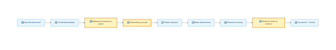
</details>

### 1️⃣ Kya test karna hai? (Scope)
Sawaal: sirf UI? UI + API? Mobile? Kya backend API **available** hai? Isse tay hota hai ki **API layer** chahiye ya nahi.
*Is guide me:* web UI + API dono, isliye hybrid architecture.

### 2️⃣ Constraints samjho
| Sawaal | Kyun important |
|---|---|
| Kitne log, kitne skill level? | Zyada complex structure team ko slow karta hai |
| Kitne environments? | Config layer kitna bada |
| CI me chalega? Parallel? | Tests independent hone chahiye |
| Test data kaise milta hai? | Data layer / fixtures ka design |
| App kitni stable/badalti hai? | Page Objects ki kimat |
| Release kitni baar? | Smoke vs regression split |

### 3️⃣ ⭐ Badlaav ke kaaran se layers banao (sabse important idea)

> [!IMPORTANT]
> **Rule:** Jo cheezein **ek hi wajah se badalti hain, unhe saath rakho. Jo alag wajah se badalti hain, unhe alag rakho.**

Ye table socho: "Kaun si cheez **kyun** badalti hai?"

| Cheez | Kab badalti hai | Isliye ghar |
|---|---|---|
| Button ka locator | Developer UI badle | 🟩 Pages |
| Login ka endpoint URL | Backend badle | 🟫 API |
| Staging ka URL | Environment badle | 🌍 Config |
| Product ka price | Business data badle | 🟤 Data |
| "Buy 2 items" ka sequence | Business flow badle | 🟧 Flows |
| Kya verify karna hai | Requirement badle | 🟦 Tests |
| Screenshot lene ka tareeka | Reporting policy badle | 📊 Reporting |

Dekho: **har cheez alag wajah se badalti hai** to alag ghar. Yahi layers ki asli wajah hai. "Pages, Tests, API" koi random naam nahi hain.

### 4️⃣ Dependency arrows tay karo
Layers ko upar se neeche rakho. **Arrow sirf neeche jaayega.** Neeche wali layer ko upar wali ka pata nahi hona chahiye. (Part 3 me diagram)

### 5️⃣ Folder structure layers ko mirror kare
Ek folder = ek layer. Koi naya aaye to folder dekh ke samajh jaye (Part 4).

### 6️⃣ Base abstractions: tab banao jab zaroorat dikhe
`BasePage`, `BaseApiClient` jaisi chhezein tab jab 2-3 jagah same code dikhe. **Pehle se mat banao.**

### 7️⃣ Fixtures se wiring
Layers ko tests tak fixtures laate hain. Scope sochkar (Part 11).

### 8️⃣ ⭐ Rules ko tests se enforce karo
"Hum rule banate hain" aur "rule tootne par build fail hota hai" me bahut fark hai (Part 14).

### 9️⃣ Document aur review
README me ek diagram aur "kahan kya jaata hai" table. Har kuch mahine me review: kaunsi layer phool gayi?

<details>
<summary>🧠 <b>Mini exercise: Banking app ke liye layers socho</b> (pehle khud, phir kholo)</summary>

App: net banking (login with OTP, balance, fund transfer). API available hai.

**Ek jawab:**
- 🌍 Config: env URLs, OTP bypass flag (test env).
- 🟤 Data: accounts, beneficiaries.
- 🟫 API: auth, accounts, transfers (setup/verify ke liye).
- 🟨 Components: navigation menu, balance widget.
- 🟩 Pages: Login, Dashboard, Transfer, Confirmation.
- 🟧 Flows: `transfer_money(from, to, amount)`.
- 🟪 Fixtures: `logged_in_page` via API token, `funded_account`.
- 🟦 Tests: transfer limits, insufficient funds, OTP failure.

**Dhyan do:** structure same hai, sirf **naam aur data** badle. Isiliye architecture reusable hai.
</details>

---

<a id="part-3"></a>

# Part 3: Big picture: layers aur dependency rule

## 3.1 🗺️ Layers ka naksha

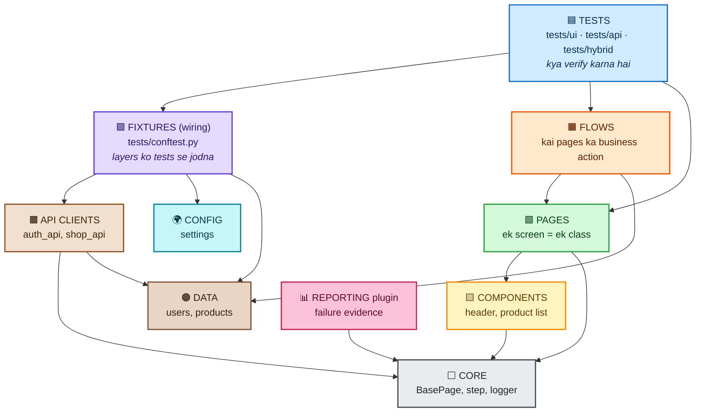

<details>
<summary>🖼️ Diagram nahi dikh raha? Image aur text version</summary>

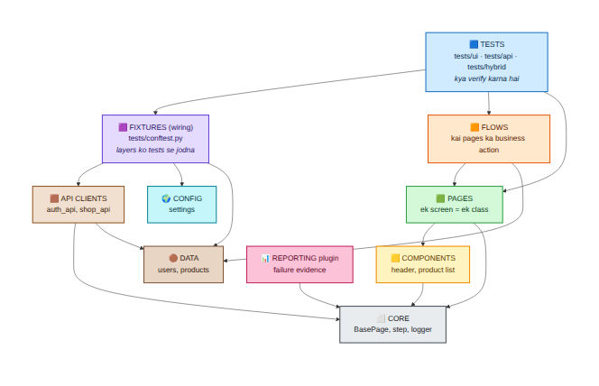

```text
 TESTS ──► FIXTURES ──► API ──► CORE
   │          │           └────► DATA
   │          ├──► CONFIG
   │          └──► DATA
   ├──► FLOWS ──► PAGES ──► COMPONENTS ──► CORE
   │         └──► DATA            └──► CORE
   └──► PAGES
 REPORTING ──► CORE
 (arrow = "import kar sakta hai")
```
</details>

**Diagram kaise padhein:** arrow `A → B` ka matlab "**A, B ko import/use kar sakta hai**". Sab arrows **neeche ki taraf** hain. Koi arrow upar nahi jaata. Ye hi **dependency rule** hai.

## 3.2 📋 Har layer ka rulebook

| Layer | Folder | ✅ Kya jaata hai | ❌ Kya NAHI jaata | Kise import kar sakti hai |
|---|---|---|---|---|
| 🌍 Config | `framework/config/` | URLs, timeouts (env se) | Playwright, test logic | Kuch nahi |
| 🟤 Data | `framework/data/` | Users, products | Browser, HTTP | Kuch nahi |
| ⬜ Core | `framework/core/` | BasePage, step, logger | Business logic | Kuch nahi |
| 🟨 Components | `framework/components/` | Header, ProductList | Poore page ka logic | Core |
| 🟩 Pages | `framework/pages/` | Locators + page actions | `requests`, pytest, **business assertions** | Core, Components |
| 🟧 Flows | `framework/flows/` | Multi-page actions | Locators, HTTP | Core, Components, Pages, Data |
| 🟫 API | `framework/api/` | HTTP calls | Playwright | Core, Data |
| 📊 Reporting | `framework/reporting/` | Allure evidence | Page logic | Core |
| 🟪 Fixtures | `tests/conftest.py` | Wiring, scopes, cleanup | Test assertions | Sab |
| 🟦 Tests | `tests/**` | Scenarios + assertions | Raw locators, HTTP details | Fixtures, Flows, Pages, Data |

> [!WARNING]
> Is table me **"kya NAHI jaata"** wala column utna hi zaroori hai. Zyada bugs isliye aate hain ki log `pages` me `requests` import kar dete hain ya `tests` me raw locator likh dete hain.

## 3.3 🔄 Ek test ka safar (sequence)

Ye ek **hybrid test** hai: API se setup, UI se verify. Dekho kaun kisse baat karta hai:

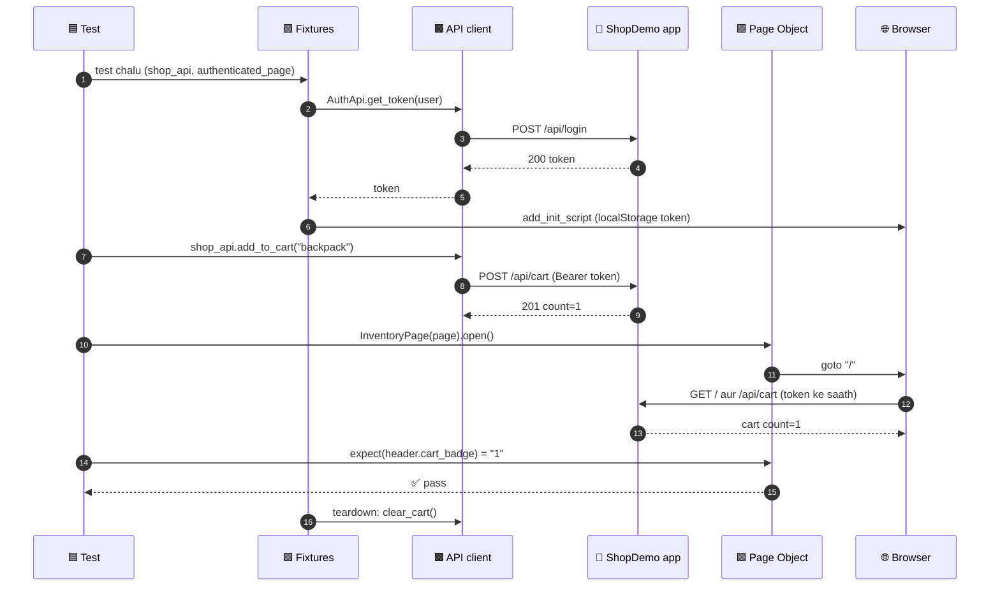

<details>
<summary>🖼️ Diagram nahi dikh raha? Image dekho</summary>

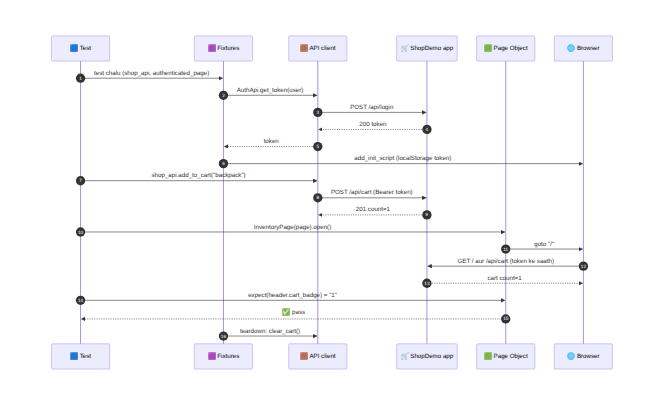
</details>

**Isme kya seekhne layak hai:**
- Test **kabhi `requests` ya raw locator nahi** likhta. Wo fixtures, API client aur Page Objects use karta hai.
- Login **API se** (step 2-5) hua, UI se nahi: fast aur stable.
- Cleanup **fixture teardown** me (last step), test me nahi.

## 3.4 🧠 Quiz: Layers samjhe? (pehle socho, phir kholo)

<details>
<summary><b>Q1.</b> Ek page ke andar `requests.get(...)` likha hai. Kaunsa rule toota?</summary>

**Dependency rule**: 🟩 Pages ko HTTP library nahi chahiye. HTTP ka kaam 🟫 API layer ka hai. Part 14 ka architecture test ise pakad leta hai.
</details>

<details>
<summary><b>Q2.</b> Staging ka URL kahan badlenge?</summary>

🌍 **Config layer** (`TEST_ENV` / `BASE_URL`). Kisi page ya test me nahi.
</details>

<details>
<summary><b>Q3.</b> "Login karke 2 product khareedna" 30 tests me chahiye. Kahan rakhein?</summary>

🟧 **Flow** (`ShoppingFlow.buy`). Par dhyan: agar sirf 2 tests me hai to abhi flow mat banao (rule of three).
</details>

<details>
<summary><b>Q4.</b> Cart badge ka locator `[data-testid=cart-count]` badla. Kitni files badlengi?</summary>

**1 file**: `framework/components/header.py`. Yahi architecture ka faida hai.
</details>

<details>
<summary><b>Q5.</b> Kya `core` layer `pages` ko import kar sakti hai?</summary>

**Nahi.** `core` sabse neeche hai. Upar wali layers `core` ko use karti hain, ulta nahi.
</details>


---

<a id="part-4"></a>

# Part 4: Project setup aur folder structure

## 4.1 🌳 Final structure (ye hum banane wale hain)

```text
shop_framework/
│
├── 🛒 app_under_test/            ← demo shop (framework ka hissa NAHI, Appendix A)
│   ├── server.py
│   └── static/index.html
│
├── 🏛️ framework/                 ← REUSABLE code (tests nahi)
│   ├── 🌍 config/settings.py
│   ├── 🟤 data/{users,products}.py
│   ├── ⬜ core/{logger,steps,base_page}.py
│   ├── 🟨 components/{header,product_list}.py
│   ├── 🟩 pages/{login,inventory,cart,order_complete}_page.py
│   ├── 🟧 flows/shopping_flow.py
│   ├── 🟫 api/{base_client,auth_api,shop_api}.py
│   └── 📊 reporting/evidence.py
│
├── 🧪 tests/                     ← SIRF scenarios
│   ├── 🟪 conftest.py            ← fixtures (wiring)
│   ├── ui/                       ← browser tests
│   ├── api/                      ← API tests
│   ├── hybrid/                   ← API + UI
│   └── architecture/             ← rules ke tests
│
├── 🧰 lab_support/local_app.py   ← LAB ONLY (demo app auto-start)
├── conftest.py                   ← root: plugins register
├── pytest.ini
├── requirements.txt
├── .env.example
└── .gitignore
```

### 🤔 Kyun `framework/` aur `tests/` alag?

| Option | Faida / nuksan |
|---|---|
| Sab `tests/` ke andar | Chhote project me chalega. Par framework code (pages, api) aur scenarios mix, reuse mushkil |
| **`framework/` alag, `tests/` alag (humne chuna)** | **Framework ek package** jo tests import karte hain. "Kya reuse hota hai" aur "kya scenario hai" saaf alag. Dependency rule check karna aasan (`framework` kabhi `tests` import na kare) |

## 4.2 🛠️ Folders aur `__init__.py` banao

```bash
mkdir shop_framework && cd shop_framework
mkdir -p framework/{config,data,core,components,pages,flows,api,reporting}
mkdir -p tests/{ui,api,hybrid,architecture} lab_support app_under_test/static
touch framework/__init__.py framework/{config,data,core,components,pages,flows,api,reporting}/__init__.py
touch lab_support/__init__.py
```

> [!NOTE]
> `{a,b,c}` wali braces bash/Git Bash/Linux/Mac me chalti hain. Windows PowerShell me folders ek-ek karke banao ya Git Bash use karo.

**`__init__.py` kya karta hai:** folder ko Python **package** banata hai (`from framework.pages... import ...` isi se chalta hai). File khali ho sakti hai.

## 4.3 ⚙️ Config files (project ke root me)

**File: `requirements.txt`**
```text
pytest==9.2.0
pytest-playwright==0.10.0
allure-pytest==2.16.2
pytest-xdist==3.8.0
requests==2.33.1
```
- `pytest-playwright`: browser fixtures (`page`) aur CLI options.
- `allure-pytest`: Allure report ka plugin.
- `pytest-xdist`: parallel run (`-n`).
- `requests`: API layer.
- Versions `==` se **pin** (aaj jo chala wahi kal bhi chale).

**File: `pytest.ini`**
```ini
[pytest]
pythonpath = .
testpaths = tests
addopts =
    -ra
    --tracing retain-on-failure
    --screenshot only-on-failure
    --video retain-on-failure
log_level = INFO
log_format = %(asctime)s %(levelname)s %(name)s: %(message)s
markers =
    smoke: quick critical checks
    regression: full regression suite
    ui: browser (UI) tests, tests/ui folder se apne aap lagta hai
    api: API tests, tests/api folder se apne aap lagta hai
    hybrid: API + UI saath, tests/hybrid folder se apne aap lagta hai
    architecture: framework ke layering rules
    demo_failure: tests that fail ON PURPOSE to learn failure evidence
```

**LINE-BY-LINE:**
| Line | Kya karti hai | Kyun |
|---|---|---|
| `pythonpath = .` | Project root ko Python ke import path me jodta hai | Taaki `from framework.pages.login_page import LoginPage` chale (framework root par hai) |
| `testpaths = tests` | Bina argument ke sirf `tests/` dhundo | `framework/` me galti se test na dhunde |
| `addopts = ...` | Har run me ye options apne aap | Team ke har member aur CI par same behaviour |
| `-ra` | End me failed/skipped ka summary | Result jaldi dikhta hai |
| `--tracing retain-on-failure` | Trace record, **file sirf fail par** bachti hai | Debug evidence, kam storage |
| `--screenshot only-on-failure`, `--video retain-on-failure` | Playwright ka failure evidence | |
| `log_level = INFO` | Test ke dauran INFO+ logs capture | Failure par "Captured log" me API calls dikhte hain (maine verify kiya) |
| `log_format` | Log line ka format | Time + level + kaun logger |
| `markers` | Valid markers register | Typo chup-chap ignore na ho |

> [!TIP]
> **Marker `ui`, `api`, `hybrid`, `architecture` ko tum haath se nahi lagaoge.** `tests/conftest.py` folder ke naam se apne aap lagata hai (Part 11). Isse `pytest -m api` chalana aasaan.

**File: `.env.example`**
```text
# Is file ko .env me copy karo (aur .env ko git me commit mat karo)
TEST_ENV=local
# BASE_URL=https://qa.shop.example.com
# API_URL=https://qa.shop.example.com
# STANDARD_USER_PASSWORD=...
# UI_TIMEOUT_MS=5000
# API_TIMEOUT_S=10
```
Ye **template** hai: sirf naam batata hai ki kaunse settings hain, **asli secrets nahi**. Ye commit hota hai. Asli `.env` ignore hota hai.

**File: `.gitignore`**
```text
.venv/
__pycache__/
*.pyc
.pytest_cache/
.env
allure-results/
allure-report/
test-results/
history.jsonl
node_modules/
```

**File: `conftest.py`**
```python
"""Root conftest: sirf plugins register karta hai. Fixtures tests/conftest.py me hain."""

pytest_plugins = [
    "framework.reporting.evidence",   # failure par Allure evidence
    "lab_support.local_app",          # LAB ONLY: demo app start (asli project me hata do)
]
```
**LINE-BY-LINE:**
- `pytest_plugins = [...]`: pytest ko batata hai ki ye modules **plugin** hain (unke fixtures aur hooks load karo). Ye variable sirf **root conftest** me kaam karta hai.
- `"framework.reporting.evidence"`: failure-evidence ka plugin (Part 12).
- `"lab_support.local_app"`: sirf lab ke liye. Asli project me tum ise hata do aur `BASE_URL` set karo.

### 🤔 Kyun root `conftest.py` itna chhota?
**Root conftest me kuch bhi bharte jao to wo dumping ground ban jaata hai.** Isliye: root = sirf plugins register. Fixtures = `tests/conftest.py`. Hooks/evidence = plugin module.

## 4.4 ✅ Checklist
- [ ] Folder structure ban gaya
- [ ] Har package me `__init__.py` hai
- [ ] `pip install -r requirements.txt` aur `playwright install chromium` ho gaya
- [ ] `pytest --collect-only` error nahi deta (tests aane ke baad)

---

<a id="part-5"></a>

# Part 5: 🌍 Config layer (settings)

## 5.1 WHY
URL, timeouts, environment ka naam: ye **environment ke saath badalte** hain. Agar ye code me bikhre hon to staging par chalana = 40 jagah edit.

**Rule (config over code):** ek hi jagah (`get_settings()`), baaki sab wahan se padhein.

## 5.2 CODE

**File: `framework/config/settings.py`**
```python
"""CONFIG layer: environment ke hisaab se saari settings ek hi jagah."""
import os
from dataclasses import dataclass
from functools import lru_cache

# Har environment ka default URL (ye placeholders hain, apni asli URLs yahan likho)
ENVIRONMENTS = {
    "local": {"base_url": "http://127.0.0.1:8000"},
    "qa": {"base_url": "https://qa.shop.example.com"},
    "staging": {"base_url": "https://staging.shop.example.com"},
}


@dataclass(frozen=True)
class Settings:
    env: str
    base_url: str
    api_url: str
    ui_timeout_ms: int
    api_timeout_s: float


@lru_cache(maxsize=1)
def get_settings() -> Settings:
    env = os.environ.get("TEST_ENV", "local")
    if env not in ENVIRONMENTS:
        raise ValueError(f"Unknown TEST_ENV={env!r}. Valid: {sorted(ENVIRONMENTS)}")

    base_url = os.environ.get("BASE_URL", ENVIRONMENTS[env]["base_url"]).rstrip("/")
    return Settings(
        env=env,
        base_url=base_url,
        api_url=os.environ.get("API_URL", base_url).rstrip("/"),
        ui_timeout_ms=int(os.environ.get("UI_TIMEOUT_MS", "5000")),
        api_timeout_s=float(os.environ.get("API_TIMEOUT_S", "10")),
    )
```

## 5.3 LINE-BY-LINE

| Line | Matlab | Kyun |
|---|---|---|
| `import os` | Environment variables padhne ke liye | Secrets/URLs code me nahi, env me |
| `from dataclasses import dataclass` | Chhoti data class banane ka shortcut | `__init__`, `__repr__` apne aap |
| `from functools import lru_cache` | Function ka result yaad rakhna | Settings ek baar bane, har fixture par dobara nahi |
| `ENVIRONMENTS = {...}` | Har env ka default URL | Naya env = ek line add |
| `@dataclass(frozen=True)` | Object **badal nahi sakte** (immutable) | Test chalte waqt koi galti se settings na badle |
| `class Settings:` ke fields | Saari settings **naam + type** ke saath | Typo (`bse_url`) turant error, editor autocomplete |
| `@lru_cache(maxsize=1)` | Pehli call ka result cache | `get_settings()` kitni baar bhi bulao, same object |
| `env = os.environ.get("TEST_ENV", "local")` | `TEST_ENV` padho, nahi to `"local"` | Default safe: local |
| `if env not in ENVIRONMENTS: raise ValueError` | Galat env naam par **turant error** | **Fail fast**: galat env par test chal kar prod ko na chhu le |
| `os.environ.get("BASE_URL", ...)` | `BASE_URL` env se override | CI me URL bina code badle |
| `.rstrip("/")` | Aakhri `/` hata do | `base + "/api"` me `//` na bane |
| `api_url=os.environ.get("API_URL", base_url)` | API ka URL default UI ke barabar | Is demo me ek hi server |
| `int(...)`, `float(...)` | Env se text aata hai, number banao | Timeouts number chahiye |

## 5.4 🤔 Kyun ye choice? (alternatives)

| Option | Faida | Nuksan |
|---|---|---|
| Code me hard-coded URL | Sabse aasan | Env badalna = code badalna 🟥 |
| Python dict / globals | Simple | Typo se silent bug, type nahi |
| `configparser` / YAML/JSON file | Non-programmers edit kar sakte | Loading code, validation alag |
| **`dataclass(frozen=True)` + env vars (humne chuna)** | Type-safe, immutable, CI-friendly, koi extra library nahi | Bahut bade configs me verbose |
| `pydantic-settings` | Validation + `.env` support | Extra dependency (bade project me achha) |

**`.env` file ke baare me:** is demo me hum seedha `os.environ` padhte hain. Local par `.env` auto-load karne ke liye `python-dotenv` jaisi library alag se laga sakte ho (maine ye nahi chalaya).

## 5.5 💡 Do nazariye
- 🎓 **Student:** "Settings ek class hai jisme sab values hain."
- 💼 **SDET:** "Config **hi** wo jagah hai jahan 'ye run kahan chal raha hai' ka jawab hai. Galat env par tests chalna sabse khatarnak cheez hai, isliye validation aur fail-fast."

## 5.6 ⚠️ Common mistakes
- 🟥 URL ya password code me.
- 🟥 Config layer me Playwright/requests import (Part 14 ka test rokta hai).
- 🟥 `get_settings()` har test me naya object (cache nahi) ya settings ko mutable chhodna.
- 🟥 `.env` ko commit kar dena.

<details>
<summary>📝 <b>Practice 5</b></summary>

1. `TEST_ENV=qa` set karke `python -c "from framework.config.settings import get_settings; print(get_settings())"` chalao. Kya aaya?
2. `TEST_ENV=prod` karo. Kya hua? Kyun achha hai?
3. `UI_TIMEOUT_MS=abc` karo. Kya error aaya?

**Jawab:** (1) `Settings(env='qa', base_url='https://qa.shop.example.com', ...)`. (2) `ValueError: Unknown TEST_ENV='prod'` (galat env par chalna roka). (3) `ValueError` (int me convert nahi hua); config galti pehle hi pakdi gayi.
</details>

---

<a id="part-6"></a>

# Part 6: 🟤 Data layer (users aur products)

## 6.1 WHY
Test me `"standard_user"`, `"Backpack"`, `29.99` baar-baar likhoge to ek change = 20 jagah. **Data ek jagah**, tests us data ka naam use karein.

## 6.2 CODE

**File: `framework/data/users.py`**
```python
"""DATA layer: test users. Password pehle environment variable se, nahi to sirf DEMO default."""
import os
from dataclasses import dataclass, field


@dataclass(frozen=True)
class User:
    username: str
    password: str = field(repr=False)   # repr/log/assert-diff me password nahi dikhega
    role: str = "customer"


def get_user(kind: str = "standard") -> User:
    users = {
        "standard": User("standard_user", os.environ.get("STANDARD_USER_PASSWORD", "secret_sauce")),
        "locked": User("locked_user", os.environ.get("LOCKED_USER_PASSWORD", "secret_sauce")),
    }
    try:
        return users[kind]
    except KeyError:
        raise ValueError(f"Unknown user kind {kind!r}. Valid: {sorted(users)}") from None
```

**LINE-BY-LINE:**
| Line | Matlab | Kyun |
|---|---|---|
| `@dataclass(frozen=True) class User` | User ek immutable data object | Test ke beech me user ka password badalna galti hai |
| `password: str = field(repr=False)` | `repr()` me password **hide** | Pytest ke assertion diff, logs, Allure me password print nahi hota (🔒 security) |
| `role: str = "customer"` | Default role | Admin user baad me aaye to `role="admin"` |
| `def get_user(kind="standard")` | Naam se user do | Test me `get_user("locked")` padhne me saaf |
| `os.environ.get("STANDARD_USER_PASSWORD", "secret_sauce")` | Pehle env, nahi to demo default | Asli project me default **mat** rakho, demo ke liye hai |
| `try / except KeyError → raise ValueError(...) from None` | Galat `kind` par saaf error | `KeyError: 'admn'` ki jagah batata hai valid options kya hain |

**File: `framework/data/products.py`**
```python
"""DATA layer: products ka data ek jagah. Price/naam badla to sirf yahan badlo."""
from dataclasses import dataclass


@dataclass(frozen=True)
class Product:
    id: str
    name: str
    price: float


BACKPACK = Product("backpack", "Backpack", 29.99)
BIKE_LIGHT = Product("bike-light", "Bike Light", 9.99)
ONESIE = Product("onesie", "Onesie", 7.99)

ALL_PRODUCTS = (BACKPACK, BIKE_LIGHT, ONESIE)
```

**LINE-BY-LINE:**
- `Product(id, name, price)`: ek product ki 3 cheezein. `id` API ke liye, `name` UI ke liye.
- `BACKPACK = Product(...)`: **constants**. Test me `BACKPACK.name` likhoge, `"Backpack"` nahi. Naam badla to ek jagah.
- `ALL_PRODUCTS = (...)`: tuple (badal nahi sakta). Sorting tests iska use karke **expected order data se nikalte hain**, copy-paste list nahi.

## 6.3 🤔 Kyun ye choice?
| Option | Nuksan / Faida |
|---|---|
| Tests me literal strings | 🟥 Repeat, typo, ek change = bahut jagah |
| JSON/YAML files me data | Non-coders edit kar sakte, par typing/validation weak, extra loader |
| **`dataclass` constants (humne chuna)** | Type-safe, editor autocomplete, `frozen` = safe, koi loader nahi |
| Faker/random data | Bade/dynamic data ke liye achha, **alag se** add karo jab zaroorat ho |

**Rule:** Data layer me **sirf data** (Playwright/requests/pytest kuch nahi). Part 14 ka test ye enforce karta hai.

## 6.4 💡 Do nazariye
- 🎓 **Student:** "Naam badalne ke liye ek file."
- 💼 **SDET:** "Data ka format tay karta hai ki test **kitna readable** hai. `get_user("locked")` ek requirement jaisa padhta hai."

<details>
<summary>📝 <b>Practice 6</b></summary>

1. Ek 4th product `Water Bottle (id "bottle", 12.50)` add karo. Kaunse tests apne aap uske liye kaam karenge (sorting)? Kyun?
2. `print(get_user("standard"))` chalao. Password dikha?

**Jawab:** (1) `ALL_PRODUCTS` me jodo; sorting tests `ALL_PRODUCTS` se expected nikalte hain, isliye wo apne aap update (par demo app me bhi product hona chahiye). (2) Nahi: `User(username='standard_user', role='customer')`, `repr=False` ki wajah se.
</details>

---

<a id="part-7"></a>

# Part 7: ⬜ Core layer (logger, step, BasePage)

Core = sabse neeche ki layer. **Isme wo chhote tools jo sab ke kaam aate hain**, par jinme business logic nahi.

## 7.1 Logger

**File: `framework/core/logger.py`**
```python
"""CORE layer: logging. Library code handler configure NAHI karta."""
import logging


def get_logger(name: str) -> logging.Logger:
    # Level aur format pytest.ini (log_level, log_format) se aate hain.
    return logging.getLogger(f"shopfw.{name}")
```

**LINE-BY-LINE:**
- `logging.getLogger(f"shopfw.{name}")`: ek **naam wala logger** (jaise `shopfw.api`). `shopfw.` prefix se saare framework ke logs ek namespace me.
- **Handler/format yahan nahi lagaya.** Wo `pytest.ini` ke `log_level` / `log_format` se aate hain.

### 🤔 Kyun?
**Python logging ka golden rule:** *library code sirf logger leta hai, configure nahi karta; configure application karti hai.* Agar framework apna handler lagaye to duplicate logs, galat format aur pytest ke capture se jhagda. Humne pytest ko config karne diya aur failure par "Captured log" apne aap milta hai (maine verify kiya).

## 7.2 `step`: safe Allure step decorator

**File: `framework/core/steps.py`**
```python
"""CORE layer: safe Allure step decorator."""
import functools

import allure


def step(title: str):
    """Allure step, jo function ke arguments report me NAHI daalta (password leak se bachav)."""

    def decorator(func):
        @functools.wraps(func)
        def wrapper(*args, **kwargs):
            with allure.step(title):
                return func(*args, **kwargs)

        return wrapper

    return decorator
```

**LINE-BY-LINE (decorator ki 3 parat):**
| Line | Matlab |
|---|---|
| `def step(title):` | Bahari function: `title` leta hai. `@step("Login karo")` likhne par ye chalta hai |
| `def decorator(func):` | Beech ka function: **jis function par decorator laga hai wo** (`func`) milta hai |
| `@functools.wraps(func)` | Wrapper ko `func` ka naam/docstring de do (debugging aur pytest ke liye) |
| `def wrapper(*args, **kwargs):` | Asli call ka replacement. `*args, **kwargs` = jo bhi arguments aaye unhe aage de do |
| `with allure.step(title):` | **Context manager** se step. Ye arguments record nahi karta |
| `return func(*args, **kwargs)` | Asli function chalao aur uska result lautao |
| `return wrapper` / `return decorator` | Decorator chain complete |

### 🤔 Kyun apna `step` banaya, `@allure.step` seedha kyun nahi?
Pichhli guide me maine real me dekha tha: **`@allure.step("...")` decorator function ke saare arguments report me daal deta hai, password bhi.**

| Tareeka | Password leak? |
|---|---|
| `@allure.step("Login")` on `login(username, password)` | 🟥 **Haan** |
| `with allure.step(...)` ya **hamara `@step("...")`** | 🟩 Nahi |

Isliye framework me **ek** `step` banaya, aur sabhi yahi use karein. **Ek policy, ek jagah.**

**Limit:** `@step("...")` ka title **static** hai (product naam jaise dynamic cheez title me nahi aati). Dynamic title chahiye to function ke andar `with allure.step(f"...")` (jaisa `ProductList.add` me hai).

## 7.3 `BasePage`: Template Method pattern

**File: `framework/core/base_page.py`**
```python
"""CORE layer: har Page Object ka base class."""
from playwright.sync_api import Locator, Page, expect


class BasePage:
    """Yahan sirf wo cheezein jo SAB pages ko chahiye."""

    path = "/"   # child page apna path override karta hai

    def __init__(self, page: Page):
        self.page = page

    @property
    def loaded_locator(self) -> Locator:
        """Wo element jo dikhe to maanenge ki page load ho gaya."""
        raise NotImplementedError("Child page 'loaded_locator' define kare")

    def wait_until_loaded(self):
        expect(self.loaded_locator).to_be_visible()
        return self

    def open(self, query: str = ""):
        self.page.goto(self.path + query)
        return self.wait_until_loaded()
```

**LINE-BY-LINE:**
| Line | Matlab | Kyun |
|---|---|---|
| `path = "/"` | Class attribute: page ka URL path | Child page apna path likhta hai (`path = "/cart"`) |
| `def __init__(self, page)` | Page object ko Playwright `page` mil jaata hai | Har page isi `page` par kaam karta hai |
| `@property loaded_locator` + `raise NotImplementedError` | **Child ko define karna zaroori** | Har page batata hai "mai load hua mane kya". Define na kare to turant clear error |
| `wait_until_loaded()` | `expect(...).to_be_visible()` | **Web-first assertion** (retry ke saath), fixed sleep nahi |
| `return self` | Method chain ho sake | `LoginPage(page).open().login(...)` |
| `open(query="")` | `goto(path + query)` phir `wait_until_loaded()` | `page.goto("/")` **relative** URL: `base_url` fixture se poora URL banta hai, page object ko environment nahi pata |

### 🤔 Kyun ye design? (Template Method)
`BasePage` **ek template** deta hai (`open` = goto + wait), aur child sirf **"load hone ka matlab"** (`loaded_locator`) batata hai. Isse **har page ka `open()` ek jaisa** hai aur "page load hone ka intezaar bhool jaana" nahi hota.

**BasePage me kya NAHI daalna (dumping ground mat banao):**
| ❌ Mat daalo | Kyun |
|---|---|
| `login()`, `add_to_cart()` jaisa business action | Wo specific page ka hai |
| Har tarah ke click/fill wrappers (`click(selector)`) | Playwright locator pehle se achha API hai, wrapper bekaar layer |
| Test data | Data layer ka kaam |

> [!WARNING]
> **Sabse common galti:** `BasePage` me 50 methods daal dena. Wo "God class" ban jaata hai jise har page inherit karta hai, aur ek change sab ko hilata hai. **Chhota rakho.**

## 7.4 Core ke rules (Part 14 me enforce)
- 🟥 `core` kisi aur framework layer ko import nahi karta (pages, api, flows...).
- Core me sirf cross-cutting tools.

<details>
<summary>📝 <b>Practice 7</b></summary>

1. Ek naya page `CartPage` banaya par `loaded_locator` define nahi kiya. `open()` chalane par kya error aayega?
2. `@step` ki jagah `@allure.step("Login {username}")` laga ke `password` wale function par report dekho. Kya leak hua?
3. Logger me `logging.StreamHandler()` jod do. Ek test chalao. Kya duplicate logs dikhe?

**Jawab:** (1) `NotImplementedError: Child page 'loaded_locator' define kare`. (2) Haan, password step parameters me. (3) Aksar do baar (ek tumhara handler, ek pytest ka). Isliye library handler nahi lagati.
</details>


---

<a id="part-8"></a>

# Part 8: 🟨 Components aur 🟩 Pages

## 8.1 Page ya Component? (pehla decision)

> [!IMPORTANT]
> **Sawaal:** "Kya ye hissa **kai screens par** dikhta hai?"
> - **Haan** → 🟨 **Component** (header, navigation bar, product list)
> - **Nahi, sirf ek screen ka** → 🟩 **Page**

**Kyun?** Agar header ka locator 5 pages me copy ho aur header badle to 5 jagah fix. Component me **ek** jagah.

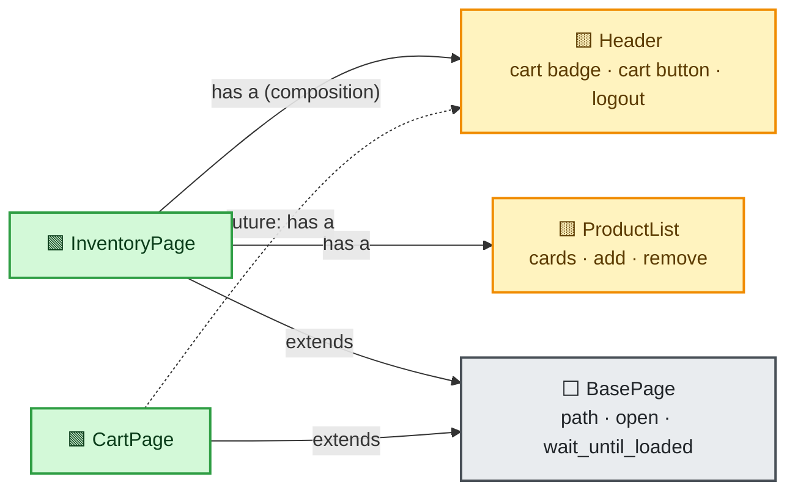

<details>
<summary>🖼️ Diagram nahi dikh raha? Image dekho</summary>

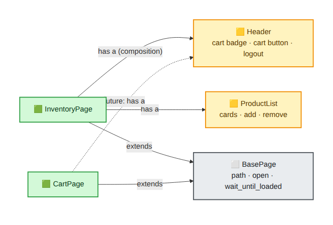
</details>

**Do relations alag hain:**
- **`extends` (inheritance):** page → `BasePage`. Sirf **common template** ke liye (path, open, wait).
- **`has a` (composition):** page ke andar `Header`, `ProductList` **objects**. Reuse isse hota hai.

## 8.2 🟨 Component: Header

**File: `framework/components/header.py`**
```python
"""COMPONENT: header (cart badge, cart button, logout). Kai pages par dikhta hai."""
from playwright.sync_api import Locator, Page

from framework.core.steps import step


class Header:
    def __init__(self, page: Page):
        self.cart_badge: Locator = page.get_by_test_id("cart-count")
        self._cart_button = page.get_by_role("button", name="View Cart")
        self._logout_button = page.get_by_role("button", name="Logout")

    @step("Cart kholo")
    def open_cart(self):
        self._cart_button.click()

    @step("Logout karo")
    def logout(self):
        self._logout_button.click()
```

**LINE-BY-LINE:**
| Line | Matlab | Kyun |
|---|---|---|
| `from framework.core.steps import step` | Safe step decorator (Part 7) | Components 🟨 sirf ⬜ Core ko jaante hain: allowed |
| `def __init__(self, page: Page)` | Component ko Playwright `page` do | Pages isse banate hain |
| `self.cart_badge: Locator = page.get_by_test_id("cart-count")` | `data-testid="cart-count"` wala element. **Public** attribute | Tests `expect(header.cart_badge).to_have_text("1")` karenge. **Locator public**, taaki expect retry kare |
| `self._cart_button = ...` (underscore) | **Private** (andar ki cheez) | Tests button ko seedha nahi chhuyenge, `open_cart()` se |
| `@step("Cart kholo")` | Report me step banta hai | Static title, arguments record nahi |
| `def open_cart(self): self._cart_button.click()` | Action | Locator ka detail component ke andar chhupa |

## 8.3 🟨 Component: ProductList

**File: `framework/components/product_list.py`**
```python
"""COMPONENT: products ki list (cards)."""
import allure
from playwright.sync_api import Locator, Page


class ProductList:
    def __init__(self, page: Page):
        self._cards = page.get_by_test_id("product")
        self.names: Locator = self._cards.locator(".name")
        self.prices: Locator = self._cards.locator(".price")

    def _card(self, name: str) -> Locator:
        return self._cards.filter(has_text=name)

    def button_for(self, name: str) -> Locator:
        return self._card(name).get_by_role("button")

    def add(self, name: str):
        with allure.step(f"Cart me add karo: {name}"):
            self._card(name).get_by_role("button", name="Add to cart").click()

    def remove(self, name: str):
        with allure.step(f"Cart se hatao: {name}"):
            self._card(name).get_by_role("button", name="Remove").click()
```

**LINE-BY-LINE:**
| Line | Matlab | Kyun |
|---|---|---|
| `self._cards = page.get_by_test_id("product")` | Saare product cards (private) | Cards ka detail bahar nahi |
| `self.names = self._cards.locator(".name")` | Cards ke andar ke naam (public Locator) | Sorting test `expect(products.names).to_have_text([...])` list assertion |
| `def _card(self, name)` | Ek naam wala card: `filter(has_text=name)` | **"Sahi product ka sahi button"** problem solve |
| `def button_for(self, name)` | Us card ka button (**Locator lautata hai**) | Test `expect(...).to_have_text("Remove")` kar sake |
| `with allure.step(f"Cart me add karo: {name}")` | Dynamic title (product ka naam) | `@step` static hai, yahan naam chahiye. Safe: sirf product naam, secret nahi |
| `.get_by_role("button", name="Add to cart").click()` | Us card ke andar ka button | Card ke andar scoped, doosre card ka button nahi |

## 8.4 🟩 Pages

**File: `framework/pages/login_page.py`**
```python
"""PAGE: login page."""
from playwright.sync_api import Locator, Page

from framework.core.base_page import BasePage
from framework.core.steps import step


class LoginPage(BasePage):
    path = "/"

    def __init__(self, page: Page):
        super().__init__(page)
        self._username = page.get_by_placeholder("Username")
        self._password = page.get_by_placeholder("Password")
        self._login_button = page.get_by_role("button", name="Login")
        self.error: Locator = page.get_by_role("alert")

    @property
    def loaded_locator(self) -> Locator:
        return self._login_button

    @step("Login form bharke submit karo")
    def login(self, username: str, password: str):
        self._username.fill(username)
        self._password.fill(password)
        self._login_button.click()
```

**LINE-BY-LINE:**
- `class LoginPage(BasePage)`: `BasePage` ka template milta hai (`open`, `wait_until_loaded`).
- `path = "/"`: login `/` par hai (app me token na ho to login dikhta hai).
- `super().__init__(page)`: parent ka `__init__` chalao (`self.page` set ho).
- `_username`, `_password`, `_login_button`: **private** locators.
- `self.error`: **public** Locator, kyunki test `expect(login.error).to_have_text(...)` karega (business assertion test ka).
- `loaded_locator` → login button: "button dikha to page load".
- `@step("Login form bharke submit karo")`: **password argument report me nahi jaata** (safe decorator).
- `login(username, password)`: fill, fill, click: ek business action.

**File: `framework/pages/inventory_page.py`**
```python
"""PAGE: products list page."""
import allure
from playwright.sync_api import Locator, Page

from framework.components.header import Header
from framework.components.product_list import ProductList
from framework.core.base_page import BasePage


class InventoryPage(BasePage):
    path = "/"

    def __init__(self, page: Page):
        super().__init__(page)
        self.header = Header(page)
        self.products = ProductList(page)
        self._heading = page.get_by_role("heading", name="Products")
        self._sort = page.get_by_test_id("sort")

    @property
    def loaded_locator(self) -> Locator:
        return self._heading

    def sort_by(self, label: str):
        with allure.step(f"Sort karo: {label}"):
            self._sort.select_option(label=label)
```

**LINE-BY-LINE:**
- `self.header = Header(page)` / `self.products = ProductList(page)`: **composition**: components ko page ke andar rakha. Test me `inventory.header.cart_badge`, `inventory.products.add(...)`.
- `loaded_locator` → "Products" heading.
- `sort_by(label)`: dropdown me option ko uske text se chuno; step ke naam me label.

**File: `framework/pages/order_complete_page.py`**
```python
"""PAGE: order complete (thank you) page."""
from playwright.sync_api import Locator, Page

from framework.core.base_page import BasePage


class OrderCompletePage(BasePage):
    def __init__(self, page: Page):
        super().__init__(page)
        self.heading = page.get_by_role("heading", name="Thank you for your order!")
        self._order_id = page.get_by_test_id("order-id")

    @property
    def loaded_locator(self) -> Locator:
        return self.heading

    def order_id(self) -> int:
        """'Order #1001' me se number nikalta hai."""
        return int(self._order_id.inner_text().replace("Order #", ""))
```
- `order_id()`: **value lautata hai** (int). Page ka kaam UI se data **padhna** hai, assertion nahi.
- Is page ka `path` default `"/"` rahega, par isse `open()` nahi karte (ye page sirf checkout ke baad aata hai).

**File: `framework/pages/cart_page.py`**
```python
"""PAGE: cart page."""
from playwright.sync_api import Locator, Page

from framework.core.base_page import BasePage
from framework.core.steps import step
from framework.pages.order_complete_page import OrderCompletePage


class CartPage(BasePage):
    def __init__(self, page: Page):
        super().__init__(page)
        self.items = page.locator("#cart-items li")
        self._heading = page.get_by_role("heading", name="Your Cart")
        self._checkout_button = page.get_by_role("button", name="Checkout")

    @property
    def loaded_locator(self) -> Locator:
        return self._heading

    @step("Checkout karo")
    def checkout(self) -> OrderCompletePage:
        self._checkout_button.click()
        return OrderCompletePage(self.page).wait_until_loaded()
```
- `checkout() -> OrderCompletePage`: **agle page ka object lautata hai** (navigation chaining). Test padhne me flow jaisa: `cart.checkout().order_id()`.
- Ek page doosre page ko import kar sakta hai (same layer 🟩): allowed.

## 8.5 ⚖️ Page Object ke 7 rules

| # | Rule | Kyun |
|---|---|---|
| 1 | Locators **private** (`_x`) jab tak test ko `expect` ke liye na chahiye | Tests locator ke detail se door |
| 2 | Jo test ko `expect` karna hai wo **public `Locator`** do, text nahi | `expect(Locator)` auto-retry karta hai. `inner_text()` ek baar padhta hai |
| 3 | Actions **verbs** (`login`, `add`, `open_cart`) | Business language |
| 4 | Action agle page ka object lautaye jahan natural ho | Chaining aur clear flow |
| 5 | Business **assertions test me** (`expect(...)` test file me) | Page "kaise" jaanta hai, test "kya sahi hai" |
| 6 | Sirf **readiness wait** page me (`wait_until_loaded`) | Ye precondition hai, business check nahi |
| 7 | Pages me HTTP, test data, environment nahi | Dusri layers ka kaam |

<details>
<summary>🤔 <b>"Page me assertion kyun nahi?" (deep-dive)</b></summary>

Pichhli guide me `expect_loaded()` jaise methods the, jo page me hi `expect` karte the. Dono tareeke chalte hain. Humne yahan **sirf readiness check** (`wait_until_loaded`) page me rakha aur **business assertion** test me.

**Reason:** page me assertion ho to ek hi page 5 alag tests me alag expectations (kabhi "badge 1", kabhi "badge 2") ke liye bana nahi sakta. Locator expose karne se test **apni expectation** khud likhta hai, aur `expect` ka retry bhi milta hai.
</details>

## 8.6 🤔 Kyun ye choices?
| Decision | Alternative | Kyun humne ye chuna |
|---|---|---|
| Component alag classes | Sab page me | Header ek jagah |
| Composition (`self.header = Header(page)`) | Page ko `HeaderMixin` se inherit | Mixins ka jaal, ek change sab ko hilata hai |
| Public `Locator` attributes | `get_cart_count()` jaise getter methods | Getter value ek baar padhta hai (retry nahi) |
| Relative `goto(path)` | Page me full URL | Page ko environment ka pata nahi hona chahiye |
| `loaded_locator` per page | Fixed `sleep` / networkidle | Condition-based wait, stable |

## 8.7 ⚠️ Common mistakes
- 🟥 Tests me `page.get_by_role(...)`/`page.locator(...)` (Part 14 ka architecture test pakadta hai).
- 🟥 Page me `assert` ya `time.sleep`.
- 🟥 Ek **bada** page class jisme poori app ka sab kuch.
- 🟥 `get_text()` return karke test me raw `assert` (retry nahi).

<details>
<summary>📝 <b>Practice 8</b></summary>

1. Cart page par bhi header chahiye (cart badge). Kitni jagah badlaav hoga? Kya karoge?
2. `ProductList` me ek method `price_of(name) -> float` likho jo UI se price padhe.
3. Kya `OrderCompletePage.order_id()` me `assert` lagana sahi hoga?

**Jawab:** (1) `CartPage.__init__` me `self.header = Header(page)` ek line. Header ka code same. (2) `float(self._card(name).locator(".price").inner_text().lstrip("$"))`. (3) Nahi, wo value lautata hai; test decide kare ki sahi hai ya nahi.
</details>

---

<a id="part-9"></a>

# Part 9: 🟧 Flows layer

## 9.1 WHY
Kai tests me ye sequence repeat hota hai: "login karo → 2 product add → cart → checkout". Har test me 8 lines. **Ek jagah** likho.

## 9.2 Flow ya Page ya Fixture? (decision)

| Cheez | Ghar |
|---|---|
| Ek screen ke andar ka action (`login`, `sort_by`) | 🟩 Page |
| **Kai screens** par business action (`buy`) | 🟧 Flow |
| Test ke liye **setup/state** taiyar karna (token, logged-in page) | 🟪 Fixture |
| Kya verify karna hai | 🟦 Test |

## 9.3 CODE

**File: `framework/flows/shopping_flow.py`**
```python
"""FLOW layer: kai pages ko jodne wale business actions."""
import allure
from playwright.sync_api import Page

from framework.data.users import User
from framework.pages.cart_page import CartPage
from framework.pages.inventory_page import InventoryPage
from framework.pages.login_page import LoginPage
from framework.pages.order_complete_page import OrderCompletePage


class ShoppingFlow:
    def __init__(self, page: Page):
        self._page = page

    def login_as(self, user: User) -> InventoryPage:
        with allure.step(f"UI se login karo: {user.username}"):
            LoginPage(self._page).open().login(user.username, user.password)
            return InventoryPage(self._page).wait_until_loaded()

    def buy(self, inventory: InventoryPage, product_names: list[str]) -> OrderCompletePage:
        with allure.step(f"Khareedo: {product_names}"):
            for name in product_names:
                inventory.products.add(name)
            inventory.header.open_cart()
            return CartPage(self._page).wait_until_loaded().checkout()
```

**LINE-BY-LINE:**
| Line | Matlab | Kyun |
|---|---|---|
| Imports: `User`, `CartPage`, `InventoryPage`, `LoginPage`, `OrderCompletePage` | Flow 🟧 pages aur data ko use karta hai | Flow allowed: Core, Components, Pages, Data (Part 3 table) |
| `__init__(self, page)` → `self._page` | Flow ko Playwright page | Pages isi page par bante hain |
| `login_as(self, user)` | **UI se** login (poora login screen) | Jab test ka maqsad UI login hi test karna ho. Fast setup ke liye API token fixture (Part 11) |
| `LoginPage(self._page).open().login(...)` | open (return self) phir login | Method chaining ka faida |
| `-> InventoryPage` return | Agla page ready lautao | Test `inventory = shopping.login_as(user)` se aage badh sake |
| `with allure.step(f"UI se login karo: {user.username}")` | Step title me **sirf username** | Password step me nahi (safe) |
| `buy(self, inventory, product_names)` | Har naam ke liye add, phir cart, phir checkout | Business action ka ek naam |
| `return CartPage(...).wait_until_loaded().checkout()` | Cart load hone ka wait phir checkout, `OrderCompletePage` lautata hai | Test `done.order_id()` use kar sake |
| **Koi `expect(...)` business assertion nahi** | Flow sirf karta hai | Verification test ka kaam |

## 9.4 🤔 Kyun ye choices?
| Decision | Alternative | Kyun |
|---|---|---|
| Flow ek **alag class** | Pages me `buy()` daalna | Page God-class ban jaata hai (login page ko cart ka pata?) |
| Flow **assert nahi karta** | Flow me `expect` | Alag tests me alag expectations |
| `inventory` flow ko **argument** me | Flow khud banaye | Test ko control, flow chhota |
| Flow **thin** (sirf jod) | Flow me logic/branches | Flow phoolta hai to khud ek mini-app ban jaata hai |

> [!WARNING]
> **Flow ka khatra: Over-abstraction.** Agar sirf 2 tests flow use karte hain, to **abhi flow mat banao**. Rule of three: teesri baar repeat dikhe tab. Aur flow me `if/else` aane lage to ruk jao: ye test logic hai, flow nahi.

## 9.5 💡 Do nazariye
- 🎓 **Student:** "Flow = bahut saare steps ka ek naam."
- 💼 **SDET:** "Flow business ki **bhasha** hai. Test padh ke product owner samajh jaye: `shopping.buy(inventory, [...])`."

<details>
<summary>📝 <b>Practice 9</b></summary>

1. `ShoppingFlow.buy` me kaunsi layers use hui? Kya `requests` use hua? Kyun nahi hona chahiye?
2. Ek test likhna hai jo `login` ke baad **sirf** ek product add kare. Kya flow chahiye?
3. `buy()` ke andar `expect(done.heading).to_be_visible()` daalna chahiye?

**Jawab:** (1) Pages + Components, `requests` nahi: flow ko HTTP nahi chahiye (dependency rule). (2) Nahi: `inventory.products.add(...)` seedha, flow ki zaroorat nahi. (3) Nahi. `CartPage.checkout()` already `OrderCompletePage` ke load hone ka wait karta hai; business assertion test me.
</details>

---

<a id="part-10"></a>

# Part 10: 🟫 API layer

## 10.1 WHY
UI se login/data setup **slow aur flaky** hota hai. Backend API se same kaam **milliseconds** me. Aur kabhi **API hi test** karna hota hai. Iske liye UI se alag ek layer.

## 10.2 Teen classes, ek idea

```text
BaseApiClient  ──►  AuthApi   (login endpoint)
      │
      └──────────►  ShopApi   (products, cart, checkout, orders)
```

## 10.3 BaseApiClient

**File: `framework/api/base_client.py`**
```python
"""API layer: har API client ka base."""
import requests

from framework.core.logger import get_logger

log = get_logger("api")


class BaseApiClient:
    def __init__(self, base_url: str, timeout: float, token: str | None = None):
        self._base_url = base_url.rstrip("/")
        self._timeout = timeout
        self._session = requests.Session()
        if token:
            self._session.headers["Authorization"] = f"Bearer {token}"

    def request(self, method: str, path: str, **kwargs) -> requests.Response:
        kwargs.setdefault("timeout", self._timeout)        # timeout hamesha
        response = self._session.request(method, f"{self._base_url}{path}", **kwargs)
        log.info("%s %s -> %s", method.upper(), path, response.status_code)  # body/headers nahi (secrets)
        return response

    def close(self):
        self._session.close()
```

**LINE-BY-LINE:**
| Line | Matlab | Kyun |
|---|---|---|
| `log = get_logger("api")` | `shopfw.api` logger | Print nahi, structured logs |
| `def __init__(self, base_url, timeout, token=None)` | URL, timeout aur optional token | **Config bahar se aati hai** (client Settings ko nahi jaanta: loose coupling) |
| `str | None` | Python 3.10+ ka type: string ya None | Token optional |
| `self._session = requests.Session()` | Ek session (connection reuse, shared headers) | Har request par naya connection nahi |
| `self._session.headers["Authorization"] = f"Bearer {token}"` | Token ek baar, har request me jaata hai | Har call me repeat nahi |
| `def request(self, method, path, **kwargs)` | **Sab HTTP calls ka ek raasta** | Logging, timeout ek jagah |
| `kwargs.setdefault("timeout", self._timeout)` | Timeout **hamesha** | Bina timeout ke request atak sakti hai |
| `response = self._session.request(...)` | Asli call | |
| `log.info("%s %s -> %s", method.upper(), path, response.status_code)` | Sirf **method, path, status** log | **Body/headers log nahi**: password/token leak na ho |
| `return response` (raise nahi) | Raw response lautao | **Test decide kare** ki 401 expected hai ya error. Negative tests ke liye zaroori |
| `def close(self)` | Session band | Fixture teardown me |

## 10.4 AuthApi aur ShopApi

**File: `framework/api/auth_api.py`**
```python
"""API layer: login endpoint."""
import requests

from framework.api.base_client import BaseApiClient
from framework.data.users import User


class AuthApi(BaseApiClient):
    def login(self, username: str, password: str) -> requests.Response:
        return self.request("POST", "/api/login", json={"username": username, "password": password})

    def get_token(self, user: User) -> str:
        response = self.login(user.username, user.password)
        response.raise_for_status()
        return response.json()["token"]
```
- `login()`: **raw Response** (negative test: galat password par 401 dekhne ke liye).
- `get_token(user)`: **happy path helper**. Fail ho to `raise_for_status()` exception deta hai (fixture setup fail = "setup me problem", test body ki galti nahi).
- `json={...}`: dict ko JSON body bana ke bhejta hai.
- API layer 🟫 ne `User` (🟤 data) import kiya: allowed.

**File: `framework/api/shop_api.py`**
```python
"""API layer: products, cart, checkout, orders."""
import requests

from framework.api.base_client import BaseApiClient


class ShopApi(BaseApiClient):
    def list_products(self) -> requests.Response:
        return self.request("GET", "/api/products")

    def get_cart(self) -> requests.Response:
        return self.request("GET", "/api/cart")

    def add_to_cart(self, product_id: str) -> requests.Response:
        return self.request("POST", "/api/cart", json={"product_id": product_id})

    def clear_cart(self) -> requests.Response:
        return self.request("DELETE", "/api/cart")

    def checkout(self) -> requests.Response:
        return self.request("POST", "/api/checkout")

    def list_orders(self) -> requests.Response:
        return self.request("GET", "/api/orders")
```
- Har method **ek endpoint**. Naam business ka (`add_to_cart`), URL/HTTP method andar chhupa.
- Endpoint badla to **sirf yahan** badlega.
- Return `requests.Response`: test `status_code` aur `json()` dekh sakta hai.

## 10.5 🤔 Kyun ye design?
| Decision | Alternative | Kyun |
|---|---|---|
| API layer **alag** | Tests me seedha `requests.get(...)` | URL/headers/timeouts har test me repeat, endpoint badla to bahut jagah |
| **`requests`** | Playwright ka built-in `APIRequestContext` | `requests` browser se **independent** (API tests bina browser chalte, layer rule saaf). Playwright ka API client browser cookies share kar sakta hai, ye alag trade-off hai (maine isse chalaya nahi) |
| Client **raw Response** lautata hai | Client khud raise kare / JSON parse kare | Negative tests ko status code chahiye |
| Client ko **Settings nahi pata** (URL argument) | Client `get_settings()` call kare | Loose coupling: client alag project me bhi chale, test me fake URL de sako |
| Sirf status/path log | Poori body log | Secrets leak |
| `BaseApiClient` + subclasses | Ek giant `ApiClient` | Auth aur Shop alag zimma |

## 10.6 ⚠️ Common mistakes
- 🟥 API layer me `playwright` import (Part 14 rokta hai).
- 🟥 Tokens/passwords log karna.
- 🟥 `timeout` na dena.
- 🟥 Client me assertions (client sirf bhejta hai, test verify karta hai).
- 🟥 Har test me naya login jabki token fixture bana sakte ho.

<details>
<summary>📝 <b>Practice 10</b></summary>

1. `ShopApi.remove_from_cart(product_id)` likho (endpoint `DELETE /api/cart/<id>`).
2. Kya `AuthApi` ko `get_settings()` call karna chahiye? Kyun/kyun nahi?
3. `response.raise_for_status()` kab hona chahiye aur kab nahi?

**Jawab:** (1) `return self.request("DELETE", f"/api/cart/{product_id}")`. (2) Nahi, loose coupling (URL argument se), fixtures wiring karte hain. (3) **Setup/helper** (token lena) me haan: fail = setup problem. **Negative test** me nahi, kyunki 401/404 expected hota hai.
</details>


---

<a id="part-11"></a>

# Part 11: 🟪 Fixtures layer (wiring)

## 11.1 WHY
Neeche ki layers (config, api, pages...) apne aap tests tak nahi pahunchti. **Fixtures unhe jodte hain.** Ye layer batati hai: "is test ko kya milega, kab banega, kab saaf hoga."

## 11.2 🕸️ Fixture dependency graph

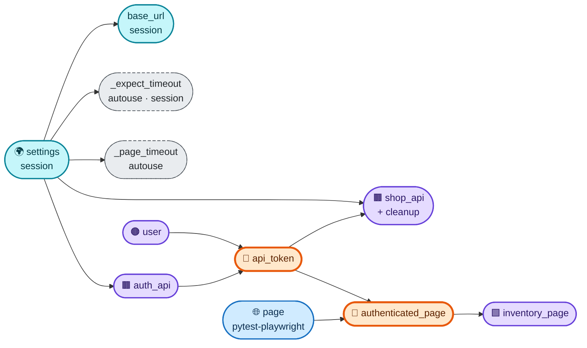

<details>
<summary>🖼️ Diagram nahi dikh raha? Image aur text</summary>

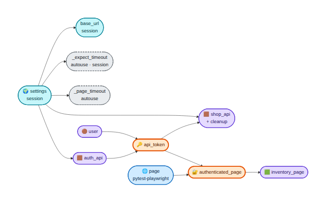

`settings → base_url, auth_api, shop_api, autouse timeouts` · `auth_api + user → api_token` · `api_token → shop_api, authenticated_page` · `page + api_token → authenticated_page → inventory_page`
</details>

**Kaise padhein:** arrow `A → B` = "**B ko A chahiye**". Dekho `api_token` ek **chabi** hai: `shop_api` (API calls) aur `authenticated_page` (browser) dono **ek hi token** use karte hain. Isi wajah se hybrid test me API ka data UI me dikhta hai.

## 11.3 CODE

**File: `tests/conftest.py`**
```python
"""FIXTURES layer: framework ke saare layers ko tests se jodta hai (wiring)."""
import json

import pytest
from playwright.sync_api import expect

from framework.api.auth_api import AuthApi
from framework.api.shop_api import ShopApi
from framework.config.settings import Settings, get_settings
from framework.data.users import User, get_user
from framework.pages.inventory_page import InventoryPage

_FOLDER_MARKERS = ("ui", "api", "hybrid", "architecture")


def pytest_collection_modifyitems(items):
    """Folder ke naam se marker apne aap: tests/ui/... -> @pytest.mark.ui"""
    for item in items:
        parts = set(item.path.parts)
        for name in _FOLDER_MARKERS:
            if name in parts:
                item.add_marker(getattr(pytest.mark, name))


# ---------- config ----------
@pytest.fixture(scope="session")
def settings() -> Settings:
    return get_settings()


@pytest.fixture(scope="session")
def base_url(settings: Settings) -> str:
    """pytest-playwright ka base_url fixture override: page.goto('/') isi URL par jaayega."""
    return settings.base_url


@pytest.fixture(scope="session", autouse=True)
def _expect_timeout(settings: Settings):
    expect.set_options(timeout=settings.ui_timeout_ms)


@pytest.fixture(autouse=True)
def _page_timeout(request, settings: Settings):
    if "page" in request.fixturenames:
        request.getfixturevalue("page").set_default_timeout(settings.ui_timeout_ms)


# ---------- data ----------
@pytest.fixture
def user() -> User:
    return get_user("standard")


# ---------- API ----------
@pytest.fixture
def auth_api(settings: Settings):
    client = AuthApi(settings.api_url, settings.api_timeout_s)
    yield client
    client.close()


@pytest.fixture
def api_token(auth_api: AuthApi, user: User) -> str:
    """Har test ko apna token (apna cart) => tests ek doosre se independent."""
    return auth_api.get_token(user)


@pytest.fixture
def shop_api(settings: Settings, api_token: str):
    client = ShopApi(settings.api_url, settings.api_timeout_s, token=api_token)
    yield client
    client.clear_cart()          # cleanup: test ne cart gandha kiya ho to saaf
    client.close()


# ---------- UI (logged in) ----------
@pytest.fixture
def authenticated_page(page, api_token: str):
    """Login UI se nahi, API se. Token browser ke localStorage me har navigation par daal do."""
    page.add_init_script(f"window.localStorage.setItem('token', {json.dumps(api_token)});")
    return page


@pytest.fixture
def inventory_page(authenticated_page) -> InventoryPage:
    return InventoryPage(authenticated_page).open()
```

## 11.4 LINE-BY-LINE

### 🔹 Auto markers (folder = marker)
| Line | Matlab | Kyun |
|---|---|---|
| `_FOLDER_MARKERS = ("ui", ...)` | Folder naam jinse marker lagana hai | Ek jagah list |
| `def pytest_collection_modifyitems(items)` | **Hook**: pytest tests ko collect karne ke baad ise bulata hai | Collected tests par kaam karne ka mauka |
| `parts = set(item.path.parts)` | Test file ke path ke saare hisse (`tests`, `ui`, `test_login.py`...) | Folder naam nikaalna |
| `item.add_marker(getattr(pytest.mark, name))` | `pytest.mark.ui` jaisa marker lagao | `pytest -m ui` kaam kare **bina har test par haath se likhe** |

**Kyun:** marker haath se lagana bhool jaate hain. Folder rule ek baar, galti ki gunjaish nahi.

### 🔹 Config fixtures
| Line | Matlab | Kyun |
|---|---|---|
| `@pytest.fixture(scope="session")` + `settings()` | Settings poore run me **ek baar** | Config badalti nahi, dobara banane ka fayda nahi |
| `base_url(settings)` | **pytest-playwright ke `base_url` fixture ko override** | `page.goto("/")` ab `settings.base_url` use karega. Page Objects ko environment ka pata nahi |
| `_expect_timeout` `autouse=True, scope="session"` | `expect` ka default timeout settings se | **Cross-cutting** kaam, har test me manga nahi jaata |
| `_page_timeout` `autouse` + `request.fixturenames` check | `page` ka default timeout set | Sirf unhe jinhe `page` chahiye (API tests me browser nahi khulega) |

### 🔹 Data
- `user()` function-scoped: har test ko fresh `User` object (immutable hai to safe).

### 🔹 API fixtures
| Line | Matlab | Kyun |
|---|---|---|
| `auth_api(settings)` + `yield client` + `client.close()` | Client banao, test ke baad **band** | Teardown fixture ka kaam |
| `api_token(auth_api, user)` | Token **har test ke liye naya** (function scope) | **Isolation:** token = alag session = alag cart. Do tests ka cart mix nahi hota. Session scope me ek token sab share karte to parallel/order me tests tootte |
| `shop_api(settings, api_token)` | API client **token ke saath** | Test me `shop_api.add_to_cart(...)` |
| `client.clear_cart()` after `yield` | **Cleanup**: cart saaf | Test ne data banaya to teardown me hata do |

### 🔹 UI fixtures
| Line | Matlab | Kyun |
|---|---|---|
| `authenticated_page(page, api_token)` | `page` + token dono maangta hai | **Wahi token jo `shop_api` ko mila** |
| `page.add_init_script("window.localStorage.setItem('token', ...)")` | Browser me har page load se **pehle** token localStorage me daalo | App token dekhta hai to login screen skip karke seedha inventory dikhata hai. **UI login ki zaroorat nahi** |
| `json.dumps(api_token)` | Token ko safe JS string literal banao | Quotes/special chars se script na toote |
| `return page` | Wahi `page` | Evidence plugin ka `page` hi hai (screenshot/trace kaam karte hain) |
| `inventory_page(authenticated_page)` | Page object banao aur `.open()` | Test ko seedha ready inventory page |

## 11.5 🔐 Login ke 3 tareeke: kaun sa kab?

| Tareeka | Kaise | Faida | Nuksan | Kab |
|---|---|---|---|---|
| **A. Har test UI se login** | `LoginPage.login(...)` | Real flow | Slow, flaky | Sirf **login feature** ka test |
| **B. API token + init script** (humne chuna) | Fixture 11.3 | Fast, har test ka apna session | App token ko localStorage se padhe tab | Zyadatar UI tests |
| **C. `storage_state` file reuse** | Ek baar login, state file save, sab tests us se | Sabse fast, cookie-sessions ke liye | **Shared session**: ek test ka logout/data doosre ko tod sakta hai | Read-only tests, cookie-based apps |

*(C maine is project me nahi chalaya. Pichhli guides me `storage_state` ka concept hai.)*

> [!WARNING]
> **B ka caveat:** `add_init_script` **har navigation par** token set karta hai. Agar test me **logout** karke login screen dekhna hai to is fixture ki jagah plain `page` use karo (nahi to refresh par phir login ho jaayega).

## 11.6 🤔 Scope decision table

| Fixture | Scope | Kyun |
|---|---|---|
| `settings`, `base_url`, `_expect_timeout` | `session` | Config nahi badalti |
| `user` | `function` | Chhota, immutable |
| `auth_api`, `api_token`, `shop_api` | `function` | **Isolation** (alag token/cart har test ka) |
| `authenticated_page`, `inventory_page` | `function` | Page har test ka naya |

**Rule of thumb:** *sabse chhota scope jo kaam kare.* Bada scope tabhi jab fixture **mehnga** ho (browser launch) aur **state na badalta** ho.

## 11.7 ⚠️ Fixture anti-patterns
- 🟥 **God fixture:** ek fixture me login + data + browser + setup. Chhote composable fixtures banao.
- 🟥 Fixture me **business assertions**.
- 🟥 Zyada `autouse`: naya banda samajh nahi pata kya chal raha hai. Sirf timeouts/evidence jaisa cross-cutting.
- 🟥 Shared mutable state session scope me.
- 🟥 Fixtures me hard-coded URL/password.
- 🟥 Cleanup test body me (assert fail hua to cleanup skip). **Teardown (`yield` ke baad)** me.

<details>
<summary>📝 <b>Practice 11</b></summary>

1. Sirf `api_token` ko `scope="session"` kar do, phir `user`, `auth_api`, `api_token` **teeno** ko. Kya hoga? (Ek test banao jo cart me item **chhodta** hai, aur ek jo **khaali** cart expect karta hai.)
2. `shop_api` ke cleanup (`clear_cart`) ko hata do. Kab problem aayegi?
3. Naya fixture `locked_user_api_token` kaise banayoge?

**Jawab:** (1) Sirf `api_token` session karne par `ScopeMismatch` error (session fixture function-scoped `auth_api` ko use nahi kar sakta). Teeno session karne par maine real me dekha: item chhodne wale test ke baad khaali-cart wala test fail hua (`Locator expected to have text '0', Actual value: 1`), jabki per-test token par dono pass. Kabhi order mehrbaan ho to serial me pass bhi ho jaata hai, isliye ye **order-dependent bug** khatarnak hai. (2) Jab fixtures scope bade hon ya same token par next test aaye; cleanup isolation ki guarantee deta hai. (3) `get_user("locked")` se alag fixture; par locked user ka login 423 deta hai, to `get_token` fail hoga. Isliye uska test **login ka negative test** hai (`auth_api.login(...)`), token fixture nahi.
</details>

---

<a id="part-12"></a>

# Part 12: 📊 Reporting plugin

## 12.1 WHY
Test fail hone par screenshot, URL, HTML, console aur network logs, video, trace **apne aap** report me aayein. Ye har test me likhna impossible hai. Ek **pytest plugin** isse kar deta hai.

## 12.2 Plugin kyun, `conftest.py` me kyun nahi?
| Option | Nuksan / Faida |
|---|---|
| Sab `conftest.py` me | conftest dumping ground ban jaata hai |
| **Alag module, `pytest_plugins` se load (humne chuna)** | Reuse (kisi aur project me bhi), conftest chhota, reporting ka code ek jagah |

## 12.3 CODE

**File: `framework/reporting/evidence.py`**
```python
"""REPORTING layer (pytest plugin): test fail ho to Allure me evidence attach karna."""
from pathlib import Path

import allure
import pytest


@pytest.fixture(autouse=True)
def _evidence(request):
    if "page" not in request.fixturenames:          # API/architecture test: browser mat kholo
        yield
        return

    page = request.getfixturevalue("page")
    request.node.page_for_report = page

    console_logs, network_errors = [], []
    request.node.console_logs = console_logs
    request.node.network_errors = network_errors

    page.on("console", lambda m: console_logs.append(f"[{m.type}] {m.text}"))
    page.on("pageerror", lambda e: console_logs.append(f"[pageerror] {e}"))
    page.on("requestfailed", lambda r: network_errors.append(f"FAILED {r.method} {r.url}"))
    page.on(
        "response",
        lambda r: network_errors.append(f"{r.status} {r.request.method} {r.url}")
        if r.status >= 400
        else None,
    )
    yield


@pytest.hookimpl(hookwrapper=True)
def pytest_runtest_makereport(item, call):
    outcome = yield
    report = outcome.get_result()
    setattr(item, f"rep_{report.when}", report)

    page = getattr(item, "page_for_report", None)
    if page is None:
        return

    if report.failed and report.when in ("setup", "call"):
        try:
            allure.attach(page.screenshot(full_page=True), name=f"screenshot-{report.when}",
                          attachment_type=allure.attachment_type.PNG)
            allure.attach(page.url, name="page-url", attachment_type=allure.attachment_type.TEXT)
            allure.attach(page.content(), name="page-html", attachment_type=allure.attachment_type.HTML)
            allure.attach("\n".join(item.console_logs) or "(no console output)",
                          name="browser-console", attachment_type=allure.attachment_type.TEXT)
            allure.attach("\n".join(item.network_errors) or "(no network errors)",
                          name="network-errors", attachment_type=allure.attachment_type.TEXT)
        except Exception as exc:
            print(f"[evidence] attach fail hua: {exc}")

    if report.when == "teardown":
        failed = any(
            getattr(item, f"rep_{phase}", None) is not None
            and getattr(item, f"rep_{phase}").failed
            for phase in ("setup", "call")
        )
        out_dir = item.funcargs.get("output_path")
        if failed and out_dir:
            for f in Path(out_dir).glob("*"):
                if f.suffix == ".webm":
                    allure.attach.file(str(f), name="video",
                                       attachment_type=allure.attachment_type.WEBM)
                elif f.name == "trace.zip":
                    allure.attach.file(str(f), name="playwright-trace.zip",
                                       attachment_type=allure.attachment_type.ZIP)
```

## 12.4 LINE-BY-LINE (short, poori detail pichhli Allure guide me)

| Hissa | Kya karta hai | Kyun |
|---|---|---|
| `_evidence` fixture, `if "page" not in request.fixturenames: yield; return` | API/architecture tests me kuch nahi | **Browser fizool me nahi khulega** |
| `page = request.getfixturevalue("page")`, `request.node.page_for_report = page` | Page ko test item par rakho | Hook baad me use kare; **fixture fail ho tab bhi** page mile |
| `page.on("console"/"pageerror"/"requestfailed"/"response")` | Browser events jama | Console aur network evidence |
| `@pytest.hookimpl(hookwrapper=True)` | pytest ke result banane ke **aas-paas** | Result dekh sake |
| `setattr(item, f"rep_{report.when}", report)` | setup/call/teardown ka result yaad | Teardown me pata chale ki upar fail hua |
| `report.failed and report.when in ("setup","call")` | Fail ke turant baad | **Page abhi zinda** hai: screenshot, URL, HTML, logs attach |
| `report.when == "teardown"` + `output_path` | Video/trace tab final hote hain jab context band | `.webm` aur `trace.zip` ko `attach.file` |

> [!NOTE]
> Ye wahi hook hai jo pichhli **Allure guide ke Part 5** me line-by-line explain hua hai. Yahan sirf ye dekho ki **architecture me iska ghar kahan hai**: 📊 Reporting layer, jo sirf ⬜ Core par depend karti hai (hum kisi framework layer ko import nahi karte, sirf `allure`/`pytest`).

**Report dekhne ke liye:** `pytest --alluredir=allure-results --clean-alluredir` phir `allure generate allure-results --clean` aur `allure open allure-report` (Allure guide dekho).

---

<a id="part-13"></a>

# Part 13: 🟦 Tests layer

## 13.1 Ek test kaisa dikhna chahiye

**Pehle 🟥 galat (ex_6 jaisa style):**
```python
def test_checkout(page):
    page.goto("https://www.saucedemo.com")
    page.get_by_placeholder("Username").fill("standard_user")
    page.get_by_placeholder("Password").fill("secret_sauce")
    page.get_by_role("button", name="Login").click()
    page.locator(".inventory_item").filter(has_text="Backpack").get_by_role("button").click()
    ...
```

**Ab 🟩 sahi (is architecture me):**
```python
def test_user_can_buy_two_products_through_ui(page, user):
    shopping = ShoppingFlow(page)
    inventory = shopping.login_as(user)
    done = shopping.buy(inventory, [BACKPACK.name, ONESIE.name])
    expect(done.heading).to_be_visible()
    assert done.order_id() > 1000
```

```diff
- page.goto("https://www.saucedemo.com")
- page.get_by_placeholder("Username").fill("standard_user")
- page.get_by_placeholder("Password").fill("secret_sauce")
- page.get_by_role("button", name="Login").click()
+ inventory = shopping.login_as(user)
```

**Test padhne me kahani jaisa:** *login karo → 2 product khareedo → thank-you dikhe → order id valid ho.* Locator, URL, password: **kuch nahi**.

## 13.2 AAA structure (Arrange · Act · Assert)

| Hissa | Is test me | Kaun deta hai |
|---|---|---|
| 🟦 **Arrange** (taiyari) | `page`, `user` | Fixtures |
| 🟧 **Act** (kaam) | `shopping.login_as(...)`, `shopping.buy(...)` | Flow |
| 🟩 **Assert** (verify) | `expect(done.heading)...`, `assert done.order_id() > 1000` | **Test khud** |

## 13.3 UI tests

**File: `tests/ui/test_login.py`**
```python
from dataclasses import replace

import allure
import pytest
from playwright.sync_api import expect

from framework.data.users import get_user
from framework.pages.inventory_page import InventoryPage
from framework.pages.login_page import LoginPage

_STANDARD = get_user("standard")

# Parametrize me sirf scenario ka NAAM jaata hai (password report/test-name me leak nahi hota)
LOGIN_ERROR_CASES = {
    "locked-user": (get_user("locked"), "Sorry, this user has been locked out."),
    "wrong-password": (replace(_STANDARD, password="wrong-password"), "Username and password do not match"),
    "unknown-user": (replace(_STANDARD, username="nobody"), "Username and password do not match"),
}


@allure.feature("Login")
@pytest.mark.smoke
def test_valid_user_reaches_inventory(page, user):
    LoginPage(page).open().login(user.username, user.password)
    InventoryPage(page).wait_until_loaded()


@allure.feature("Login")
@pytest.mark.regression
@pytest.mark.parametrize("scenario", LOGIN_ERROR_CASES)
def test_login_errors(page, scenario):
    bad_user, message = LOGIN_ERROR_CASES[scenario]
    login = LoginPage(page).open()
    login.login(bad_user.username, bad_user.password)
    expect(login.error).to_have_text(message)
```

**LINE-BY-LINE:**
- `from dataclasses import replace`: **copy with changes**. `replace(_STANDARD, password="wrong-password")` = standard user ki copy, bas password alag (`User` immutable hai, to ye safe tareeka).
- `LOGIN_ERROR_CASES = {...}`: scenario ka **naam → (user, expected message)**.
- `@pytest.mark.parametrize("scenario", LOGIN_ERROR_CASES)`: **sirf scenario ka naam** parametrize hua, password nahi. (Report me test naam `test_login_errors[wrong-password]`, password leak nahi.)
- `test_valid_user_reaches_inventory`: `LoginPage(page).open().login(...)` phir `InventoryPage(page).wait_until_loaded()`: "inventory dikha = login success".
- `expect(login.error).to_have_text(message)`: **test me business assertion**, page ka public `error` locator par.
- Markers: `smoke` (critical), `regression`. `ui` marker folder se apne aap.

**File: `tests/ui/test_inventory.py`**
```python
import allure
import pytest
from playwright.sync_api import expect

from framework.data.products import ALL_PRODUCTS, BACKPACK, ONESIE

# Expected order DATA se nikalta hai (copy-paste list nahi)
SORT_RULES = {
    "Name (A to Z)": lambda ps: sorted(ps, key=lambda p: p.name),
    "Name (Z to A)": lambda ps: sorted(ps, key=lambda p: p.name, reverse=True),
    "Price (low to high)": lambda ps: sorted(ps, key=lambda p: p.price),
    "Price (high to low)": lambda ps: sorted(ps, key=lambda p: p.price, reverse=True),
}


@allure.feature("Inventory")
@pytest.mark.regression
@pytest.mark.parametrize("label", SORT_RULES)
def test_sorting(inventory_page, label):
    expected_names = [p.name for p in SORT_RULES[label](ALL_PRODUCTS)]
    inventory_page.sort_by(label)
    expect(inventory_page.products.names).to_have_text(expected_names)


@allure.feature("Inventory")
@pytest.mark.smoke
def test_add_and_remove_updates_badge(inventory_page):
    badge = inventory_page.header.cart_badge
    expect(badge).to_have_text("0")

    inventory_page.products.add(BACKPACK.name)
    expect(badge).to_have_text("1")

    inventory_page.products.add(ONESIE.name)
    expect(badge).to_have_text("2")

    inventory_page.products.remove(BACKPACK.name)
    expect(badge).to_have_text("1")
```

**LINE-BY-LINE:**
- `SORT_RULES`: har sort option ka **rule** (lambda). Expected order **`ALL_PRODUCTS` data se calculate**, haath se list nahi. Naya product aaya to ek jagah.
- `test_sorting(inventory_page, label)`: fixture `inventory_page` = **pehle se logged-in (API token) aur page open**. Login ki line test me nahi (isi liye fast).
- `expect(inventory_page.products.names).to_have_text(expected_names)`: **list assertion** (ginti + order + retry).
- `badge = inventory_page.header.cart_badge`: **component ke Locator** ko variable me. Phir har step ke baad `expect(badge)...`.
- Test ka naam **kya hona chahiye** batata hai (`..._updates_badge`).

**File: `tests/ui/test_checkout.py`**
```python
import allure
import pytest
from playwright.sync_api import expect

from framework.data.products import BACKPACK, ONESIE
from framework.flows.shopping_flow import ShoppingFlow


@allure.feature("Checkout")
@pytest.mark.smoke
def test_user_can_buy_two_products_through_ui(page, user):
    shopping = ShoppingFlow(page)
    inventory = shopping.login_as(user)

    done = shopping.buy(inventory, [BACKPACK.name, ONESIE.name])

    expect(done.heading).to_be_visible()
    assert done.order_id() > 1000
```
- Ye **end-to-end UI** test hai (login bhi UI se, kyunki poora flow test karna hai).
- `assert done.order_id() > 1000`: value par plain `assert` theek hai kyunki `order_id()` ek baar padh leta hai, aur `OrderCompletePage` ke load hone ka wait pehle ho chuka (`checkout()` me).

**File: `tests/ui/test_bug_demo.py`**
```python
import allure
import pytest
from playwright.sync_api import expect

from framework.data.products import BACKPACK
from framework.pages.inventory_page import InventoryPage

pytestmark = pytest.mark.demo_failure   # ye test JAAN-BOOJH ke fail hota hai


@allure.feature("Failure evidence")
def test_cart_badge_in_bug_mode(authenticated_page, shop_api):
    shop_api.add_to_cart(BACKPACK.id)                                  # setup API se (fast)
    inventory = InventoryPage(authenticated_page).open(query="?bug=1") # app ka BUG mode
    expect(inventory.header.cart_badge).to_have_text("1", timeout=2000)
```
- `pytestmark = pytest.mark.demo_failure`: file ke saare tests par marker. Normal run me `-m "not demo_failure"` se hata do.
- Ye test **setup API se** karta hai, **verify UI me**. `?bug=1` par app badge ko galat (2) dikhata hai, to test fail aur evidence report me.

## 13.4 API tests

**File: `tests/api/test_cart_api.py`**
```python
import allure
import pytest

from framework.api.shop_api import ShopApi
from framework.data.products import BACKPACK, ONESIE


@allure.feature("Cart API")
def test_cart_requires_authentication(settings):
    anonymous = ShopApi(settings.api_url, settings.api_timeout_s)   # token nahi
    try:
        assert anonymous.get_cart().status_code == 401
    finally:
        anonymous.close()


@allure.feature("Cart API")
@pytest.mark.smoke
def test_add_product_to_cart(shop_api):
    response = shop_api.add_to_cart(BACKPACK.id)

    assert response.status_code == 201
    assert response.json() == {"items": [BACKPACK.id], "count": 1}


@allure.feature("Cart API")
def test_unknown_product_is_rejected(shop_api):
    assert shop_api.add_to_cart("does-not-exist").status_code == 404


@allure.feature("Checkout API")
def test_checkout_with_empty_cart_is_rejected(shop_api):
    response = shop_api.checkout()

    assert response.status_code == 400
    assert response.json()["error"] == "Cart is empty"


@allure.feature("Checkout API")
@pytest.mark.regression
def test_checkout_creates_order_and_empties_cart(shop_api):
    shop_api.add_to_cart(BACKPACK.id)
    shop_api.add_to_cart(ONESIE.id)

    checkout = shop_api.checkout()

    assert checkout.status_code == 201
    order_id = checkout.json()["order_id"]
    assert order_id in [o["order_id"] for o in shop_api.list_orders().json()]
    assert shop_api.get_cart().json()["count"] == 0
```

**LINE-BY-LINE (naye hisse):**
- `test_cart_requires_authentication(settings)`: **token ke bina** client banao. Ye wahi fixture-wala (token) nahi, isliye `settings` direct. `try/finally: close()` = cleanup.
- `shop_api` fixture: token ke saath ready client; teardown me cart saaf.
- Assertions **API tests me test me** (`status_code`, `json()`): client ne sirf bheja.
- Koi **browser nahi khulta** (`_evidence` ne `page` ki zaroorat nahi dekhi).

## 13.5 Hybrid tests (API + UI)

**File: `tests/hybrid/test_cart_hybrid.py`**
```python
import allure
import pytest
from playwright.sync_api import expect

from framework.data.products import BACKPACK, ONESIE
from framework.pages.cart_page import CartPage
from framework.pages.inventory_page import InventoryPage


@allure.feature("Hybrid")
@pytest.mark.smoke
def test_item_added_by_api_is_visible_in_ui(authenticated_page, shop_api):
    shop_api.add_to_cart(BACKPACK.id)                      # setup: API se (fast, stable)

    inventory = InventoryPage(authenticated_page).open()   # verify: UI se
    expect(inventory.header.cart_badge).to_have_text("1")
    expect(inventory.products.button_for(BACKPACK.name)).to_have_text("Remove")


@allure.feature("Hybrid")
@pytest.mark.regression
def test_order_placed_in_ui_is_stored_in_backend(authenticated_page, shop_api):
    shop_api.add_to_cart(ONESIE.id)                        # setup: API

    inventory = InventoryPage(authenticated_page).open()
    inventory.header.open_cart()
    done = CartPage(authenticated_page).wait_until_loaded().checkout()   # action: UI

    stored_ids = [o["order_id"] for o in shop_api.list_orders().json()]  # verify: API
    assert done.order_id() in stored_ids
```

**LINE-BY-LINE:**
- `(authenticated_page, shop_api)`: dono fixtures **ek hi token** use karte hain (Part 11 graph). Isliye API me jo cart bana wahi UI me dikhta hai.
- Test 1: **API se setup, UI se verify.** 30 second ki UI setup 30 millisecond me.
- `InventoryPage(authenticated_page).open()`: **API call ke baad** page kholte hain (pehle kholte to cart purana dikhta).
- Test 2: **UI se action, API se verify** (backend ne order sach me store kiya?). Ye UI-only test se zyada pakka sabut hai.
- `button_for(...)` Locator par `to_have_text("Remove")`: component ka public Locator.

> [!TIP]
> **Hybrid pattern ka naam:** *"Setup via API, act/verify via UI (ya ulta)."* Isse tests fast, stable aur sirf wahi cheez UI se test hoti hai jo UI ka kaam hai.

## 13.6 🧭 Tests ke rules

| ✅ Karo | ❌ Mat karo |
|---|---|
| Fixtures, flows, page objects use karo | Raw locator (`page.get_by_role`) tests me |
| Business assertion test me | `requests.get(...)` seedha test me |
| Scenario naam parametrize karo | Password parametrize karna |
| Test ka naam = behaviour | `test_1`, `test_login2` |
| Ek test = ek behaviour | Ek test me 5 alag cheezein |
| Data `framework/data` se | Literal `"Backpack"` har jagah |

<details>
<summary>📝 <b>Practice 13</b></summary>

1. `test_add_and_remove_updates_badge` me ek line badlo: `expect(badge).to_have_text("1")` ki jagah `assert badge.inner_text() == "1"`. Kya problem?
2. Ek naya hybrid test socho: "API se checkout kiya, UI me cart khaali dikhe". Kaun se fixtures lagenge?
3. Ek UI test me `page.get_by_role("button", name="Login")` likh do. Kaunsa rule toota? (Part 14 pakdega.)

**Jawab:** (1) `inner_text()` retry nahi karta, UI update hone se pehle padh ke flaky fail ho sakta hai; `expect` retry karta hai. (2) `authenticated_page`, `shop_api`; API me `add_to_cart` + `checkout`, phir `InventoryPage(...).open()` aur `expect(header.cart_badge).to_have_text("0")`. (3) "Tests me raw locator nahi" rule.
</details>

---

<a id="part-14"></a>

# Part 14: 🔴 Architecture fitness tests (rules ko code se enforce karo)

## 14.1 WHY
Rule banana aasan hai. **Rule ko tootne se rokna** mushkil hai, kyunki:
- Team ka naya member rule nahi jaanta.
- Deadline par log shortcut lete hain ("bas `requests` import kar leta hu").
- Code review me har galti nahi pakdi jaati.

**Fitness test** = ek normal pytest test jo **framework ke code ko khud scan karke** rules check karta hai. Rule toota to **CI red**.

## 14.2 Teen rules jo humne lagaye

| # | Rule | Kaise check |
|---|---|---|
| R1 | **Layer dependency**: kaun kisko import kare, kaun si library kis layer me allowed, absolute imports | `ast` se imports padhna |
| R2 | **Koi fixed sleep nahi** (`time.sleep`, `wait_for_timeout`) | Source text me search |
| R3 | **Tests me raw locator nahi** | Regex se `.locator(`/`.get_by_*(` |

## 14.3 CODE

**File: `tests/architecture/test_layering.py`**
```python
"""ARCHITECTURE FITNESS TESTS: framework ke rules ko code se enforce karo."""
import ast
import re
from pathlib import Path

import pytest

ROOT = Path(__file__).resolve().parents[2]
FRAMEWORK = ROOT / "framework"
TESTS = ROOT / "tests"

# Kaun kis layer ko import kar sakta hai (apni layer hamesha allowed hai)
ALLOWED_LAYERS = {
    "config": set(),
    "core": set(),
    "data": set(),
    "reporting": {"core"},
    "api": {"core", "data"},
    "components": {"core"},
    "pages": {"core", "components"},
    "flows": {"core", "components", "pages", "data"},
}

# Kis layer me kaunsi third-party library NAHI chalegi
FORBIDDEN_LIBS = {
    "config": {"playwright", "requests", "pytest", "allure"},
    "data": {"playwright", "requests", "pytest", "allure"},
    "api": {"playwright"},
    "components": {"requests", "pytest"},
    "pages": {"requests", "pytest"},
    "flows": {"requests", "pytest"},
}


def _framework_files():
    return sorted(p for p in FRAMEWORK.rglob("*.py") if p.name != "__init__.py")


def _imports(path: Path):
    """(module_name, relative_level) ki list."""
    tree = ast.parse(path.read_text(encoding="utf-8"))
    found = []
    for node in ast.walk(tree):
        if isinstance(node, ast.Import):
            found += [(alias.name, 0) for alias in node.names]
        elif isinstance(node, ast.ImportFrom):
            found.append((node.module or "", node.level))
    return found


@pytest.mark.parametrize("path", _framework_files(), ids=lambda p: str(p.relative_to(ROOT)))
def test_layer_dependency_rules(path):
    layer = path.relative_to(FRAMEWORK).parts[0]
    violations = []

    for module, level in _imports(path):
        if level > 0:
            violations.append(f"relative import (absolute use karo): {'.' * level}{module}")
            continue
        top = module.split(".")[0]
        if top == "tests":
            violations.append(f"framework ne tests import kiya: {module}")
        if top == "framework":
            target_layer = module.split(".")[1] if "." in module else ""
            if target_layer and target_layer != layer and target_layer not in ALLOWED_LAYERS[layer]:
                violations.append(f"layer '{layer}' ko layer '{target_layer}' import karne ki ijazat nahi: {module}")
        if top in FORBIDDEN_LIBS.get(layer, set()):
            violations.append(f"layer '{layer}' me library '{top}' allowed nahi: {module}")

    assert not violations, "\n".join(violations)


@pytest.mark.parametrize("path", _framework_files(), ids=lambda p: str(p.relative_to(ROOT)))
def test_no_fixed_sleeps_in_framework(path):
    source = path.read_text(encoding="utf-8")
    assert "time.sleep" not in source, "time.sleep mat use karo, condition par wait karo"
    assert "wait_for_timeout" not in source, "wait_for_timeout mat use karo, expect/auto-wait use karo"


def test_tests_do_not_use_raw_locators():
    """Locators sirf pages/components me. Tests ko page object ke methods/locators milte hain."""
    pattern = re.compile(r"\.(locator|get_by_\w+)\(")
    offenders = []
    for path in TESTS.rglob("test_*.py"):
        if "architecture" in path.parts:
            continue
        for number, line in enumerate(path.read_text(encoding="utf-8").splitlines(), start=1):
            if pattern.search(line):
                offenders.append(f"{path.relative_to(ROOT)}:{number}: {line.strip()}")
    assert not offenders, "Tests me raw locator mila:\n" + "\n".join(offenders)
```

## 14.4 LINE-BY-LINE

### Setup
| Line | Matlab |
|---|---|
| `ROOT = Path(__file__).resolve().parents[2]` | Ye file `tests/architecture/test_layering.py` hai. `.parents[2]` = project root (2 level upar) |
| `FRAMEWORK`, `TESTS` | Scan karne ke folders |
| `ALLOWED_LAYERS` | **Rule table**: har layer kise import kar sakti hai. (Part 3 ke rulebook ka code version) |
| `FORBIDDEN_LIBS` | Kis layer me kaunsi library mana. Jaise `pages` me `requests` nahi (UI layer ko HTTP nahi), `api` me `playwright` nahi |

### Helpers
| Line | Matlab |
|---|---|
| `_framework_files()` | `framework/` ki saari `.py` files (`__init__.py` chhod ke), sorted |
| `ast.parse(path.read_text())` | Python file ko **syntax tree** me badalna (code **chalaye bina** padhna) |
| `ast.walk(tree)` | Tree ke har node par ghoomna |
| `isinstance(node, ast.Import)` | `import x` wali lines |
| `isinstance(node, ast.ImportFrom)` | `from x import y` wali lines; `node.level > 0` matlab relative import (`from .x import`) |

### Test 1: layer rules
| Line | Matlab |
|---|---|
| `@pytest.mark.parametrize("path", _framework_files(), ids=...)` | **Har file ke liye alag test**: fail hone par file ka naam test ID me dikhta hai |
| `layer = path.relative_to(FRAMEWORK).parts[0]` | File kis layer ki hai (`pages`, `api`...): `framework/` ke baad pehla folder |
| `if level > 0: violation` | **Relative import mana** (absolute use karo): imports clear aur grep-able |
| `top == "tests"` | Framework **kabhi tests ko import nahi karta** (dependency rule ki jad) |
| `target_layer not in ALLOWED_LAYERS[layer]` | Ye layer us layer ko import kar sakti hai? Nahi to violation |
| `top in FORBIDDEN_LIBS.get(layer, set())` | Is layer me ye library mana |
| `assert not violations, "\n".join(violations)` | Saari violations ek saath batao (ek ek karke nahi) |

### Test 2: no sleeps
- `"time.sleep" not in source`: fixed sleep flaky tests ki jad hai. Framework me kahin nahi.

### Test 3: no raw locators in tests
- `re.compile(r"\.(locator|get_by_\w+)\(")`: `.locator(` ya `.get_by_xxx(` pakadta hai.
- `if "architecture" in path.parts: continue`: is test file ko skip (isme khud ye pattern likha hai).
- Offenders ki list `file:line: code` ke saath: seedha pata chalta hai kahan.

## 14.5 🔬 Maine violation daal ke dekha (real run)

**Violation 1:** `pages` me `requests` aur relative import.
```diff
  """PAGE: login page."""
+ import requests
+ from .cart_page import CartPage
  from playwright.sync_api import Locator, Page
```
```text
FAILED test_layer_dependency_rules[framework/pages/login_page.py]
AssertionError: layer 'pages' me library 'requests' allowed nahi: requests
                relative import (absolute use karo): .cart_page
```

**Violation 2:** `api` layer ne `pages` import kiya.
```diff
  """API layer: products, cart, checkout, orders."""
+ from framework.pages.login_page import LoginPage
```
```text
AssertionError: layer 'api' ko layer 'pages' import karne ki ijazat nahi: framework.pages.login_page
```

**Violation 3:** test me raw locator.
```diff
+ def test_bad(page):
+     page.get_by_role("button", name="Login").click()
```
```text
AssertionError: Tests me raw locator mila:
  tests/ui/test_bad.py:2: page.get_by_role("button", name="Login").click()
```

Teeno me test **fail hua** aur galti hatane par **35 architecture tests pass** hue.

## 14.6 🤔 Kyun ye approach?
| Option | Nuksan / Faida |
|---|---|
| Sirf documentation ("rules README me hain") | Koi padhta nahi, rules decay hote hain 🟥 |
| Code review par bharosa | Insaan thak jaata hai, har PR me nahi pakadta |
| Lint rules / `import-linter` jaise tools | Achha, par extra tool seekhna. Dependency list chhoti ho to **khud ka pytest test** simple (maine `import-linter` chalaya nahi) |
| **Fitness tests (humne chuna)** | Same pytest me, CI me apne aap, naye rule = chhota function |

## 14.7 ➕ Naya rule kaise jodo
1. Pehle **bolke likho**: "Pages me `time` module nahi."
2. Dhundho: imports se check hoga ya source text se?
3. Chhota test likho, **pehle violation daal ke fail dekho**, phir hatao.

<details>
<summary>📝 <b>Practice 14</b></summary>

1. Rule jodo: `framework/data` me `os` ke alawa koi aur framework layer import nahi. (Ye already `ALLOWED_LAYERS["data"] = set()` se ho raha hai. Kaise confirm karoge?)
2. `pages` me `print(` mana karne ka rule likho (source-text based).
3. Kya architecture test ko tests ke saath chalana sahi hai ya alag job me?

**Jawab:** (1) `framework/data/users.py` me `from framework.pages.login_page import LoginPage` daalo, test fail hona chahiye. (2) `assert "print(" not in source` jaisa test, `pages` ki files par parametrize. (3) Dono theek: chhote hain (0.06s), to **sabse pehle** chalao taaki structure toota ho to jaldi pata chale (`pytest -m architecture`).
</details>


---

<a id="part-15"></a>

# Part 15: Decision guide aur anti-patterns

## 15.1 🧭 "Ye code kahan jaayega?": decision flowchart

Naya code likhne se pehle ye sawaal puchho. Upar se shuru karo, Haan/Nahi follow karo.

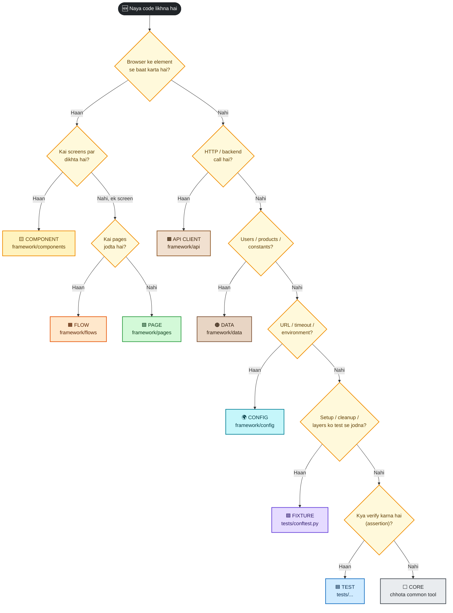

<details>
<summary>🖼️ Diagram nahi dikh raha? Image dekho</summary>

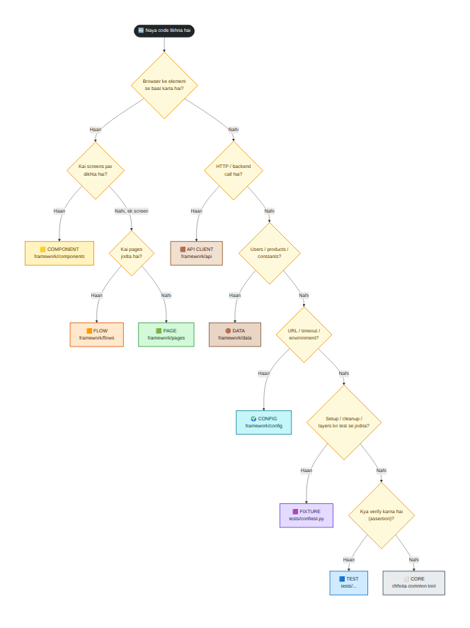
</details>

## 15.2 📇 Quick reference: cheez → ghar

| Cheez | Ghar |
|---|---|
| `staging` ka URL | 🌍 Config |
| `"standard_user"` / password | 🟤 Data (password env se) |
| `Backpack` ka price | 🟤 Data |
| `[data-testid=cart-count]` locator | 🟨 Component (Header) |
| Login form ke fields | 🟩 Page (LoginPage) |
| "Login karo → 2 item khareedo" | 🟧 Flow |
| `POST /api/login` | 🟫 API client |
| "Test ke liye token banao" | 🟪 Fixture |
| "Test ke baad cart saaf karo" | 🟪 Fixture teardown |
| "Cart badge 1 hona chahiye" | 🟦 Test (assertion) |
| Allure screenshot on failure | 📊 Reporting plugin |
| Logger banana | ⬜ Core |
| Ek jaisa `open()` har page par | ⬜ Core (BasePage) |
| "Kaun kisko import kare" ka rule | 🟦 Architecture test |

## 15.3 🟥 Anti-pattern gallery (click karke dekho)

<details>
<summary><b>▶ 🟥 1. Locators tests me</b></summary>

```diff
- def test_x(page):
-     page.get_by_role("button", name="Login").click()
+ def test_x(page, user):
+     LoginPage(page).open().login(user.username, user.password)
```
**Symptom:** UI badla, 30 tests toote. **Fix:** locators Page Object me. **Rokna:** Part 14 ka R3.
</details>

<details>
<summary><b>▶ 🟥 2. URL / password code me</b></summary>

```diff
- page.goto("https://qa.shop.example.com/login")
- page.fill("#password", "Pa$$w0rd")
+ LoginPage(page).open()                       # base_url config se
+ login.login(user.username, user.password)   # password env se
```
**Symptom:** env badalna = code badalna, password leak. **Fix:** Config + Data layer.
</details>

<details>
<summary><b>▶ 🟥 3. Har test me UI login</b></summary>

```diff
- def test_a(page):
-     login_via_ui(page)     # 5 sec
-     ...
+ def test_a(inventory_page):   # token API se, ms me
+     ...
```
**Symptom:** suite slow, flaky (login page ki problem sab tests ko tod de). **Fix:** `authenticated_page` fixture. Login UI sirf login ke tests me.
</details>

<details>
<summary><b>▶ 🟥 4. God class (BasePage me 50 methods)</b></summary>

**Symptom:** har page inherit karta hai, ek change sab ko hilata hai. **Fix:** BasePage me sirf `open`/`wait_until_loaded`. Baaki components/composition.
</details>

<details>
<summary><b>▶ 🟥 5. `time.sleep` / `wait_for_timeout`</b></summary>

**Symptom:** kabhi pass kabhi fail, ya slow. **Fix:** `expect(...)` aur auto-wait. **Rokna:** Part 14 ka R2.
</details>

<details>
<summary><b>▶ 🟥 6. Shared state / order-dependent tests (maine real me dekha)</b></summary>

Maine ek test banaya jo cart me item **chhod** deta hai aur doosra jo cart **khaali** expect karta hai:
- **Per-test token (humara design):** dono pass.
- **Session-shared token:** doosra test fail: `Locator expected to have text '0', Actual value: 1`.

**Symptom:** test akela pass, suite me fail (ya order badalne par). **Fix:** har test ka apna data/token, cleanup teardown me.
</details>

<details>
<summary><b>▶ 🟥 7. Pages me `requests` / API layer me `playwright`</b></summary>

**Symptom:** layers mix, circular imports. **Fix:** dependency rule. **Rokna:** Part 14 ka R1.
</details>

<details>
<summary><b>▶ 🟥 8. conftest dumping ground</b></summary>

Root conftest me 600 lines: hooks, fixtures, helpers. **Fix:** root = plugins register; fixtures `tests/conftest.py`; hooks/evidence plugin module me.
</details>

<details>
<summary><b>▶ 🟥 9. Business assertions pages / flows me</b></summary>

**Symptom:** ek page ka method sirf ek test ke liye "theek" (alag expectation ke liye naya method). **Fix:** page Locator expose kare, test `expect` kare. Page me sirf readiness wait.
</details>

<details>
<summary><b>▶ 🟥 10. Pehle se over-engineering</b></summary>

10 tests ke liye 8 layers, factories, interfaces. **Fix:** Level ke hisaab se (Part 16). Rule of three.
</details>

## 15.4 🧪 Quiz: "Ye code kahan jaayega?" (pehle socho, phir kholo)

<details>
<summary><b>1.</b> <code>def checkout_total(prices): return sum(prices)</code> (UI se padhe hue prices ka jod)</summary>

Agar sirf ek test me use hota hai: **test me** (ya local helper). Kai tests me: ⬜ Core ya 🟧 Flow ka chhota helper. **Abhi mat abstract karo.**
</details>

<details>
<summary><b>2.</b> <code>TIMEOUT = 30</code> (API ka timeout)</summary>

🌍 Config (`api_timeout_s`).
</details>

<details>
<summary><b>3.</b> "Checkout ke baad order confirmation ka number padhna"</summary>

🟩 Page (`OrderCompletePage.order_id()`): UI se **padhna** page ka kaam hai.
</details>

<details>
<summary><b>4.</b> "Order sach me DB/API me store hua?" verify</summary>

🟦 Test: `shop_api.list_orders()` (🟫 API client) se data lo, **assert test me**.
</details>

<details>
<summary><b>5.</b> Search bar jo 4 pages par hai</summary>

🟨 Component (`SearchBar`).
</details>

<details>
<summary><b>6.</b> "Login karke cart me 3 items daalna" 15 tests me chahiye</summary>

Agar UI se zaroori hai: 🟧 Flow. Agar sirf setup hai: 🟪 Fixture (API se) **behtar**.
</details>

<details>
<summary><b>7.</b> Failure par Slack message bhejna</summary>

📊 Reporting/notification plugin (framework me alag module), conftest me nahi.
</details>

<details>
<summary><b>8.</b> Test data me random unique email banana</summary>

🟤 Data layer ka factory/helper (ya fixture jo us helper ko call kare).
</details>

---

<a id="part-16"></a>

# Part 16: Roadmap aur tumhare `ex_6` ka migration

## 16.1 📈 Architecture ek baar me nahi banta, **badhta** hai

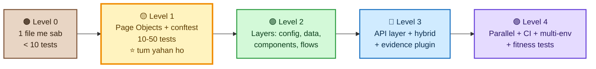

<details>
<summary>🖼️ Diagram nahi dikh raha? Image dekho</summary>

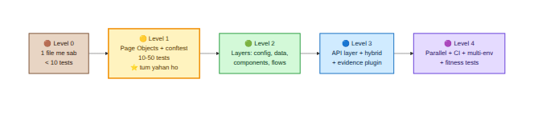
</details>

**Agle level par kab jaana hai (triggers):**

| Dikha ye | Matlab | Karo |
|---|---|---|
| Ek element 3 pages par | Repeat | 🟨 Component |
| Same 6-8 line sequence 3 tests me | Repeat | 🟧 Flow |
| Hard-coded literals 10+ jagah | Data scatter | 🟤 Data layer |
| 2+ environments | URL hard-coded | 🌍 Config |
| UI setup slow/flaky, API available | Wrong tool for setup | 🟫 API + fixtures |
| Failures samajh nahi aate | Evidence nahi | 📊 Reporting plugin |
| Team ke log rules tod rahe | Rule sirf docs me | 🟦 Fitness tests |
| Suite 10+ minute | Serial | Parallel + independent tests |

> [!IMPORTANT]
> **Trigger ke bina layer mat banao.** Har layer ek **kharcha** hai (seekhna, maintain karna). Jab dard dikhe tab dawa.

## 16.2 🔍 Tumhara `ex_6` kahan khada hai (pichhle review ke aadhar par)

Pichhle review me jo maine tumhari repo me dekha tha:

| ex_6 me | Level | Is architecture me ghar |
|---|---|---|
| 4 Page Objects (login, inventory, cart, checkout) | Level 1 ✅ | 🟩 `framework/pages/` |
| `conftest.py` me `auth_page` fixture jo UI login karta hai | Level 1 | 🟪 Fixture (UI login wala tareeka A; sirf login test ke liye) |
| Base URL kai jagah hard-coded | Level 1 ⚠️ | 🌍 Config (`base_url`) |
| `goto` kahin nahi (site khulti nahi) | 🐞 bug | `BasePage.open()` |
| Credentials aur product naam strings me | Level 1 ⚠️ | 🟤 Data layer |
| Cart badge/header locators page me | Level 1 | 🟨 Header component |
| Allure/evidence nahi | | 📊 Reporting plugin |
| `pytest.ini`, `requirements.txt`, README khali/nahi | | Part 4 |

> [!NOTE]
> **Dhyan:** SauceDemo ek **frontend demo** hai. Mujhe pata nahi (maine check nahi kiya) ki uske paas test-friendly **backend API** hai ya nahi. Agar nahi hai to **API layer aur hybrid tests abhi mat banao** (YAGNI). Wo practice is guide ke demo app par karo, aur SauceDemo par Levels 1-2 + reporting pakke karo.

## 16.3 🚚 Migration plan (chhote, safe steps)

> [!WARNING]
> **Rule:** har step ke baad `pytest` **green** hona chahiye. Ek saath sab badloge to kuch toota to pata nahi chalega kya.

- [ ] **Step 0: Pehle green karo.** ex_6 ki tests chalti hon (goto, DoD pura). Bina green base ke refactor mat karo.
- [ ] **Step 1: `framework/` package banao** aur apne pages ko **jaise ke taise** wahan le jao (behaviour nahi badalna). Imports theek karo.
- [ ] **Step 2: `BasePage`** (path, `open()`, `loaded_locator`, `wait_until_loaded()`). Pages ko extend karao.
- [ ] **Step 3: Component** nikaalo: header/cart badge jo kai pages par hai.
- [ ] **Step 4: Config:** `base_url` ko `pytest.ini`/env me; code se URLs hatao.
- [ ] **Step 5: Data layer:** users aur products ko dataclasses/constants me; strings hatao.
- [ ] **Step 6: Tests se raw locators** hatao. Page Object ke methods use karo.
- [ ] **Step 7: Architecture test** (Part 14) jodo. Pehle jaan-boojh ke ek violation se fail dekho.
- [ ] **Step 8: Evidence plugin + Allure** (pichhli guide).
- [ ] **Step 9 (jab dard ho):** Flow, API layer, hybrid tests.
- [ ] **Step 10:** CI par chalao.

## 16.4 🧪 Refactor Labs (khud karo; solution mai nahi de raha)

| Lab | Task | ✅ Accept jab |
|---|---|---|
| **RL-1** | `ex_6` ko green karo (Step 0) | `pytest` me sab pass, har fix ka note |
| **RL-2** | Step 1-2: framework package + BasePage | Tests green, `open()` har page par same |
| **RL-3** | Step 3: Header component | Cart badge ka locator **ek** file me (grep karke dikhao) |
| **RL-4** | Step 4-5: Config + Data | Repo me `saucedemo.com` URL string sirf **ek** jagah, user/product strings sirf data layer me |
| **RL-5** | Step 6-7: raw locators hatao + architecture test | `grep -r "get_by_" tests/` khaali (architecture folder chhod ke), fitness tests pass |
| **RL-6** | Ek **jaan-boojh ka violation** daalo, test fail dekho, hatao | Failure message screenshot/paste |

Jab ek lab ho jaye to mujhe code + `pytest` output bhejo; strict review milega (GOOD / WRONG / RISK / IMPROVEMENT).

## 16.5 🎓 Self-assessment (apni design skill)

| Sawaal | ☐ |
|---|---|
| Kya main bata sakta hu ki ek change (jaise locator) kitni files badalta hai? | ☐ |
| Kya main har folder ka **kaaran** bata sakta hu? | ☐ |
| Kya mere pas ek **dependency diagram** hai? | ☐ |
| Kya rules tests se enforce hote hain? | ☐ |
| Kya naya banda 30 minute me "kahan kya" samajh sakta hai? | ☐ |
| Kya mai ek layer **hata** sakta hu (YAGNI) aur kyun? | ☐ |

---

<a id="part-17"></a>

# Part 17: Interview Q&A

Format: **simple English → strong 1–2 minute answer → keywords.** Pehle upar ke concepts samjho, phir bolna practise karo. Sirf wahi bolo jo tumne sach me kiya ho.

<details>
<summary><b>Q1. Explain your automation framework architecture.</b></summary>

- *Simple:* It is a layered framework: tests on top, then fixtures, flows, page objects and components, API clients, and core utilities, with config and data separated.
- *Strong:* "I organise it by reason to change. Locators live only in page objects and shared components like the header. Multi-page business actions are flows. Backend calls are API clients that tests use for fast setup and verification. Config such as URLs and timeouts comes from environment variables through one settings object, and test data lives in a data layer. Fixtures wire these together, with a function-scoped token per test for isolation. Dependencies only point downward, and I enforce that with an architecture test that scans imports, so the structure doesn't decay."
- *Keywords:* layers, dependency rule, composition, API for setup, isolation, fitness test.
</details>

<details>
<summary><b>Q2. Why layers? What is the dependency rule?</b></summary>

- *Simple:* So a change in one area doesn't break others.
- *Strong:* "Each layer changes for a different reason: UI locators, backend endpoints, environments, requirements. If layers can import each other freely, one change ripples everywhere. The rule is that a layer may only depend on layers below it. For example pages must not import API clients, and the framework must never import tests."
- *Keywords:* separation of concerns, reason to change, circular imports.
</details>

<details>
<summary><b>Q3. Page vs Component vs Flow?</b></summary>

- *Simple:* A page is one screen, a component is a part shared across screens, a flow is a business action across pages.
- *Strong:* "If a piece of UI appears on several screens, like a header, it's a component that pages compose. A page object owns one screen's locators and actions. A flow chains several pages into a business action like 'buy these products'. Flows don't assert; tests do."
- *Keywords:* composition, reuse, thin flows.
</details>

<details>
<summary><b>Q4. How do you handle login and test data efficiently?</b></summary>

- *Simple:* Log in through the API and inject the token into the browser.
- *Strong:* "A fixture gets a token from the login endpoint and adds an init script that puts it in localStorage, so UI tests start already authenticated without driving the login screen. The same token is used by an API client for setup and cleanup, so the data I create is exactly what the UI shows. Each test gets its own token, so carts don't leak between tests. UI login is tested only in login tests."
- *Keywords:* API setup, token, isolation, hybrid testing.
</details>

<details>
<summary><b>Q5. How do you decide fixture scope?</b></summary>

- *Simple:* The smallest scope that works.
- *Strong:* "Immutable, expensive or configuration-like things such as settings can be session scoped. Anything that holds state a test can change, like a user's cart or token, is function scoped. I tried sharing one token and an order-dependent test failed, because one test left an item that the next expected to be empty."
- *Keywords:* scope, isolation, teardown cleanup, order dependence.
</details>

<details>
<summary><b>Q6. How do you stop the framework from rotting?</b></summary>

- *Simple:* Automated rules, not just documentation.
- *Strong:* "I wrote architecture tests that parse the framework's imports with `ast` and fail when a layer imports something it shouldn't, when a forbidden library appears in a layer, when fixed sleeps are used, or when tests contain raw locators. They run in CI, so rule violations fail the build instead of relying on review."
- *Keywords:* fitness functions, `ast`, CI gate.
</details>

<details>
<summary><b>Q7. Drawbacks of Page Object Model?</b></summary>

- *Simple:* It can become heavy or turn into big classes.
- *Strong:* "Big god-page classes, assertions hidden inside pages, and an abstraction layer around every Playwright call add cost without value. I keep pages thin, expose locators so tests use retrying `expect`, and put shared parts in components. I also don't build layers before there's repetition."
- *Keywords:* god class, thin pages, YAGNI.
</details>

<details>
<summary><b>Q8. How do you support multiple environments?</b></summary>

- *Simple:* One settings object driven by environment variables.
- *Strong:* "A frozen settings dataclass reads TEST_ENV and optional overrides like BASE_URL. An unknown environment raises immediately, so tests can't accidentally run against the wrong target. Secrets such as passwords come from environment variables and never from the repo."
- *Keywords:* config over code, fail fast, secrets.
</details>

<details>
<summary><b>Q9. Inheritance or composition in page objects?</b></summary>

- *Simple:* Composition for reuse, inheritance only for a small shared template.
- *Strong:* "My pages extend a small base class that provides open and a readiness wait. Reusable UI pieces like the header are separate component objects that pages hold. That avoids deep inheritance trees where changing a base class affects everything."
- *Keywords:* template method, has-a vs is-a.
</details>

<details>
<summary><b>Q10. What do you automate at API level vs UI level?</b></summary>

- *Simple:* Business rules at API, user journeys at UI.
- *Strong:* "Validation, status codes, permissions and data rules are faster and more stable at the API. The UI suite covers a small number of critical journeys and things only the UI can break. Hybrid tests use the API for setup or verification so each test only exercises through the UI what the UI is responsible for."
- *Keywords:* test pyramid, hybrid, stability.
</details>

---

<a id="appendix-a"></a>

# Appendix A: Demo app (Application Under Test)

> [!NOTE]
> Ye app **framework ka hissa nahi** hai. Ye wo chhota shop hai jise hum test karte hain (login, products, cart, checkout + JSON API). Ise `app_under_test/` me rakho.

**File: `app_under_test/server.py`**
```python
"""Chhota demo shop: static UI + JSON API. Ye FRAMEWORK ka hissa NAHI, ye 'application under test' hai."""
import json
import secrets
import threading
from http.server import BaseHTTPRequestHandler, ThreadingHTTPServer
from pathlib import Path
from urllib.parse import urlparse

STATIC_DIR = Path(__file__).parent / "static"

PRODUCTS = [
    {"id": "backpack", "name": "Backpack", "price": 29.99},
    {"id": "bike-light", "name": "Bike Light", "price": 9.99},
    {"id": "onesie", "name": "Onesie", "price": 7.99},
]
USERS = {"standard_user": "secret_sauce", "locked_user": "secret_sauce"}
LOCKED = {"locked_user"}


class State:
    def __init__(self):
        self.lock = threading.Lock()
        self.tokens = {}      # token -> username
        self.carts = {}       # token -> [product ids]
        self.orders = []      # [{order_id, user, items}]
        self.next_order_id = 1001


class Handler(BaseHTTPRequestHandler):
    state = State()

    def log_message(self, *args):
        pass

    # ---------- helpers ----------
    def _send(self, status, payload=None, content_type="application/json"):
        body = b"" if payload is None else (
            payload if isinstance(payload, bytes) else json.dumps(payload).encode())
        self.send_response(status)
        self.send_header("Content-Type", content_type)
        self.send_header("Content-Length", str(len(body)))
        self.end_headers()
        self.wfile.write(body)

    def _body(self):
        length = int(self.headers.get("Content-Length", 0))
        if not length:
            return {}
        try:
            return json.loads(self.rfile.read(length))
        except json.JSONDecodeError:
            return {}

    def _token(self):
        auth = self.headers.get("Authorization", "")
        token = auth.removeprefix("Bearer ").strip() if auth.startswith("Bearer ") else None
        return token if token in self.state.tokens else None

    def _cart_payload(self, token):
        items = self.state.carts.setdefault(token, [])
        return {"items": list(items), "count": len(items)}

    # ---------- routes ----------
    def do_GET(self):
        path = urlparse(self.path).path
        if path in ("/", "/index.html"):
            return self._send(200, (STATIC_DIR / "index.html").read_bytes(), "text/html; charset=utf-8")
        if path == "/api/products":
            return self._send(200, PRODUCTS)
        token = self._token()
        if path == "/api/cart":
            return self._send(200, self._cart_payload(token)) if token else self._send(401, {"error": "Unauthorized"})
        if path == "/api/orders":
            if not token:
                return self._send(401, {"error": "Unauthorized"})
            user = self.state.tokens[token]
            return self._send(200, [o for o in self.state.orders if o["user"] == user])
        self._send(404, {"error": "Not found"})

    def do_POST(self):
        path = urlparse(self.path).path
        data = self._body()
        with self.state.lock:
            if path == "/api/login":
                user, pwd = data.get("username"), data.get("password")
                if user in LOCKED:
                    return self._send(423, {"error": "Sorry, this user has been locked out."})
                if USERS.get(user) != pwd or user is None:
                    return self._send(401, {"error": "Username and password do not match"})
                token = secrets.token_hex(8)
                self.state.tokens[token] = user
                self.state.carts[token] = []
                return self._send(200, {"token": token})
            token = self._token()
            if not token:
                return self._send(401, {"error": "Unauthorized"})
            if path == "/api/cart":
                pid = data.get("product_id")
                if pid not in {p["id"] for p in PRODUCTS}:
                    return self._send(404, {"error": "Unknown product"})
                cart = self.state.carts.setdefault(token, [])
                if pid not in cart:
                    cart.append(pid)
                return self._send(201, self._cart_payload(token))
            if path == "/api/checkout":
                cart = self.state.carts.setdefault(token, [])
                if not cart:
                    return self._send(400, {"error": "Cart is empty"})
                order = {"order_id": self.state.next_order_id,
                         "user": self.state.tokens[token], "items": list(cart)}
                self.state.next_order_id += 1
                self.state.orders.append(order)
                self.state.carts[token] = []
                return self._send(201, {"order_id": order["order_id"], "items": order["items"]})
        self._send(404, {"error": "Not found"})

    def do_DELETE(self):
        path = urlparse(self.path).path
        with self.state.lock:
            token = self._token()
            if not token:
                return self._send(401, {"error": "Unauthorized"})
            if path == "/api/cart":
                self.state.carts[token] = []
                return self._send(200, self._cart_payload(token))
            if path.startswith("/api/cart/"):
                pid = path.rsplit("/", 1)[-1]
                cart = self.state.carts.setdefault(token, [])
                if pid in cart:
                    cart.remove(pid)
                return self._send(200, self._cart_payload(token))
        self._send(404, {"error": "Not found"})


def create_server(host="127.0.0.1", port=0):
    return ThreadingHTTPServer((host, port), Handler)


if __name__ == "__main__":
    server = create_server(port=8000)
    print(f"ShopDemo chal raha hai: http://127.0.0.1:{server.server_port}")
    server.serve_forever()
```

**API summary:**

| Endpoint | Kaam | Status |
|---|---|---|
| `POST /api/login` | token deta hai | 200 / 401 (galat) / 423 (locked) |
| `GET /api/products` | products list | 200 |
| `GET /api/cart` | cart (token chahiye) | 200 / 401 |
| `POST /api/cart` `{product_id}` | cart me add | 201 / 404 (unknown) / 401 |
| `DELETE /api/cart` | cart saaf | 200 |
| `DELETE /api/cart/<id>` | ek item hatao | 200 |
| `POST /api/checkout` | order banao | 201 / 400 (empty) |
| `GET /api/orders` | apne orders | 200 |

**File: `app_under_test/static/index.html`**
```html
<!DOCTYPE html>
<html lang="en">
<head>
  <meta charset="utf-8">
  <title>ShopDemo</title>
  <style>
    body { font-family: Arial, sans-serif; margin: 24px; }
    .hidden { display: none; }
    .error { color: #b00020; margin-top: 8px; }
    .card { border: 1px solid #ccc; padding: 10px; margin: 8px 0; width: 320px; }
    .badge { background: #e8590c; color: #fff; border-radius: 10px; padding: 2px 8px; }
    nav { margin-bottom: 16px; }
  </style>
</head>
<body>
  <h1>ShopDemo</h1>

  <section id="login-view" class="hidden">
    <h2>Login</h2>
    <label>Username <input id="username" placeholder="Username"></label><br><br>
    <label>Password <input id="password" type="password" placeholder="Password"></label><br><br>
    <button id="login-btn">Login</button>
    <div id="login-error" class="error" role="alert"></div>
  </section>

  <section id="inventory-view" class="hidden">
    <nav>
      <span>Cart: <span id="cart-count" class="badge" data-testid="cart-count">0</span></span>
      <button id="open-cart">View Cart</button>
      <button id="logout">Logout</button>
    </nav>
    <h2>Products</h2>
    <label>Sort
      <select id="sort" data-testid="sort">
        <option value="az">Name (A to Z)</option>
        <option value="za">Name (Z to A)</option>
        <option value="lohi">Price (low to high)</option>
        <option value="hilo">Price (high to low)</option>
      </select>
    </label>
    <div id="products"></div>
  </section>

  <section id="cart-view" class="hidden">
    <h2>Your Cart</h2>
    <ul id="cart-items"></ul>
    <button id="back">Continue Shopping</button>
    <button id="checkout">Checkout</button>
  </section>

  <section id="done-view" class="hidden">
    <h2>Thank you for your order!</h2>
    <p data-testid="order-id" id="order-id"></p>
  </section>

<script>
  const BUG = new URLSearchParams(location.search).get("bug") === "1";
  const $ = (id) => document.getElementById(id);
  let products = [], cart = [], sortMode = "az";

  const api = async (method, path, body) => {
    const token = localStorage.getItem("token");
    const res = await fetch(path, {
      method,
      headers: { "Content-Type": "application/json", ...(token ? { Authorization: "Bearer " + token } : {}) },
      body: body ? JSON.stringify(body) : undefined,
    });
    let data = null;
    try { data = await res.json(); } catch (e) {}
    return { status: res.status, data };
  };

  const show = (view) => {
    ["login", "inventory", "cart", "done"].forEach(v => $(v + "-view").classList.toggle("hidden", v !== view));
    location.hash = view;
  };

  function renderProducts() {
    const list = [...products];
    if (sortMode === "az") list.sort((a, b) => a.name.localeCompare(b.name));
    if (sortMode === "za") list.sort((a, b) => b.name.localeCompare(a.name));
    if (sortMode === "lohi") list.sort((a, b) => a.price - b.price);
    if (sortMode === "hilo") list.sort((a, b) => b.price - a.price);
    $("products").innerHTML = list.map(p => `
      <div class="card" data-testid="product">
        <strong class="name">${p.name}</strong>
        <span class="price">$${p.price.toFixed(2)}</span><br><br>
        <button data-id="${p.id}">${cart.includes(p.id) ? "Remove" : "Add to cart"}</button>
      </div>`).join("");
    if (BUG && cart.length) console.error("BUG MODE: cart count is inflated");
    $("cart-count").textContent = String(cart.length + (BUG && cart.length ? 1 : 0));
  }

  async function loadInventory() {
    const [p, c] = await Promise.all([api("GET", "/api/products"), api("GET", "/api/cart")]);
    if (c.status === 401) { localStorage.removeItem("token"); show("login"); return; }
    products = p.data; cart = c.data.items;
    show("inventory"); renderProducts();
  }

  $("login-btn").onclick = async () => {
    const res = await api("POST", "/api/login", { username: $("username").value, password: $("password").value });
    if (res.status !== 200) { $("login-error").textContent = res.data.error; return; }
    $("login-error").textContent = "";
    localStorage.setItem("token", res.data.token);
    await loadInventory();
  };
  $("products").onclick = async (e) => {
    const id = e.target.dataset && e.target.dataset.id;
    if (!id) return;
    const res = cart.includes(id) ? await api("DELETE", "/api/cart/" + id) : await api("POST", "/api/cart", { product_id: id });
    cart = res.data.items; renderProducts();
  };
  $("sort").onchange = (e) => { sortMode = e.target.value; renderProducts(); };
  $("open-cart").onclick = () => {
    $("cart-items").innerHTML = cart.map(id => `<li>${products.find(p => p.id === id).name}</li>`).join("");
    show("cart");
  };
  $("back").onclick = () => show("inventory");
  $("checkout").onclick = async () => {
    const res = await api("POST", "/api/checkout");
    if (res.status !== 201) return;
    $("order-id").textContent = "Order #" + res.data.order_id;
    cart = []; show("done");
  };
  $("logout").onclick = () => { localStorage.removeItem("token"); cart = []; show("login"); };

  localStorage.getItem("token") ? loadInventory() : show("login");
</script>
</body>
</html>
```

**App ka behaviour (framework ke liye zaroori):** token `localStorage` me `token` key se; page load par token ho to seedha inventory; `?bug=1` par cart badge me +1 (jaan-boojh ka bug).

<a id="appendix-b"></a>

# Appendix B: Lab-only helper

**File: `lab_support/local_app.py`**
```python
"""LAB ONLY: demo app ko local start karta hai. Asli project me ye file nahi hogi (BASE_URL set hoga)."""
import os
import sys
import threading
from pathlib import Path


def pytest_configure(config):
    if os.environ.get("BASE_URL"):
        return   # tum kisi asli environment ko test kar rahe ho

    sys.path.insert(0, str(Path(__file__).resolve().parents[1] / "app_under_test"))
    import server

    srv = server.create_server()          # port 0 = koi bhi free port
    threading.Thread(target=srv.serve_forever, daemon=True).start()
    os.environ["BASE_URL"] = f"http://127.0.0.1:{srv.server_port}"
```
**LINE-BY-LINE:**
- `pytest_configure(config)`: hook jo pytest ke shuru me ek baar chalta hai (har xdist worker me alag).
- `if os.environ.get("BASE_URL"): return`: agar tumne `BASE_URL` set kiya (asli env) to demo app **start mat karo**.
- `sys.path.insert(...)`: `app_under_test` folder ko import path me jodo taaki `import server` chale.
- `server.create_server()` (port 0): free port par server, thread me.
- `os.environ["BASE_URL"] = ...`: **Config layer isi env variable ko padhta hai**, isliye framework ko pata hi nahi ki server local hai. (Asli project me ye file nahi, tum `BASE_URL` set karte ho.)

<a id="appendix-c"></a>

# Appendix C: Commands cheat sheet

```bash
# Setup (ek baar)
python -m venv .venv && source .venv/bin/activate
pip install -r requirements.txt
playwright install chromium

# Roz ka kaam
pytest                                   # sab
pytest -m "not demo_failure"             # jaan-boojh ke fail ke bina
pytest -m ui                             # sirf UI (folder marker)
pytest -m api                            # sirf API
pytest -m hybrid                         # API + UI
pytest -m architecture                   # structure ke rules (sabse tez)
pytest -m smoke -n 2                     # smoke, parallel
pytest --headed                          # browser dikhe
pytest tests/ui/test_login.py -k wrong   # ek test

# Dusre environment par
TEST_ENV=qa pytest -m smoke
BASE_URL=https://qa.shop.example.com pytest -m smoke

# Allure report (alag guide)
pytest --alluredir=allure-results --clean-alluredir
allure generate allure-results --clean && allure open allure-report
```
Windows PowerShell me env variable: `$env:TEST_ENV="qa"; pytest -m smoke`

<a id="appendix-d"></a>

# Appendix D: Glossary (har naya term)

| Term | Matlab |
|---|---|
| **Architecture** | Code ke hisse, unka ghar, aur kaun kisko jaane ka rule |
| **Layer** | Ek zimma wala hissa (pages, api...) |
| **Dependency rule** | Arrows sirf neeche (upar wali layer neeche wali ko jaane, ulta nahi) |
| **Composition** | Ek object ke andar dusre objects rakhna (`has-a`) |
| **Inheritance** | Class dusri class se extend (`is-a`) |
| **Template Method** | Base class flow deta hai, child ek hissa define karta hai |
| **Fixture** | pytest ka reusable setup/teardown |
| **Scope** | Fixture kitni der zinda (function/session) |
| **autouse** | Fixture bina maange har test par lagta hai |
| **Hook** | pytest ke predefined function jinhe pytest khaas moment par bulata hai |
| **Plugin** | Hooks + fixtures ka module jo pytest me load hota hai |
| **dataclass(frozen=True)** | Chhoti data class jo badal nahi sakti |
| **AST** | Python code ka syntax tree (code chalaye bina padhna) |
| **Fitness test** | Architecture ke rules check karne wala test |
| **Hybrid test** | API aur UI dono ka use ek test me |
| **Isolation** | Ek test dusre par asar na daale |
| **YAGNI** | "You aren't gonna need it": zaroorat se pehle mat banao |
| **God class** | Ek class jo sab kuch jaanti hai (bura sign) |
| **Rule of three** | Teesri baar repeat par abstraction banao |

---

## ✅ Final checklist (is guide se kya aaya)

- [ ] Main bata sakta hu **architecture kyun** aur 10 principles me se 5.
- [ ] Mai **9 steps** se kisi bhi project ka architecture design kar sakta hu.
- [ ] Mai **layers ka diagram** khud bana sakta hu aur dependency rule samjha sakta hu.
- [ ] Mai **har layer ka code** line-by-line samjha sakta hu.
- [ ] Mai **"ye code kahan jaayega?"** ka jawab flowchart se de sakta hu.
- [ ] Maine **architecture tests** chalake violation pakadte dekha.
- [ ] Maine apne `ex_6` ki **migration ka plan** banaya (Part 16).

> [!TIP]
> **Agla step:** zip kholo, `pytest` chalao, phir `pytest -m architecture` ke saath ek jaan-boojh ka violation daalo (Part 14.5). Jab tumhe dikhe ki rule toot-ne par build fail hota hai, tab architecture "samajh" me aata hai, sirf "padha hua" nahi rehta.

